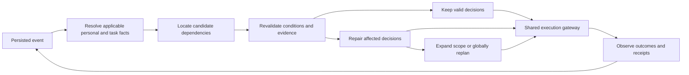

# System design alternatives

**Scope:** these alternatives concern the original personal-agent runtime. The [product portfolio](11-experiment-portfolio.md) compares six additional products and links to their product-specific architecture alternatives.

**Status:** proposed architecture, reviewed against primary documentation on 2026-10-17. No application, browser integration, benchmark result, or production deployment is verified by this document. The recommendation is conditional on measured results, not an assertion that incremental planning is superior.

Read [the product and research thesis](01-product-and-research-thesis.md) first. Detailed contracts belong in [the runtime](03-personal-agent-runtime.md), model interfaces in [the decision layer](04-model-and-decision-layer.md), and comparisons in [the evaluation protocol](06-evaluation-and-experiments.md). The earlier system design supersedes its older two-store example: start with **one controlled store, a personal workspace, two missions, and one write executor**. Add the second store after the shared-resource and recovery tests pass.

## Recommendation and the decision being made

Build a **reactive incremental runtime**, while implementing strong ReAct and structured global replanning through the same environment and execution gateway. Keep one logical personal agent per user; invoke a model when interpretation, planning, or semantic repair is needed. A continuously running model process is unnecessary.

This is a decision about how the system maintains and repairs work. It is separate from where its browser tools run. A browser extension does not make a planning algorithm incremental, and a durable workflow does not establish the correctness of a plan.

The initial application is personal procurement: resolve personal and task-specific requirements, select items, reserve shared funds, and complete authorized operations. The controlled store is an explicitly labeled test application, not evidence of integration with real merchants. The product remains useful only if the agent can explain its choices, accept corrections, and preserve actual completed work.

## Common substrate: keep these identical across alternatives

- The same model version, inference settings, personal context resolution, tool catalog, visible state, and event delivery.
- The same explicit tool contracts, authorization rules, conditional writes, stable operation IDs, and authoritative receipts.
- The same shared-budget reservation service and access to operation-status queries, compact state differences, and cached observations.
- The same hard constraints, commitment-preservation objective, and optional deterministic solver; permit useful warm starts and caching in every applicable baseline.
- The same total resource limits, independent final-state evaluator, and accounting for retries, graph maintenance, model calls, and failed episodes.

Database transaction protection belongs to this substrate. It must not be presented as an algorithmic advantage available only to the proposed runtime. Convex transactions provide serializability within their database boundary; they do not include arbitrary merchant effects or an earlier model invocation. [Convex OCC documentation](https://docs.convex.dev/database/advanced/occ)

## Alternatives at a glance

| Design | Decision mechanism | Correctness boundary | Cost and latency profile | When it may win |
|---|---|---|---|---|
| Strong ReAct / tool loop | Observe, reason, act, observe again | Shared gateway rejects invalid writes; reasoning is not a proof | Little bookkeeping; potentially repeated context and decisions | Short, unfamiliar, weakly structured tasks; small workloads |
| Structured global replanning | Recompute the remaining structured plan after material change | Checked plans; completed effects remain fixed facts | More work per change, but caching and solver warm starts can be effective | Dense constraints, small search spaces, broad changes |
| Reactive incremental runtime | Track evidence, revalidate affected decisions, repair and expand scope | Depends on sound dependency tracking plus the shared gateway | Graph overhead; potential savings under sparse changes | Long-lived tasks with reusable, mostly independent decisions |
| Restricted program or policy | Interpret a checked program with branches and bounded loops | Interpreter capabilities, guards, and explicit budgets | Amortizes repeated routines; harder authoring and debugging | Stable, recurring workflows with genuine conditional behavior |
| Multiple specialized agents | Separate reasoning workers coordinate proposals | Same shared authority; extra agents do not establish correctness | Additional model calls and coordination; possible parallel speedup | Independent research or specialist reasoning with measurable value |

These are hypotheses about workloads. Their relative quality, latency, and cost remain **unmeasured** in this project.

## A. Strong ReAct: the simplest credible system

The model receives the goal, current facts, recent events, and available tools. It chooses a call, observes the result, and continues. Prompt it to check stale observations, reconcile unknown operations, respect commitments, and use the same resource-reservation tools as the other systems.

Use this as both the first working end-to-end implementation and a serious baseline. It must be allowed to recover, reread, cache, and change direction; comparing against a one-shot plan that cannot react would answer the wrong question. Measure all requests rather than assuming a tool loop is expensive.

Its limitation is that the reason for retaining or replacing a choice lives mainly in model context. This can make repeat decisions expensive or difficult to audit, but a competent model may already handle the target workload well. If it matches the proposed runtime at lower cost, prefer the simpler product architecture.

## B. Structured global replanning: the strongest immediate alternative

The model produces a restricted decision graph. A deterministic checker validates types, references, applicability, constraints, and authorization boundaries. After a material event, recompute the remaining plan using the latest state, retaining completed purchases and user-locked choices.

Give this system the same solver, observation cache, previous solution, and objective ordering as the incremental system: satisfy hard constraints, minimize disruption to commitments, then optimize cost and preferences. Global replanning does not mean starting with an empty context or discarding previous computation.

This may be best for small catalogs or tightly coupled budgets where nearly every change affects the whole solution. It is also the proposed runtime's fallback when expanding local repair does not restore feasibility. A deterministic solver on structured inputs is an additional control: language-model calls need not solve arithmetic or already formalized constraints.

## C. Reactive incremental runtime: recommended research path

Track entity reads, constraint references, and query-set dependencies. Choosing the cheapest eligible product depends on the eligible candidate set, not only on the selected product. An inserted competitor or changed delivery promise can invalidate the choice without modifying its original item. Initially use conservative category revisions when precise query tracking is unavailable.

Tool semantics and instrumented reads supply dependencies. For an opaque model decision, conservatively depend on its complete supplied input snapshot. The model may propose links but cannot author the only evidence used to certify its own independence. Distinguish a changed version from a changed relevant condition; only the latter necessarily requires replacing a decision.

Repair starts with affected decisions and fixed valid boundaries. Expand through shared constraints when needed, then fall back to global replanning. Do not claim that the first locally feasible repair is globally optimal. Measure solution quality and scope expansion as well as speed.

Use entity revisions for evidence; `planningAttemptId` to reject superseded model attempts; `nodeRevision` to fence replaced decisions; `stopEpoch` for mission-wide cancellation; and executor fencing tokens for ownership. A new unrelated node must not invalidate every outstanding command. Completed or unknown effects remain part of the current world, even when their originating decisions are superseded.

The thesis is narrower than “DAGs improve agents”: explicit dependency evidence and condition revalidation may reduce repeated work under partial change. Reject or narrow that thesis if gains disappear against the warm-started global baseline. See [experiments and stopping criteria](06-evaluation-and-experiments.md).

## D. Restricted programs, policies, and counterfactual sandboxes

A plan graph is a finite current proposal. A policy adds conditions such as “if unavailable, inspect these alternatives”; a program adds control flow and variable binding. These can be appropriate for repeated personal routines, but require a capability-limited interpreter, typed values, bounded loops, cancellation checks, and explicit side-effect gateways. Do not execute arbitrary model-generated JavaScript in the user's page.

An isolated simulator can replay recorded outcomes and compare alternative decisions. Deterministic replay means using recorded observations and effects; calling the model again is a new experiment. A counterfactual branch predicts only the modeled environment and cannot rewind external purchases. Implement this after reliable event and receipt recording, or pursue it as a separate developer-tool thesis rather than quietly adding a second major product.

## E. Multi-agent reasoning: optional, not a reliability mechanism

Introduce separate workers only for work with independent inputs and independently assessable outputs, such as parallel research over different catalogs or an adversarial review of a proposed plan. Keep a single authoritative commit gateway and shared reservations. Workers submit proposals; they do not each maintain an independent “true” budget.

Require a paired experiment showing that extra workers improve quality or elapsed time enough to justify tokens and coordination. Do not create planner, critic, memory, and executor agents merely to rename ordinary functions. Deterministic checks remain necessary even when two models agree.

## Browser-host alternatives: independent of the reasoning architecture

| Host or transport | Concrete deployment shape | Advantages | Constraints and verification gate |
|---|---|---|---|
| In-page, same-origin | React workspace and controlled store in one frame tree | Smallest integration surface; shared visible session | Recommended first; verify discovery, execution, navigation, and reconnect |
| In-page, cross-origin iframe | Workspace embeds a cooperating store | Tests explicit origin boundaries | Store must permit embedding and tool exposure; auth/cookie behavior must be tested |
| Browser extension | Side panel plus content-script bridge and narrowly scoped host permissions | Can support an existing browsing workflow | Tab/frame routing and permissions are implementation work; no automatic access to every tab |
| Hosted browser executor | A deployed browser session consumes commands | Can remain available without the user's local tab | Verify native WebMCP availability, browser build, session login, lifecycle, cost, and user visibility; not established here |
| Backend API adapter | Convex action calls a service API through the shared gateway | Suitable when a service offers a supported API | Uses explicit credentials and different execution semantics; label it API execution, not WebMCP |

Current WebMCP exposes registration, discovery, and invocation through `document.modelContext`. Discovery is scoped to authorized documents in the frame tree. Cross-origin use requires explicit permission and exposure; it is not arbitrary-tab discovery. [Chrome imperative API](https://developer.chrome.com/docs/ai/webmcp/imperative-api)

GoogleChromeLabs provides a [page-agent example](https://github.com/GoogleChromeLabs/webmcp-tools/tree/main/demos/page-agent) and an [extension example](https://github.com/GoogleChromeLabs/webmcp-extension). The page example includes a polyfill, so its successful rendering is not evidence that a native path works. These are reusable references, not integrations already validated for this project.

## Adoption gates and growth path

| Gate | Evidence required | Resulting decision |
|---|---|---|
| Reliable tool loop | Real browser invocation, independent final-state check, recoverable receipts | Establish ReAct and the shared gateway |
| Structured decisions | Validated graphs and a tuned global baseline | Add incremental bookkeeping without changing execution privileges |
| Incremental value | Held-out paired results, ablations, no-change overhead, quality comparison | Retain, narrow, or remove incremental repair |
| Wider browser reach | Native compatibility and authenticated integration tests for each host | Add extension or hosted execution independently |
| Larger planning workload | Demonstrated local CPU/solver bottleneck | Consider a separate solver service or bounded program interpreter |

The primary growth path is deeper correctness and measured efficiency before more stores, domains, or agents. Review [deployment](05-deployment-and-operations.md), [sponsor positioning](07-sponsor-track-strategy.md), and [delivery milestones](08-delivery-roadmap-and-demo.md) together. Unresolved choices and source verification belong in [the decision log](09-decisions-and-open-questions.md) and [the evidence register](10-sources-and-evidence.md). Return to [the documentation index](README.md).
