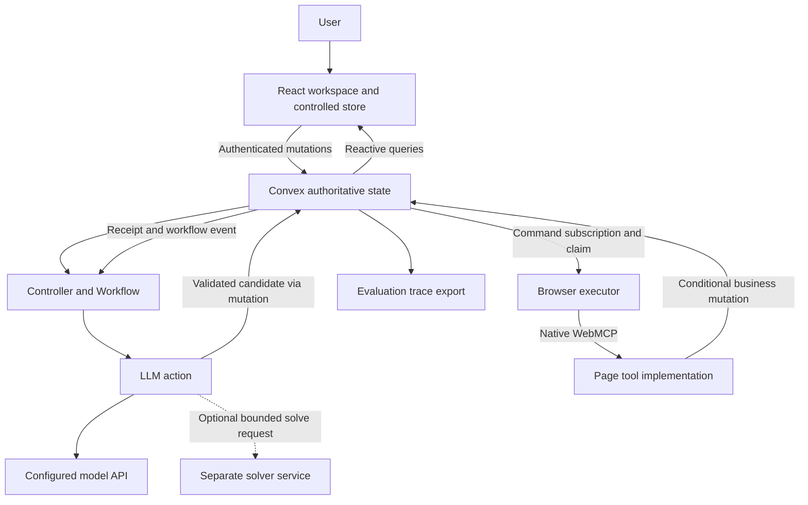

# Deployment and operations

**Current scope — October 22, 2026:** [16 — Travel-agent system design](16-travel-agent-system-design.md) defines the active deployment: a TypeScript/React workspace, Convex persistent coordination, and two controlled provider boundaries for one arrival journey. The single-store/two-mission topology and native-WebMCP-first milestones below describe the original shopping candidate. Preserve the recovery and access-control principles, but use the travel adapter choice and gates in [08](08-delivery-roadmap-and-demo.md). A closed browser cannot execute page tools; persist waiting state unless a separately implemented available executor can perform the operation. No deployment is claimed.

For the October 18 persistent-assistant expansion, read [15 — Persistent runtime design](15-persistent-agent-runtime-design.md). Hosted execution, credential brokers, and company-agent adapters there are options to validate, not deployments already completed.

**Status:** deployment design and acceptance checklist as of 2026-10-17. No services have been provisioned, no application has been deployed, and no native-browser smoke test or benchmark is claimed. Documented platform behavior is cited; product behavior remains to be implemented and tested. Delivery proceeds by evidence gates, not a fixed 36-hour cap.

This document operationalizes [the architecture alternatives](02-system-design-alternatives.md), [runtime contracts](03-personal-agent-runtime.md), and [model layer](04-model-and-decision-layer.md). Start with a React personal workspace, one controlled store, two missions sharing resources, and one active write executor per user. The store uses seeded test products and clearly labeled simulated purchases.

## Primary deployment topology

The frontend can be deployed to a conventional HTTPS static host. Convex hosts authoritative data, queries, mutations, actions, and the Workflow component. Keep API keys in server-side configuration. The browser exposes the actual tool registry and executes authorized commands; a Convex action does not acquire DOM or browser-session access merely by knowing a tool name.

Model interpretation, planning, and repair use bounded action calls. Candidates are published through a mutation that checks the planning attempt and its actual dependencies again. Actions can call outside services but do not make an entire read-model-write sequence atomic. [Convex actions](https://docs.convex.dev/functions/actions)

## Execution and deployment boundaries

1. A user mutation validates ownership, persists intent or changed facts, appends a business event, and schedules controller work in the same transaction. Scheduling from mutations is atomic with their writes. [Scheduled functions](https://docs.convex.dev/scheduling/scheduled-functions)
2. The controller resolves applicable context, revalidates decisions, and calls the model only when semantic work remains. Keep each advancement bounded and persist its cursor.
3. An accepted decision creates a command referencing `nodeRevision`, mission `stopEpoch`, stable `operationId`, tool contract version, and a correlated Workflow event ID.
4. The browser subscribes to pending commands and claims one through a mutation. Server ownership and lease checks decide eligibility; observing a command is not permission to execute it.
5. The browser discovers the current tool, checks its origin and schema against the approved adapter, and invokes it. A same-named replacement is not automatically equivalent.
6. For the controlled store, one business mutation checks authorization, fencing, decision validity, current resources, and operation deduplication; it commits the purchase and authoritative receipt together.
7. Receipt settlement updates actual facts and reservations, appends an event, and signals the waiting workflow. Application writes and component mutation writes can commit together. [Component transactions](https://docs.convex.dev/components/using#transactions)
8. Reconciliation uses authoritative operation status before retrying unknown writes. A late success remains a fact even if its decision is superseded; it must not resurrect the superseded plan.

Workflow can wait on external events and replay completed steps. After a new business event, use a new read/check step; a historical step result is not a fresh observation. Persist large traces outside its step journal and pass IDs. Pin the component version and test upgrades against paused workflows. [Workflow source and lifecycle](https://github.com/get-convex/workflow)

### Optional Python solver

The initial checker and bounded catalog search can be ordinary TypeScript. If a selected solver requires Python, native libraries, or longer CPU work, deploy a separate authenticated service or worker. Convex backend functions use JavaScript/TypeScript runtimes; installing a Python solver into the frontend or a Convex function is not the deployment plan. [Convex runtimes](https://docs.convex.dev/functions/runtimes)

Send a versioned, immutable problem snapshot with `requestId`, input digest, constraints, objective ordering, seed, and deadline. Return feasibility status, candidate assignments, objective value, any valid bound, solver version, and elapsed time. Independently validate the response, then recheck current dependencies before accepting it. A timeout is neither proof of infeasibility nor proof that the best returned solution is optimal. Give the global and incremental experimental variants equal solver access.

### Optional Rust kernel or worker

Current Convex supports imported WebAssembly modules in its default runtime. A bounded pure Rust validator can compile to WASM and run inside a TypeScript mutation that reads current state and commits conditionally. Native Rust function entrypoints are not implied. Heavy computation can instead use an authenticated external worker with snapshot-bound results. See [language and integration design](12-typescript-rust-convex-webmcp.md) for deployment choices, ABI constraints, and evaluation gates.

## Environment and configuration matrix

| Environment | Data and credentials | Purpose and exit gate |
|---|---|---|
| Development | Isolated Convex deployment; seeded personal/store data; developer API keys | Contract, browser, state-machine, and component tests pass |
| Staging / evaluation | Separate deployment and origins; frozen fixtures; restricted service credentials | Paired experiments and authenticated browser recovery tests are reproducible |
| Demonstration | Dedicated seeded deployment; capped API allowance; tested browser profile | Reset, recovery, and complete live demonstration pass on the actual machine |
| Production pilot | Real authentication, isolated user data, approved integrations, operational ownership | Access-control, retention, rollout, and integration-specific recovery gates pass |

These names describe project environments; configure separate deployments rather than assuming every name is a built-in Convex environment class. Never point an evaluation reset or fault injector at production.

Configuration must explicitly identify: frontend origin; Convex deployment URL; authentication issuer/audience; allowed store origins; tool-contract and schema versions; model provider/version/settings; per-user and per-mission limits; executor lease policy; trace retention; simulation mode; and feature flags. Record these with every evaluation release. Values belong in environment-specific configuration, not a shared demo transcript.

Public browser configuration may contain deployment URLs and allowed-origin lists. Private configuration includes model keys, solver credentials, deployment keys, and any merchant API credentials. Never expose them through frontend build variables, tool results, downloadable traces, or a generic “read settings” endpoint. Browser cookies remain in their browser session; do not copy them into prompts.

## Browser compatibility gates

- Pin a known working browser build and record its channel, OS, flags, origin-trial configuration if used, and adapter version. Chrome currently documents an origin trial and the `enable-webmcp-testing` local flag; do not assume universal default support. [Chrome setup and limitations](https://developer.chrome.com/docs/ai/webmcp)
- Verify `document.modelContext` exists and completes a real register/discover/invoke round trip. Current invocation uses the discovered tool object and JSON-serializable arguments; old guides may target `navigator.modelContext` or obsolete signatures. [Imperative API](https://developer.chrome.com/docs/ai/webmcp/imperative-api)
- Store browser-local tool objects locally; persist serializable identities in Convex. Rediscover after navigation or reconnection rather than reusing a stale object.
- For cross-origin iframes, verify embedding policy, `allow="tools"`, provider `exposedTo`, caller `fromOrigins`, and actual session behavior. A working same-origin demo does not validate cross-origin operation. [Origin rules](https://developer.chrome.com/docs/ai/webmcp/imperative-api#cross-origin_iframes)
- Mark native and polyfill runs separately in UI and traces. A fallback may keep a demo usable, but is not evidence of native interoperability.
- Treat extension and hosted-browser support as separate integrations with their own permissions, routing, lifecycle, and session tests. Neither grants arbitrary-tab access automatically.

## Authentication, authority, and browser sessions

Every public query and mutation derives ownership from authenticated identity and checks access to referenced missions, commands, facts, and receipts. Do not trust a submitted `ownerId`, including on “read-only” endpoints. Internal function visibility reduces exposure but does not replace correct caller-context handling. [Authentication in functions](https://docs.convex.dev/auth/functions-auth)

The personal workspace's login and the store's login are separate concepts even when the controlled demo shares infrastructure. An external store must supply its own supported session and authorization path. Persist grants separately from preferences: scope, allowed action, resource/amount limits, expiry, and revocation. Recheck authority at final commit, not only at planning time.

Use a dedicated demo account and browser profile. Isolate each judge session's seeded workspace so resets and simulated purchases do not affect another viewer. Real payment or messaging integrations need their own sandbox configuration and explicit execution grants; see [sponsor strategy](07-sponsor-track-strategy.md).

## Failure handling and reconciliation

| Observation | Required operational response | Incorrect shortcut |
|---|---|---|
| Browser disconnects before execution | Preserve queued work; show waiting for executor; reconnect and revalidate | Claim that the backend continues native page execution |
| Write starts, then lease expires | Mark outcome unknown; query authoritative status; fence later writes | Reassign and repeat merely because time elapsed |
| Business commit succeeds, response disappears | Find receipt by stable operation ID; settle once | Issue a new operation ID and purchase again |
| Older planning result arrives | Validate attempt plus current dependency versions; reject stale candidate | Replace current plan based on response arrival order |
| Superseded command reports success | Record completed effect and spending; repair remaining goals | Drop the receipt because its plan is old |
| User revokes permission or cancels | Fence new commits; preserve history; reconcile in-flight effects | Treat cancellation as rollback of completed effects |
| Model or solver is unavailable | Bounded retries where safe; retain state and surface blocked reason | Infinite repair loops or inventing a successful result |
| Tool contract changes | Pause affected commands, rediscover, validate adapter compatibility | Invoke the new tool because its name matches |

Fencing prevents a stale executor from committing through an endpoint that checks the fence. It cannot fence arbitrary remote effects. External exactly-once execution and cross-merchant atomicity are not promised. For unknown purchases, keep resource reservations until non-execution or the actual result is confirmed.

## Resources, caches, and spend

Maintain separate **user purchase budgets** and **system inference budgets**. Purchase funds are reserved atomically across missions; model/API budgets bound calls, tokens, attempts, wall time, and optional solver CPU. Set workspace-wide caps so parallel missions cannot each consume the full account allowance. Record actual usage, including unsuccessful calls and repair overhead.

Cache observations with origin, user scope, query identity, source version, and freshness policy. A cache hit is useful only while its dependency evidence remains applicable. Never cache final authorization checks. Convex's reactive query cache is not a substitute for semantic decision dependencies. Subscriptions deliver query results; maintain business-event records and consumer cursors for recovery. [Convex realtime](https://docs.convex.dev/realtime)

Bound graph expansion, commands per controller advancement, concurrent planning attempts, and pending work per user. Keep business data, high-frequency executor heartbeats, and verbose traces separate enough that a heartbeat does not invalidate every planning query. Configure log redaction and retention; export frozen evaluation traces with the minimum necessary personal data.

## Rollout milestones

| Milestone | Required evidence before broadening access |
|---|---|
| Local integration | Native tool round trip, ownership checks, checked mutation, persistent receipt |
| Shared-resource staging | New reservations and increases respect available capacity; later cap reductions preserve obligations, block further allocation, and surface overcommitment; stale workers and stale candidates cannot create new effects through guarded endpoints |
| Recovery staging | Disconnect, restart, duplicate callback, and lost-response cases preserve actual effects |
| Research release | Frozen versions/fixtures; strong baselines; independent verdicts and complete cost accounting |
| Demonstration release | Actual-machine rehearsal, isolated reset, pinned configuration, labeled fallback recording |
| Limited pilot | Integration-specific grants, operational monitoring, retention policy, and reversible rollout |

Deploy schema-compatible changes before switching execution behavior. Drain or explicitly reconcile in-flight commands when changing tool contracts or workflow step definitions. A rollback restores software, not purchases; preserve receipts and events. If new results regress, disable new command dispatch and revert the affected feature while reconciliation remains available.

## Release smoke checklist

- [ ] Actual browser and origin complete native registration, discovery, invocation, and visible UI update.
- [ ] Registry changes and navigation invalidate stale bindings; missing tools produce a clear blocked state.
- [ ] User A cannot subscribe to or mutate user B's facts, missions, commands, receipts, or budget.
- [ ] Personal facts and event-specific requirements stay scoped to their intended missions.
- [ ] Two missions compete for one budget through the same atomic reservation path.
- [ ] A replaced node cannot newly commit; an unrelated node remains eligible without global invalidation.
- [ ] A committed operation survives lost response, browser restart, and duplicate settlement without a second purchase.
- [ ] An executing lease expiry becomes unknown until reconciliation establishes the outcome.
- [ ] Revocation blocks new effects while already completed effects remain visible.
- [ ] Controller scheduling and receipt signaling survive the relevant transaction/restart tests.
- [ ] Provider failure reaches bounded retry/blocked behavior; spend caps and trace redaction work.
- [ ] Demo reset affects only the selected isolated workspace; evaluation fault injection is disabled in pilot environments.

For operations, expose queue age, executor availability, unknown-operation age, repair attempts, provider failures, usage, and shared-budget invariants. Give each alert a specific response: restore executor, reconcile receipt, disable dispatch, inspect stale-contract error, or increase capacity only after identifying the bottleneck. Keep metrics separate from claims of research improvement.

Track unresolved browser builds, hosting choice, auth provider, model version, solver need, and real-merchant recovery semantics in [decisions and open questions](09-decisions-and-open-questions.md). Verification evidence belongs in [sources](10-sources-and-evidence.md); experiment gates in [evaluation](06-evaluation-and-experiments.md); release rehearsals in [the roadmap](08-delivery-roadmap-and-demo.md). Return to [the index](README.md) or [the product thesis](01-product-and-research-thesis.md).
