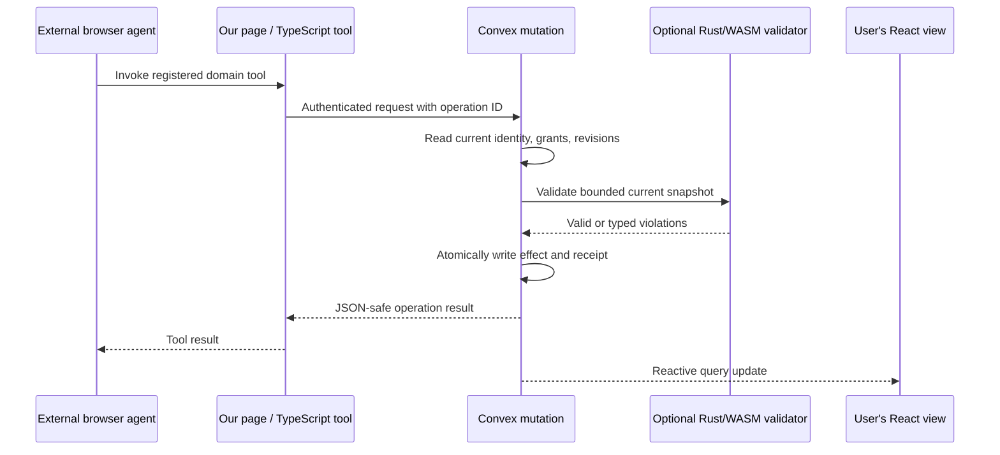
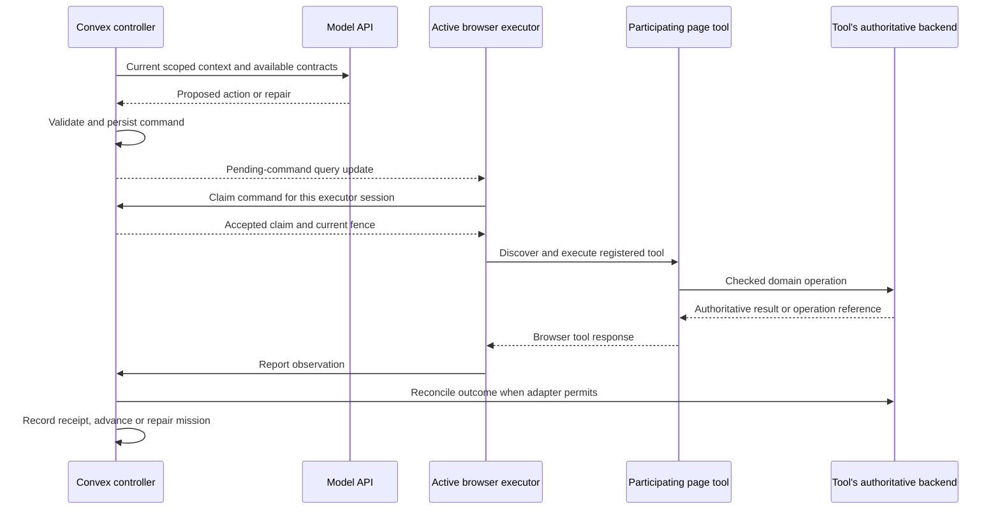

# TypeScript, Rust, Convex, and WebMCP: Integration Design

**Status:** proposed design, with primary documentation reviewed on October 17, 2026. No browser integration, WASM build, service deployment, or performance measurement has been performed. The examples identify application code that still needs implementation.

Read with the [product portfolio](11-experiment-portfolio.md), [runtime contracts](03-personal-agent-runtime.md), and [deployment plan](05-deployment-and-operations.md).

## 1. Recommended language boundary

Use **TypeScript for the web application, WebMCP adapter, and Convex functions**. If Rust is part of the implementation, give it a concrete, bounded responsibility: a deterministic dependency/constraint kernel, compiled to WASM initially. Use an external native Rust worker only when a measured workload or native dependency requires it. DataPatch still has a strong reason to use a separate Python execution layer.

| Layer | Recommended language | Responsibility |
|---|---|---|
| Web workspace | TypeScript + React | User controls, authenticated session, live state, progress and evidence |
| WebMCP registration and browser executor | TypeScript | Page tool registration, discovery, invocation, lifecycle and origin handling |
| Convex queries and mutations | TypeScript | Identity, authoritative records, current-state validation, transactional admission and receipts |
| Convex actions and Workflow | TypeScript | Model API calls, bounded orchestration, external requests, durable waits |
| Optional deterministic kernel | Rust compiled to WASM | Dependency traversal, constraint evaluation, checked arithmetic, patch validation |
| Optional large-compute worker | Native Rust | Large graph search, history checking, CPU-heavy processing or native libraries |
| DataPatch transformation/agent workers | Python | Factory SDK, Python data stack, isolated execution of candidate transformations |

WebMCP is a browser interface, not a programming language, database, model, or server transport. It does not replace the Convex client. The bridge is ordinary application code in the page: a registered tool handler invokes an authenticated backend operation.

## 2. What current Convex support means for Rust

Convex function entrypoints are JavaScript/TypeScript. Its default runtime also explicitly supports importing `.wasm` modules and running WebAssembly in queries, mutations, and actions. Therefore a TypeScript mutation can read current records, invoke a Rust-derived pure validator, and conditionally write within the same transaction. [Convex runtimes](https://docs.convex.dev/functions/runtimes#running-webassembly)

The Rust module does not become a native Rust Convex function and does not acquire direct database access. TypeScript owns the read/write boundary and passes a bounded snapshot into the module.

```text
Convex mutation, one database transaction:
  authenticate and load the operation
  return an existing matching receipt if already complete
  read current authority, versions, and affected resources
  run a bounded deterministic validator (TypeScript or Rust/WASM)
  commit the allowed state change and receipt together
```

Do not run an unbounded solver in this mutation. The current limits page gives queries/mutations one second of user-code execution, excluding database operations; WASM remains subject to runtime limits. Recheck the deployed limits and measure complete calls, not just a native benchmark. [Convex limits](https://docs.convex.dev/production/state/limits)

Use a pure `wasm32-unknown-unknown` target as the first Rust experiment. Avoid filesystem, network, thread, and implicit clock assumptions; the Rust target's OS limitations are documented, and Convex does not document a general WASI environment here. Inspect actual module imports and generated JavaScript glue. [Rust target documentation](https://doc.rust-lang.org/rustc/platform-support/wasm32-unknown-unknown.html)

An external Rust process can also use the official client to call or subscribe to Convex functions. That client is a connection mechanism, not a different function deployment runtime. [Convex Rust client](https://docs.convex.dev/client/rust)

## 3. Compare the implementation choices

| Choice | Benefits | Added cost | Decision |
|---|---|---|---|
| TypeScript throughout | Fewest deployment boundaries; shared web/backend types; easy complete-path iteration | CPU-heavy or native-library workloads may need another component | Establish as the reference implementation |
| TypeScript + Rust/WASM kernel | Reuse a tested pure kernel in backend and browser; possible compute benefit | ABI, packaging, module loading, serialization, cross-runtime checks | Preferred Rust path for bounded computation |
| TypeScript + native Rust service | Native ecosystem, parallel compute, separate resource allocation | Authentication, jobs, retries, networking, deployment and stale results | Add for a demonstrated workload requirement |
| TypeScript + Python workers | Natural for DataPatch, Factory Python SDK, data validation, and OR-Tools | Isolated workers and runtime management | Prefer where Python libraries are central |
| Predominantly Rust web stack | Possible through generated JavaScript/WASM integration | Convex entrypoints and browser API boundaries still need compatible glue | Not the default for this project |

Rust can make a particular implementation fast and maintainable; it does not automatically make an agent correct or technically differentiated. TypeScript can implement the same bounded algorithms and exact integer rules. The product contribution still needs the fair comparisons described in the [evaluation plan](06-evaluation-and-experiments.md).

## 4. Pattern A: an external personal agent operates our application

Use this when DataPatch, LiveOps, or another product exposes useful actions to a user's browser assistant. The external assistant already owns its reasoning loop; our application need not create a second loop merely to receive its tool call.



The user's button and the WebMCP handler should invoke the same domain operation. This prevents two inconsistent implementations of applying a repair or updating a plan. The backend applies the appropriate authority checks to each caller context; registering a tool does not give it privileged writes.

For DataPatch, useful tools are `get_incident`, `inspect_validation`, and `request_repair`. A long repair request should return a durable job identifier; a later query retrieves progress and artifacts. Do not hold a browser tool call open for an entire large data repair if a job contract is more resilient.

For LiveOps, useful tools are `get_event_constraints`, `propose_assignment_patch`, and `respond_to_offer`. A participant response must still be authorized for that participant. Tool discovery is not consent.

### Illustrative page registration

This shows the current browser API shape. `parseRepairRequest`, `toJsonSafe`, the imported schema, and `api.incidents.requestRepair` are proposed application code. They are not platform-provided helpers. Preview API types and serialization need verification against the chosen browser build.

```ts
const registrationLifetime = new AbortController();

await document.modelContext.registerTool(
  {
    name: "request_repair",
    description: "Request repair analysis for an incident in this workspace.",
    inputSchema: {
      type: "object",
      properties: {
        incidentId: { type: "string" },
        operationId: { type: "string" },
        expectedRevision: { type: "string" },
      },
      required: ["incidentId", "operationId", "expectedRevision"],
      additionalProperties: false,
    },
    execute: async (raw, { signal }) => {
      signal.throwIfAborted();
      const args = parseRepairRequest(raw);
      const result = await convex.mutation(api.incidents.requestRepair, args);
      return toJsonSafe(result); // For example: operationId, jobId, status.
    },
  },
  { signal: registrationLifetime.signal },
);

// On page-tool teardown or account change:
registrationLifetime.abort();
```

Mount only after the authenticated Convex client is ready. Handle registration failures and cleanup even if component teardown races with registration. The registration promise is not an unregister function. Removing a tool does not undo an already dispatched mutation. [Chrome imperative API](https://developer.chrome.com/docs/ai/webmcp/imperative-api)

The current draft and Chrome guide describe execution-result transport differently enough that callers should test the exact serialized form. Return JSON-safe domain results and recover consequential status from an authoritative receipt, rather than assuming an MCP `content` envelope or an already-parsed object. [WebMCP draft](https://webmachinelearning.github.io/webmcp/)

## 5. Pattern B: our persistent agent needs to operate a browser page

Use this when our own model/controller needs a participating page's tools, authenticated browser session, or user-visible context. A Convex action cannot call `document.modelContext`: there is no page document in that server environment.



The final backend may be our Convex deployment for a controlled application, or an independent service for a partner. Only the controlled case can share our database transaction. An external service needs its own supported idempotency, conditional-write, and outcome-query contract.

The browser executor needs four small responsibilities: subscribe to its commands, claim one, discover/invoke the matching current tool, and report observations. It should not own a second budget ledger or independently decide that a cancelled command should be retried.

Illustrative invocation shape:

```ts
const tools = await document.modelContext.getTools();
const tool = selectVerifiedTool(tools, command.target);
const observed = await document.modelContext.executeTool(
  tool, // Current descriptor, not a string tool name.
  command.input,
  { signal: executionLifetime.signal },
);
await reportObservationAndReconcile(command.operationId, observed);
```

`selectVerifiedTool` and `reportObservationAndReconcile` are application helpers to implement. Match the intended origin, document/session, name, schema, and adapter version. Rediscover after navigation or tool-registry changes; a persisted JavaScript window handle is not a durable address.

Production control flow must reconcile after errors as well. If the page disappears before reporting, the server's persisted command remains; its watchdog records uncertainty and reconciliation work. A browser-side `finally` block is not a guarantee that cleanup runs after navigation, process termination, or loss of connectivity.

When a purely server-side domain operation is available, call it directly through the controller's checked interface. Do not add a browser round trip solely to display a WebMCP logo. The two patterns serve different product needs and can coexist.

## 6. Browser origin and lifetime constraints

For a first integration, use one controlled page and one executor session. Extend to multiple origins only after the round trip works.

Same-origin page tools can be discovered within the applicable frame tree. Cross-origin cooperation requires explicit permissions and exposure: the embedding frame's `allow="tools"`, the provider's `exposedTo`, and the caller's `fromOrigins` must be configured consistently. This is not arbitrary-tab discovery or automatic access to all websites. [Chrome cross-origin model](https://developer.chrome.com/docs/ai/webmcp/imperative-api#cross-origin-iframes)

`toolchange` signals registry availability. Stock, budget, source data, or a user's plan edit needs a separate business event channel. Convex subscriptions can update the live view, while persisted events and work records support recovery.

Closing a local browser stops its page execution. Convex can keep mission state, perform backend work, and wait for reconnection. Continuous browser execution needs a separately managed browser environment with its own login, compatibility, and lifecycle design.

## 7. Put a clear contract around the Rust kernel

Start with one crate, such as `policy-core`, containing pure types and algorithms. Keep networking, database clients, model calls, credentials, and browser APIs out of it.

```text
affected(snapshot, changeSet) -> candidateDecisionIds
validate(snapshot, proposedPatch) -> violations + dependencyWitnesses
compare(oldPlan, proposedPlan, objective) -> typedDelta
```

These are proposed interfaces. A useful first kernel traverses recorded dependency edges, rechecks declared predicates, and validates a bounded plan patch against current constraints. It should return structured error codes and referenced entities, not an unexplained boolean.

The host supplies current facts and versions, resource amounts, explicit locks, relevant grants, and a fixed evaluation time if time matters. The host verifies ownership before building the snapshot. Dependency records come from instrumented reads and declared expressions; a Rust implementation does not make a model's guessed dependency list sound.

Use stable output ordering, checked integer arithmetic, explicit limits, and an error on unsupported operators. Keep query-set dependencies for selection from a changing collection. Cache keys include contract/kernel versions and all relevant input identities.

Browser WASM can preview the same rules, but its result is advisory. The server must reconstruct the current snapshot and validate again; never accept a browser-provided `valid: true` as authorization.

A TypeScript host can import the compiled module and invoke a project-owned ABI wrapper. A generated wrapper that assumes `window`, `fetch`, filesystem access, or a specific bundler is not automatically suitable for the Convex runtime. Test the actual artifact and imports, including cold module setup and serialization costs.

Reuse immutable compiled modules where supported; do not retain user-specific mutable WASM memory across invocations without a verified reset/isolation strategy. A fresh instance or carefully managed scratch memory keeps semantics inspectable.

Keep a separate small reference checker for correctness testing. Running the same Rust kernel in the browser, server, and benchmark checks consistency, not independent correctness.

## 8. When a native Rust worker becomes justified

Move large searches, extensive fault-history checking, or native-library work to an external process when bounded in-transaction computation is insufficient. This is also appropriate when measured resource or throughput requirements justify parallel native execution.

```text
mutation: create immutable job + schedule dispatch
action: send job ID and scoped artifact references to worker
Rust worker: compute using frozen input; store result manifest
authenticated callback: report job ID, attempt, input/result digests
mutation: admit result only if current witnesses still hold
```

The worker may use HTTPS endpoints or the official Rust client. Server endpoints must enforce a narrowly scoped worker identity, job/attempt ownership, and grant checks. Do not give every worker an administrative deployment key. Query subscriptions inform workers of current state; durable jobs and claims still define what work exists.

A worker result is a proposal tied to a snapshot. It cannot overwrite current state simply because the CPU computation succeeded. On timeout, reconcile the worker's durable output before repeating costly work; record repeated attempts and their costs. The worker does not become a second source of truth for budgets, grants, or completed operations.

For DataPatch, Python remains the natural first agent/data worker: the current Factory Python SDK launches a local Droid subprocess. Keep that credential-bearing process separate from the sandbox executing candidate code. Native Rust can be added for a measured parsing, graph, or validation need, but is not a prerequisite. [Factory SDK](https://docs.factory.com/sdk/python)

## 9. Data and authority at each boundary

| Boundary | Required contract |
|---|---|
| Page to Convex | Server-derived user identity; operation ID; typed inputs; expected version; scoped permission |
| Controller to browser | Command ID; logical operation ID; executor session; origin/tool contract; relevant node revision; stop epoch; claim/fence |
| Host to WASM | Versioned bounded input; explicit time/units; deterministic operators; structured errors |
| Convex to native worker | Immutable input digest; job/attempt; scoped artifacts; deadline/budget; authenticated callback |
| External tool to coordinator | Source-bound operation identity; argument binding; authoritative status evidence; explicit unknown outcome |

Use normal SDK data types for Convex calls. At custom JSON and WebMCP boundaries, encode wide integers as checked decimal strings and document units; do not coerce an arbitrary `i64` or `bigint` to a floating-point JavaScript number. Convex's typed encoding and an exported display JSON representation are different formats. [Convex data types](https://docs.convex.dev/database/types), [Rust value API](https://docs.rs/convex/latest/convex/enum.Value.html)

Authenticate through the page's configured Convex client and derive identity in the function. The exposed origin is not a user identity. Remove tools/subscriptions on logout or account change, bind queued work to its intended principal/session, and recheck authority for in-flight writes. [Convex function authentication](https://docs.convex.dev/auth/functions-auth)

Do not require a fresh approval for every model response. Continue within the active mission's grant, and ask only when scope, unresolved user choice, or a new effect requires it. A general preference is not a grant.

## 10. Example: changed stock during an in-flight repair

1. A mission plans against item revision 7. The controller sends a bounded repair request to the model or compute worker.
2. The user changes a locked choice and stock becomes revision 8. Convex commits the edits and business events.
3. The old repair arrives. Its relevant input witnesses no longer hold, so publication is rejected. Unrelated valid work remains.
4. A current repair is checked by the TypeScript or Rust validator, then admitted. A browser command is created only if page execution is needed.
5. The executor claims and invokes the registered page tool. The controlled backend rechecks authority, current state, and operation identity at commit.
6. The effect commits but the response is lost. The command becomes uncertain; no automatic new logical purchase is issued.
7. Reconciliation finds the original receipt. Record it even if a later user edit superseded the originating plan. It may be a completed real effect and an obsolete planning decision simultaneously.

Rust handles bounded computation; Convex handles authoritative state and atomic admission; WebMCP handles the browser interaction. This division is the integration. None of the three alone guarantees the whole workflow.

## 11. Suggested repository structure

This is a future structure, not directories or source files already created by this documentation task.

```text
apps/web/                  React workspace and page-owned WebMCP tools
apps/web/browser-executor/ Optional command consumer for pattern B
convex/                    Schema, queries, mutations, actions, Workflow
packages/contracts/        Versioned tool/worker/JSON boundary schemas
packages/kernel-host/      TypeScript reference and optional WASM adapter
crates/policy-core/         Optional pure Rust library
workers/compute/           Optional native Rust worker
workers/datapatch/         Optional Python/Factory and execution services
eval/                      Independent scenarios, oracle, and reports
docs/                      Design package
```

Compile WASM as a reproducible build artifact before the Convex deployment; record its source revision and digest. Keep generated API bindings distinct from hand-authored cross-language contracts. Pin or generate schema representations deliberately rather than assume TypeScript types automatically validate JSON or Rust values.

## 12. Implementation sequence and proof gates

| Step | Build | Evidence required |
|---|---|---|
| 1 | One typed domain operation in Convex, one React control | Authenticated call changes real state; wrong owner/version is rejected |
| 2 | Register the same operation through WebMCP | Actual external-agent tool invocation produces the same checked outcome and visible update |
| 3 | One durable mission and model action | Real model output becomes a validated proposal; model/network failures leave recoverable state |
| 4 | Pattern B only for a page-dependent operation | Command claim, native tool invocation, receipt recovery, and browser reconnect work on the chosen build |
| 5 | Add a bounded Rust/WASM kernel if desired | Same results as independent fixtures; actual Convex bundling and runtime tests pass |
| 6 | Incremental repair and strong baselines | Useful quality/cost tradeoff survives sparse, dense, and no-change cases |
| 7 | External compute or more origins when justified | Scoped worker auth, stale-result rejection, real origin permissions, and recovery verified |

For a Rust-focused team, steps 1 and 5 can proceed in parallel once the pure contract is frozen. Keep a small TypeScript reference so language integration does not block the first complete path. For DataPatch, substitute its Python worker path for the optional browser execution when repair does not depend on a page.

The technically substantial demo is a correct response to changing state, with inspectable receipts and a measured comparison. A Rust logo or a fast inner loop is not sufficient evidence.

## 13. Evaluate the architecture and language separately

Test TypeScript and Rust/WASM with the same algorithm, input, and limits before claiming a language benefit. Include bridge serialization, module initialization, allocation, memory, and complete request latency. Then compare native Rust as another deployment variant if needed.

Cover small/large graphs, high fan-out, sparse/dense changes, query-set changes, malformed input, integer boundaries, and stale proposals. Cross-check native Rust, browser WASM, and Convex WASM outputs against an independently implemented reference on bounded fixtures.

Report compute time separately from model time, external tool time, and queue delay. If inference and network dominate, a kernel speedup may not improve the product's end-to-end latency. Also measure the operational cost of an extra service.

Integration acceptance includes account switching, duplicate delivery, a stopped browser, lost replies, cancelled missions, and late successful receipts. Use actual native-browser tests to substantiate WebMCP compatibility; use controlled simulator runs for broad fault coverage and label them separately.

No comparisons in this document have been run. The purpose is to make the implementation and its claims testable before adding more components.
