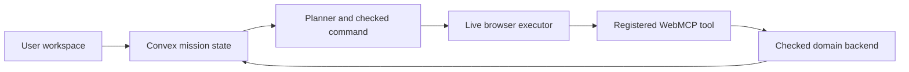
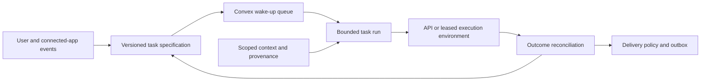
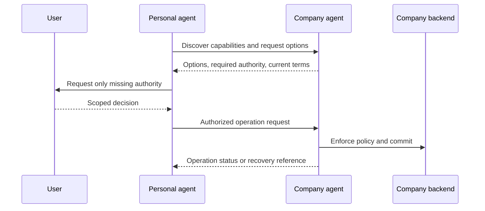

# Personal-agent system variations

**Status: research and proposed designs, October 18, 2026.** No product pivot, provider enrollment, production integration, or measured result is implied. This extends the [planning-algorithm alternatives](02-system-design-alternatives.md) with choices about the product, persistent runtime, execution environment, and business-facing interfaces.

## Recommendation

Keep the personal-agent direction, but expand the design from an interactive repair loop into a **persistent mission service**. A user should be able to define a continuing task, close the page, and return to an accurate account of what happened, what is waiting, and why. The browser remains one execution environment. Convex owns our durable task and resource state. Models interpret and propose; independently checked operations change the world.

My preferred experiment combines **B's durable task lifecycle with C's selective repair**, initially using **A's controlled WebMCP application**. Add one protocol or wallet adapter only after its actual access and recovery contracts are verified. This is a recommendation for the next scope discussion, not a decision to implement all six variations.

The technical claim to test is whether we can maintain several changing missions with less recovery work and fewer unnecessary interruptions **at comparable legal completion quality**. Memory, scheduling, subagents, scoped authorization, and operation receipts are necessary building blocks; their presence alone is not evidence of a new contribution.

## What the new sources change

The reviewed material comes from different layers. Treating every announcement as a competing complete agent would obscure the useful design choices.

| Input | Layer it helps us examine | Consequence for our design |
|---|---|---|
| [Stripe / Link](https://stripe.com/blog/helping-personal-agents-shop-more-intelligently-and-reliably-with-link) | Consumer payment authorization and checkout recovery | Keep provider approval, our spending reservation, and merchant completion as separate states |
| [Decagon](https://decagon.ai/blog/personal-agents-are-here) | Enterprise entry point and delegated customer permissions | The business retains its policy and account authority; a personal agent cannot grant itself access |
| [Profound](https://www.tryprofound.com/blog/the-era-of-personal-agents-muse-and-instinct) | Observed personal-agent shopping behavior | Evaluate retrieval and preference use separately from the ability to complete an action |
| [Sierra / PAP](https://sierra.ai/blog/introducing-personal-agent-protocol) | An explicit interface between personal and company agents | Protocol adapters belong beside browser adapters; operation handling is existing design territory |
| Supplied Instinct architecture image | A persistent harness with memory, tasks, wake-ups, execution, and delivery | Make task specification, task progress, and notification state first-class records |
| Two supplied X posts | Author reconstructions recovered through a public mirror; one also has an author-hosted publication | Qualify the retrieval route and black-box method; these do not establish official Instinct internals |

Source-by-source findings and current access limits are in [commerce and protocols](research/personal-agents-commerce-and-protocols.md), [harness and experience](research/personal-agents-harness-and-experience.md), and [social posts and reference architecture](research/personal-agents-social-and-reference-architecture.md). Those notes distinguish source statements from our recommendations.

The existing [Excalidraw diagram](diagrams/README.md) remains the detailed view of the **interactive mission repair and execution loop**. It is not yet a drawing of every persistent service proposed below.

## Separate four decisions

| Decision axis | Choices | Why it must remain separate |
|---|---|---|
| Product responsibility | Consumer assistant; shopping specialist; business gateway; infrastructure for other agents | These have different users, success criteria, and competitors |
| Task lifecycle | Foreground session; durable event-driven missions; recurring routines | A better planning policy does not make a browser stay available |
| Execution channel | Direct API; registered WebMCP page tools; company-agent protocol; browser UI | Each has different authority, freshness, and recovery contracts |
| Planning policy | Strong ReAct; structured global replan; selective repair; bounded routine | Compare policies under identical interfaces and protections |

The variations below are useful product configurations assembled from these axes. They can share modules; they are not six mutually exclusive algorithms. In particular, a cloud harness can run either a simple tool loop or an incremental planner.

## Comparison at a glance

| Variation | What the user gets | Main advantage | Main cost or weakness | Best deciding experiment |
|---|---|---|---|---|
| **A. Browser-centered personal copilot** | An agent operating participating pages while the user is present | Direct, visible interaction and a clear WebMCP demonstration | Browser availability and integration coverage bound completion | Complete, disconnect, and resume a controlled mission |
| **B. Persistent personal assistant** | Tasks that wake on time or events and report useful outcomes | A stronger continuing-service experience | Scheduling, credentials, delivery, and sandbox operations add substantial work | Recover a recurring task across restarts without missed or duplicate outcomes |
| **C. Adaptive mission coordinator** | Several missions remain consistent when preferences, stock, or budgets change | A specific algorithmic hypothesis and measurable recovery behavior | Dependency maintenance can cost more than replanning | Paired sparse-change and dense-change repair comparison |
| **D. Protocol-first concierge** | An agent that resolves requests directly with participating businesses | Explicit company authority and less UI navigation | Counterparty access, protocol evolution, and bounded negotiation | Resolve a request through two separately controlled agent endpoints |
| **E. Commerce specialist** | Personalized selection, explicit checkout state, and post-purchase follow-through | Concrete consumer value and observable transactions | Merchant coverage, account eligibility, payment approval, and support burden | Recover changed-total and unknown-checkout cases without duplicate effects |
| **F. Delegation and recovery platform** | Other agents can submit bounded missions and receive verified status | Reusable backend contribution across products | We must prove integration value beyond what protocols already provide | Route the same interrupted mission across controlled execution adapters |

## A. Browser-centered personal copilot

**Build:** a React workspace, one controlled store exposing real WebMCP tools, a browser executor, and Convex mission/command/receipt records. The user can inspect planned actions and edit requirements while work proceeds. A model proposes the next useful action; the checked backend owns the effect.

**Pros:** smallest complete browser-to-backend path; easy to inspect tool arguments and resulting state; no need to host a general-purpose computer; directly extends our existing diagram. The user's live edits produce a convincing demonstration.

**Cons:** an open page is an operational dependency; existing authentication does not imply delegated permission for every action; arbitrary websites do not expose our tools. A browser extension and cross-origin access introduce a separate implementation and permission problem.

**What makes it technical:** revision checks, dispatch ownership, durable operation lookup, and a real native WebMCP round trip. These establish engineering substance, but still need a useful product and comparative evidence.

**Experiment:** close the executor during a command, restore it, and reconcile. Separate pre-dispatch interruption from an effect whose response was lost. Compare end-state correctness, recovery time, browser-dependent waiting, and duplicate effects. Use the same backend safeguards for every planner.

**Choose A when:** our first priority is a reliable, comprehensible WebMCP demonstration. This is the execution foundation for other variants, not necessarily the final consumer experience.

## B. Persistent personal assistant

**Build:** durable task specifications, event ingestion, scheduled wake-ups, task runs, scoped memory, leased execution resources, and an output policy. The conversation is a control surface. A task can be waiting without consuming a model call or keeping a VM alive.

**Pros:** useful while the interface is closed; supports recurring routines; keeps task progress independent of conversation compaction; creates room for deliberate silence rather than constant notifications. Independent research subtasks can run concurrently with bounded budgets.

**Cons:** this is a larger operational product. We need event deduplication, stale-schedule rejection, clock semantics, account linking, credential handling, worker recovery, notification receipts, and observability. A general sandbox increases compatibility but also introduces startup cost and a broader execution boundary.

**What makes it technical:** the state transitions between task, wake-up, run, operation, and delivery. A scheduled prompt alone is insufficient: an obsolete timer must not revive a cancelled task, and a restarted worker must not send the same result again as if it were new.

**Experiment:** revise a recurring task while a timer and webhook arrive together; restart the worker after it produces a result but before delivery acknowledgment. Check missed eligible runs, duplicate runs, time to a useful result, unnecessary wake-ups, and duplicate notifications. Include quiet periods and irrelevant events, not only positive triggers.

**Choose B when:** we want the product to feel like a continuing personal assistant. Start with a narrow routine and an in-app inbox; adding multiple messaging networks is not required to establish the architecture.

## C. Adaptive mission coordinator

**Build:** B's persistent mission shell plus explicit decision dependencies, scoped facts, shared resources, committed effects, and a planner that repairs affected unfinished work. Revalidation first determines whether an apparent change actually matters. The planner expands its repair scope when dependencies or constraints couple multiple decisions.

**Pros:** closest to our established technical thesis; makes simultaneous missions and live changes visible; produces interpretable repair traces; can reduce repeated reasoning when changes are localized. It offers a natural use for Convex beyond storing chat messages.

**Cons:** incomplete dependencies can silently miss necessary repair. Search results also depend on the candidate set, not just the selected item. Dense constraints may force nearly global work. Dependency extraction, witness checks, and index maintenance add cost even when nothing changes.

**What makes it technical:** we would implement and test a dependency-aware update policy over real mission state. Neither a workflow component nor a graph drawn by an LLM supplies this behavior automatically. A Rust kernel is useful only if a bounded deterministic workload justifies it.

**Experiment:** compare strong ReAct, structured global replanning, and incremental repair with the same model, observations, tool access, caches, solver opportunities, budgets, and enforcement. Vary affected fraction, dependency density, observation freshness, and number of concurrent missions. Measure legal completion, all-run recovery cost, required changes missed, and objective quality. Include no-change overhead and global fallback.

**Choose C when:** we want a defensible systems experiment and can invest in the evaluator. If selective repair fails to outperform a simpler policy on the intended workload, retain the persistent product and remove the extra machinery.

## D. Protocol-first concierge

**Build:** a personal-agent client, an explicitly separate company-agent service, discovery/authentication adapters, an authorization interaction, bounded conversations, and structured operation tracking. Demonstrate a task such as rescheduling a reservation or requesting an exchange with clear company policy and user permission.

**Pros:** the company can expose domain semantics directly; policy and account authority stay with the business; the personal agent can request outcomes instead of clicking UI steps. Read-only discovery and effect authorization can be separated clearly.

**Cons:** protocols are not interchangeable simply because they concern agents. A public specification does not guarantee account access, merchant participation, or mutual compatibility. A company endpoint can legitimately deny a request. Two model-driven parties can waste turns without approaching resolution.

**What makes it technical:** a reproducible adapter and interoperability test with separated trust domains, bounded negotiation, revocation handling, and authoritative operation evidence. Do not call a local mock a live Sierra or Decagon integration. The PAP operation lifecycle already overlaps with approval and recovery features we previously treated mainly as our runtime concerns; those features alone are not our novelty.

**Experiment:** compare browser and protocol paths against equivalent company policies, authority, starting state, and outcomes. Test read-only grants, a changed proposal, revoked permission, denied exceptions, timeout after commit, and an unresolvable negotiation. Count both agents' model usage and cap total turns. A correct refusal or escalation is distinct from successful completion.

**Choose D when:** we want a focused agent-to-business project and have a testable counterpart. It could become an exchange/returns product rather than another generic personal assistant.

## E. Commerce specialist

**Build:** preference resolution, source-grounded product search, comparison against hard constraints, quote freshness, shared-budget reservations, a payment-provider adapter, merchant outcome reconciliation, and a purchase history view. Post-purchase changes create follow-up missions rather than rewriting the original order.

**Pros:** a user can readily judge whether the system chose an appropriate item and completed the intended purchase; payment recovery is an observable technical problem; repeated purchases create realistic context and changing constraints. The existing camping/grocery scenario can grow into this product.

**Cons:** authorization to spend, authorization to access purchase history, merchant order acceptance, payment state, and delivery are different facts. Taxes or shipping can invalidate a quote. Provider enrollment and merchant compatibility can block a live demonstration. Native wallet features reduce the differentiation of a product that only wraps checkout.

**What makes it technical:** an evidence-linked decision from personal constraints to a selected offer, then a stateful checkout that handles changed totals and unknown outcomes. Cross-mission resource coordination and repair are our hypotheses; the provider's payment capabilities must be credited as such.

**Experiment:** compare selection quality with and without scoped context while keeping the same candidate catalog; separately compare checkout completion/recovery with the same payment interface. Include a purchase for another person, conflicting preferences, tax changes, approval expiry, a declined method, and an order accepted before response loss. Use a controlled or provider-supported test environment; label synthetic events and do not infer payment access from a marketing page.

**Choose E when:** consumer shopping is our selected product. Do not combine real banking-data access, multiple merchants, autonomous spending, returns, and general personal assistance in the first scope.

## F. Delegation and recovery platform

**Build:** a service other agents call to submit a bounded mission, inspect its status, provide missing authority, and reconcile execution. The service keeps durable task state, adapter capabilities, reservations, operation mappings, and evidence. A WebMCP surface can expose these operations in our app; a server API supports other clients.

**Pros:** emphasizes backend and systems strengths; reusable across LiveOps, SupplyWatch, or commerce; avoids competing on a companion persona; creates a natural fault-injection and replay demonstration.

**Cons:** more abstract consumer value; supporting multiple protocols requires real contract work; a trivial envelope over existing operation IDs adds little. If we retain domain planning, users still need to understand which party owns decisions and permissions.

**What makes it technical:** verified routing and recovery across integrations whose capabilities differ. The platform can select a permitted adapter using actual support for conditional execution and status lookup. It cannot manufacture those guarantees for a website that lacks them.

**Experiment:** give external callers the same mission API and move a controlled integration from WebMCP to a direct/protocol adapter. Inject unknown results and stale credentials. Check whether the original operation remains traceable, new effects honor grants, and supported recovery routes work. Never retry an unknown write through a different adapter unless both resolve the same operation identity or non-execution is established.

**Choose F when:** we prefer a reusable infrastructure product or Agent Crash Lab. The demo still needs one concrete end-user mission to explain the value.

## Recommended composition and product demonstration

The first complete vertical path should contain a versioned task, an observable change, one real execution adapter, one independent final-state check, and a visible result. Layer features in this order of dependency, without assuming a fixed hackathon duration:

1. **Establish A:** the controlled store and WebMCP path, shared guards, and a strong simple agent.
2. **Add B's lifecycle:** durable task specification, wake-up deduplication, bounded run, and an in-app delivery record.
3. **Compare C:** selective repair versus tuned global replanning and ReAct. Keep it only where the evidence warrants it.
4. **Validate one D or E integration:** separate protocol testbed or eligible wallet test flow; document exact access, versions, and results.
5. **Consider F:** extract a reusable interface only after two real consumers expose a common need.

An effective proposed demonstration is: a standing camping mission and a grocery mission share a budget; attendance changes while the browser is offline; the runtime updates only affected unfinished decisions, waits for the required executor, and preserves the purchased tent. After reconnecting, a controlled checkout commits but its response is lost. The system queries the original operation, settles it once, and produces one evidence-linked update. A changed total outside an existing approval becomes a visible authority request. The accompanying report compares actual held-out runs rather than displaying an invented success percentage.

Show the task-spec revision, triggering event, affected decisions, preserved commitments, execution state, and outcome evidence. Avoid a wall of model reasoning. The value is that the user can understand why the task changed and whether the result is real.

## Languages, infrastructure, and sponsor implications

| Component | Initial choice | Why |
|---|---|---|
| Workspace and browser adapter | React + TypeScript | Shared contracts with page tools and backend functions |
| Task/event/resource state | Convex TypeScript queries and mutations | One checked authority for our state, revisions, reservations, and live views |
| Durable orchestration and model/API calls | Convex Workflow and actions | Persist progress while keeping external calls outside transactions |
| Decision model | A pinned LLM through a typed interface | Interpretation, planning, and semantic repair; no separately trained model required |
| Optional computation | Pure TypeScript first; Rust/WASM after measurement | A bounded dependency/constraint kernel, not a replacement for Convex |
| Optional execution sandbox | E2B or another validated environment | Only when the chosen task requires general code or a managed computer |
| Secrets | Scoped credential broker backed by a dedicated secret store | Execution receives narrow access; task records carry references |
| Evaluation | Independent fixtures/checker, traces, and reports | No model self-grading of business success |

The sponsor fit remains a **candidate fit**, using the [track ledger](07-sponsor-track-strategy.md): Convex is strongest when the demo exposes shared state, durable recovery, and admission; Gemini requires real model calls; a shopping variant may fit the Visa narrative subject to its requirements. A protocol experiment does not automatically qualify for Fetch.ai. A reliability product may fit Armadin only with a genuine security boundary and authorized attack evaluation. E2B, Stripe, Sierra, and Decagon are research or integration candidates here, not newly verified Cal Hacks sponsors.

## What we should decide before implementation

The largest choice is **consumer mission service (B+C)** versus **business-facing interoperability product (D/F)**. E is a domain specialization of the consumer route. A is the simplest execution foundation. After that choice, select one concrete task, one authority boundary, and one primary research question. The [persistent runtime design](15-persistent-agent-runtime-design.md) specifies the common modules we can reuse without committing to every integration.
