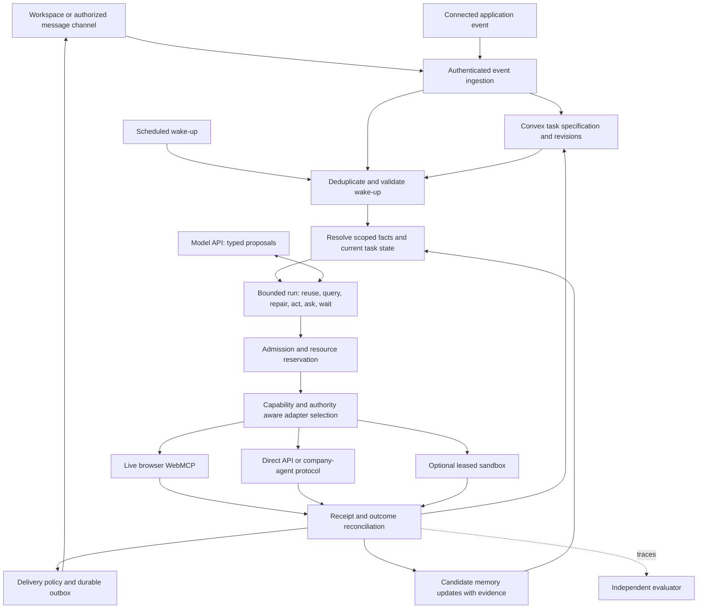

# Persistent personal-agent runtime: proposed extension

**Status: design only, October 18, 2026.** This extends the [existing mission runtime](03-personal-agent-runtime.md) and [system variations](14-personal-agent-system-variations.md). It defines application contracts we would build; these are not claims about Instinct's private implementation. No messaging provider, sandbox, wallet, or company-agent service has been connected.

## 1. The missing lifecycle

The current design explains how to repair and execute a mission. A continuing personal assistant also needs to decide when to wake, what state to restore, which execution environment can act, and whether a result merits an interruption. Those decisions need persisted records rather than a single conversation buffer.

Use a **durable control layer with replaceable execution workers**. Convex stores our authoritative tasks, permissions, runs, reservations, and outcomes. A model call, browser, or sandbox can disappear without becoming the only place that remembers the task. Remote business systems remain authoritative for their own effects.



The diagram groups logical responsibilities. It does not require a separate deployed microservice for every box. Start with a small number of Convex modules, a browser executor, and the selected external adapters.

## 2. Persist the right records

| Record | Key fields | Authority and purpose |
|---|---|---|
| `taskSpecs` | Owner, objective, scope, constraints, trigger policy, delivery policy, grant references, revision, stop epoch | The current accepted instructions; an edited spec supersedes an older version |
| `wakeEvents` | Source, source event ID, task ID, spec revision, occurrence key, due time, observed time, state | A deduplicated reason to consider advancing a task |
| `taskRuns` | Task/spec references, run ID, input cursor, lease epoch, status, usage limits, next checkpoint | One bounded attempt, not the persistent identity of the task |
| `contextFacts` | Subject, scope, value, provenance, validity interval, revision, status | Typed personal facts, preferences, and observations, as in the existing runtime |
| `memoryCandidates` | Evidence references, proposed change, extraction version, applicable scope, review state | Untrusted suggestions from summarization or inference |
| `executionOperations` | Stable logical ID, decision witness, arguments digest, adapter, remote ID, state, receipt reference | Business-operation identity, independent of process restarts |
| `executorLeases` | Executor ID, capabilities, owner/scope, epoch, expiry, last heartbeat | Temporary ownership of dispatch; not proof of remote non-execution |
| `resourceReservations` | Pool, task, operation, amount, status | Shared purchase capacity, separate from provider approval |
| `credentialRefs` | Owner, provider, account mapping, secret reference, scopes, expiry/revocation metadata | References and control metadata; no raw secrets in model context |
| `deliveryOutbox` | Task/result revision, channel, destination reference, content digest, dedupe key, status, provider receipt | Tracks the delivery effect separately from task completion |

These are proposed schema shapes, not finalized Convex definitions. Index per owner/task/status and event/operation identity. Transactionally check uniqueness and current revisions; an index by itself does not establish uniqueness.

## 3. Task, run, effect, and message are separate state machines

```text
Task:      active ↔ waiting; active → completed / cancelled / failed
Wake-up:   pending → accepted / duplicate / obsolete / suppressed
Run:       queued → running → checkpointed / waiting / succeeded / failed / obsolete
Operation: prepared → dispatched → succeeded / failed / unknown
Delivery:  prepared → sending → acknowledged / failed / unknown / suppressed
```

An unknown operation returns to a terminal state only through supported reconciliation evidence. A worker lease expiring does not move it back to prepared. A successfully completed run can produce an unknown delivery, and a delivered status update does not make the mission complete. Recurring tasks can remain active after a successful occurrence.

Cancellation increments a task stop epoch and blocks new effects through endpoints that enforce it. Already completed effects remain recorded. Cancelling an orchestration object does not cancel a remote purchase or retract a message already sent.

## 4. Wake-up policy

Normalize authenticated inputs into an event envelope before calling a model. Verify webhook authenticity where the provider supports it, preserve its event ID, and map account identity using enrolled credentials rather than trusting a payload's claimed owner.

At wake admission, a mutation checks the task's current status, spec revision, event identity, occurrence key, and applicable budget. It then creates bounded work. Coalesce equivalent events for one task while preserving the cursor needed to process every relevant change. Record why an event was suppressed so evaluation can detect missed useful work.

Admission for **new work** is separate from receipt ingestion and reconciliation. Accept late outcome evidence even after cancellation, spec replacement, or planning-budget exhaustion. Preserve unknown holds and recorded effects; use a separately bounded recovery allowance to investigate them. Revocations must update authority promptly. Suppressing a stale timer must not discard the evidence that an earlier operation completed.

Time policies specify an IANA time zone, recurrence semantics, and behavior for daylight-saving gaps and repeated times. Store the resolved UTC occurrence alongside the user rule. A timer carries the spec revision that created it; old timers cannot revive a cancelled or rescheduled task. Re-evaluate current facts after waking rather than replaying an old model context as if it were fresh.

Use events where available. Poll only with a declared interval, quota, and freshness limit when there is no reliable event source. A deterministic gate handles obvious duplicates, unchanged observations, and explicit task execution windows. Notification quiet hours belong to the delivery policy: they do not suppress authorized deadline-sensitive work, revocations, or reconciliation. A model can classify ambiguous relevance, but cannot change hard spending, grant, or notification limits.

Convex documents durable scheduled functions and atomic scheduling from mutations. Scheduling does not automatically propagate caller authentication; scheduled work must use a validated principal reference and recheck authority. Our event identities, stale-timer checks, and task semantics are additional application logic. [Convex scheduling](https://docs.convex.dev/scheduling/scheduled-functions)

## 5. Memory and context

Maintain three distinct forms of state:

- **Working context:** a bounded snapshot for the current model call, with source references and a compaction boundary.
- **Durable personal context:** scoped facts, preferences, exceptions, and observations that have explicit provenance and validity.
- **Operational state:** task specifications, grants, reservations, operations, receipts, and delivery records. A conversational summary cannot overwrite these.

A periodic memory worker proposes changes with evidence. It can compact history and identify candidate preferences, but it does not promote inferred preferences into permission to spend or silently turn a task-specific request into a permanent identity fact. Resolve explicit corrections and scope using deterministic rules; expose disputed facts when they affect the task.

Memory deletion or correction must invalidate derived retrieval entries and affected decisions. Track derivation references so an old summary cannot reintroduce a removed claim. A daily schedule is a tunable maintenance policy, not a requirement: task-boundary extraction may offer better freshness or cost.

Evaluate memory on provenance correctness, useful retrieval, scope leakage, correction propagation, and downstream decisions. A larger memory store or a friendlier response is not evidence that personalization improved outcomes.

## 6. Harness, planner, and specialized workers

The main harness authenticates input, resolves context, selects a task, and advances it through checked steps. It need not be one giant model prompt or an always-running process. Use the existing typed actions—continue, query, repair, replan, ask, wait, stop—and persist the reason and state references for each transition.

The model proposes a task or plan; typed code validates it. A saved routine can use explicit predicates, branches, and bounded repetition. Store its version and interpreter version. Treat external text and newly retrieved skill instructions as data until they pass the application's trust boundary; they cannot expand a user's grant.

Delegate independent research or candidate generation to specialized workers only when parallelism or expertise has measurable value. Give each a task ID, data scope, tool set, inference allowance, and deadline. Merge proposals against current state. All workers share the authoritative resource coordinator; they do not each receive the user's whole budget. Serialize or fence writes where required by the target contract.

Convex Workflow can persist orchestration steps and wait across actions. A saved step result is a historical observation, not a guarantee of current merchant state. External effects inside retried steps need their own idempotency or reconciliation contract. [Convex agent workflows](https://docs.convex.dev/agents/workflows)

## 7. Execution adapters and routing

Use explicit capability records instead of one generic `executeAnything` tool.

```text
Adapter capability (proposed)
  provider + protocol/version + target origin/account
  operations and required scopes
  environment: user browser | agent browser | server | sandbox
  identity: logical operation → provider operation mapping
  supports: quote expiry, conditional commit, status lookup, cancellation
  freshness and availability observations
  retry/reconciliation rules and evidence format
```

Choose among adapters only after hard checks pass: appropriate account, current authority, permitted environment, compatible operation, and sufficient recovery behavior. Then rank eligible routes by measured completion, latency, cost, and user interruption. Do not let a cheap route bypass a required confirmation or silently switch to an account with broader permissions.

| Route | Good use | Important boundary |
|---|---|---|
| Direct domain API | Structured operations with supported account integration | API success must still map to domain completion and receipt semantics |
| WebMCP | A live participating page exposes typed tools | Browser capability, origin exposure, login, and document lifetime must be verified |
| Company-agent protocol | A participating business interprets the request and owns its policy | Follow that protocol's identity, approval, operation, and recovery contracts |
| Browser UI | A necessary interaction has no supported structured tool | More fragile observation/interaction; do not silently inherit stronger adapter guarantees |
| Sandbox worker | Code, data processing, or an explicitly managed computer is needed | Isolation and process state do not confer external business authority |

Routing is operation-aware. Once a possibly effective request is dispatched, keep its operation identity and reconciliation path. Cross-adapter fallback is safe only when both adapters resolve the same logical operation at the authority or when non-execution is established. Otherwise wait or request intervention. A second route must not become a duplicate-purchase mechanism.

A hosted browser does not automatically support the same native WebMCP surface as a user's browser. Pin the browser build, flags, API version, origin permissions, and authentication flow, then test the actual registered-tool path. Keep protocol-specific browser-session requirements in the adapter; do not reuse a user's browser for an assertion that requires an agent-controlled browser.

## 8. Sandbox lifecycle and credential broker

If the task requires an execution sandbox, Convex stores the run-to-sandbox mapping and checks capability/lease ownership before dispatch. Checkpoint useful artifacts and operation references outside the sandbox. Resume by loading the current task and resolving unknown operations before executing a fresh side effect.

E2B documents isolated Linux environments and explicit lifecycle controls. Its persistence API can retain filesystem and memory across pause/resume. Those capabilities make it a candidate execution environment; they do not define our task durability or reconcile a transaction in another service. Verify the selected SDK, template, quotas, and availability before integration. [E2B lifecycle](https://docs.e2b.dev/sandbox), [E2B persistence](https://docs.e2b.dev/sandbox/persistence)

Keep sandbox lifetime and command lease separate. A paused VM can contain a stale run. On resume, its old lease must not authorize a new controlled write. Fencing only works where the receiving endpoint checks it; arbitrary external effects still need their provider's recovery rules.

Credentials remain in a dedicated secret store or supported provider mechanism. A broker issues the narrowest available capability for the current task, account, operation, and expiry. Models receive tool handles and status, not raw credentials. Where a provider offers only coarse tokens, document the wider exposure rather than describing it as fine-grained delegation. Redact artifacts and logs, and prevent one task's execution environment from accidentally reusing another user's session.

## 9. Payment and company-agent authority

Separate four quantities or states: the user's requested budget, our active reservations, the provider's current authorization, and confirmed spending. They are related but not interchangeable. A grant to read financial context is not permission to buy. Our reservation does not increase a provider-approved amount.

Record the selected offer, final quote revision, provider approval reference, merchant operation ID, and actual result. Tax, shipping, or substitution changes can require a revised reservation and provider approval. A company protocol may bind approval to exact terms and a revision; honor that boundary rather than treating a general task instruction as the protocol's approval message.

The [commerce/protocol research note](research/personal-agents-commerce-and-protocols.md) records current Link and PAP requirements and access limits. Implement one verified adapter at a time. A spec-conformant local test service must be labeled as such; it is not evidence of access to a vendor's production partners.

## 10. Delivery policy

Make the choice to notify explicit. A task can produce an in-app update, an authorized external message, a file, a batched digest, or no interruption. Decide from the task's delivery policy, novelty, urgency, unresolved authority, and user-selected quiet periods. The model may draft or summarize; deterministic checks enforce destination, channel authorization, and rate limits.

Write an outbox record transactionally with the result version that warrants delivery. A sender claims it, sends through the chosen channel, and records the provider receipt. If a response is lost, reconcile using provider support. Without idempotency or lookup, mark delivery unknown and follow a stated duplicate-risk policy; do not promise exactly-once external messaging.

A result revision change can supersede an unsent update. A completed delivery remains in the history. Suppress repeated identical notices with stable dedupe keys, but do not suppress a genuinely new failure or authority request merely because its wording resembles a previous message.

For the first prototype, an in-app inbox gives us an observable delivery target without depending on WhatsApp, iMessage, or another messaging provider's access. Those channels are later adapters, not assumed infrastructure.

## 11. Failure-driven evaluation extensions

These tests extend [06](06-evaluation-and-experiments.md); they do not replace its frozen comparison or add hidden fixtures to an already reported result. Run mechanics tests first, then preregister a separate budget for any model-based comparison. All entries below are **Not run**.

| Case | Injected situation | Independent assertion | Comparison or metric |
|---|---|---|---|
| Duplicate wake | Timer and webhook describe the same occurrence | One admitted logical occurrence; all relevant events accounted for | Duplicate/missed occurrence rates |
| Stale task | Edit or cancel while a wake/run is queued | Old spec cannot authorize new guarded effects | Obsolete work admitted; recovery latency |
| Memory scope | Gift preference differs from the owner's preference | Recipient/task scope remains separate | Scope errors and downstream choice quality |
| Memory correction | Delete a claim after summaries and indexes exist | Derived retrieval no longer resurrects it | Correction propagation and stale-use rate |
| Quiet period | Many irrelevant events plus a deadline or late receipt during notification quiet hours | No needless run or repeated notification; required work and evidence ingestion still proceed | Useful wake recall; notification precision; all-event cost |
| Worker replacement | Lease expires while a sandbox is paused | Old worker cannot newly commit through fenced endpoints | Stale dispatch/commit attempts and recovery |
| Adapter fallback | First route's effect status is unknown | Another route does not create a duplicate logical effect | Completion, unknown age, duplicate effects |
| Provider approval | Final total or exact terms change | Current provider-required approval obtained before effect | Approval violations and interruption burden |
| Protocol denial | Two agents cannot agree on permitted terms | Bounded termination or escalation, no scope escalation | Turns, total two-party cost, legal outcome |
| Lost delivery response | Update sent, acknowledgment lost | Delivery not assumed absent; supported reconciliation used | Duplicate/unknown delivery; useful message delay |
| Concurrent missions | Two tasks compete for a shared resource | Common ledger and grant rules hold | Legal completion, allocation cost, starvation |
| External outage | Browser or provider remains unavailable | Accurate waiting state and bounded expenditure | Cost while blocked; resume latency |

Pick one primary algorithmic question. For selective repair, keep our strong ReAct/global/incremental protocol. For wake gating, compare fixed polling with event-triggered deterministic and optional model-assisted gates under equivalent information arrival and quotas. For adapter selection, compare supported routes over equivalent operations and permissions. Do not combine all three treatments and attribute the gain to one module.

Report completion and errors before efficiency. Cost includes model calls from both sides, tool requests, sandbox lifetime, retries, reconciliation, indexing, and delivery work where applicable. Include failures and quiet periods in denominators. Use task/family-level paired analysis; repeated wake-ups within one scenario are not independent users.

## 12. Implementation boundaries for the next scope discussion

Keep TypeScript as the integration language, Convex as our state authority, and a model API as a bounded reasoning service. Rust/WASM remains optional for measured deterministic compute. Start with one controlled domain and one native WebMCP executor. Add a persistent spec/wake/run/outbox lifecycle before general-purpose messaging or computer automation.

An optional protocol adapter, wallet, or sandbox must earn its place through the selected task. Our proposed product can remain useful with fewer integrations. Its technical result should come from a reproducible experiment showing what the runtime handles better, where it fails, and what the added complexity costs.
