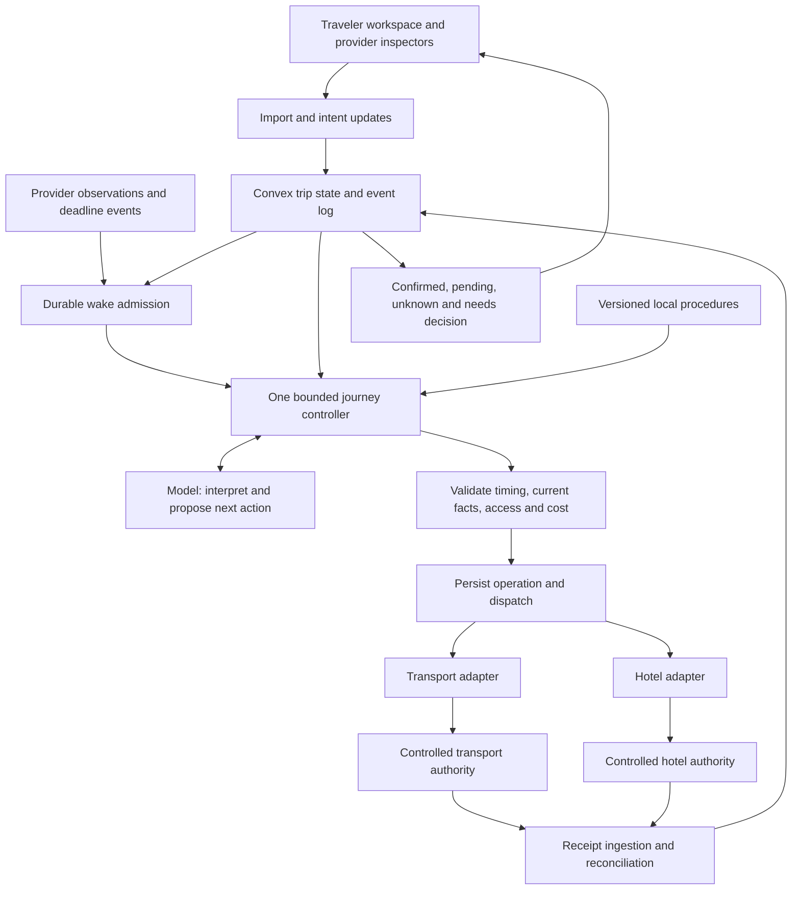

# Travel personal agent: active system design

**Design date:** October 22, 2026, America/Los_Angeles.

**Status:** implemented and verified for the scoped local controlled-provider demo. This document remains the acceptance authority; the [verification report](verification-report.md) records actual results and limits. Commercial integrations and optional adapters are not implied.

**Precedence:** this document controls the first travel implementation. Reuse the general correctness contracts in [03](03-personal-agent-runtime.md), model boundaries in [04](04-model-and-decision-layer.md), and persistence in [15](15-persistent-agent-runtime-design.md). Where scope conflicts, this document supersedes their shopping example, multiple-mission requirement, incremental-planner priority, browser-first deployment, and historical benchmark size. [08](08-delivery-roadmap-and-demo.md) is the active delivery plan. [Implementation goal prompt](prompts/travel-agent-goal.md) is the runnable handoff.

## 1. Product and completion boundary

Build an arrival companion for an international traveler who already holds reservations across providers. The first journey covers Haneda arrival, an existing airport-bus reservation, and an existing hotel reservation.

The product takes provided confirmations and traveler constraints, identifies an endangered arrangement, selects an applicable local procedure, executes supported changes, and verifies the result. The traveler sees confirmed arrangements, pending items, the next physical action, and any specific decision required.

The MVP objective is **arrangements_confirmed**, meaning a feasible transport booking and the hotel's necessary arrival acceptance are verified. This does not mean the traveler has physically arrived. A subsequent material event can invalidate readiness and reopen work; physical arrival is a separately recorded user/provider observation, outside the first success predicate.

The market and operational rationale is in the [October 22 research](../exa-results/travel-personal-agent-2026-10-22.md). Persistent memory, booking, and disruption repair have close competitors. This implementation proves bounded feasibility; it does not establish market novelty or competitive superiority.

### Included

- One traveler, one arrival journey, three imported synthetic confirmations.
- One configurable real model provider, plus explicitly labeled deterministic replay for development.
- TypeScript application, React/Vite frontend, Convex authoritative orchestration state and durable work.
- Curated bus-amendment and hotel-late-arrival procedures.
- Two independently authoritative controlled providers with observable state changes.
- Event ingestion, structured replanning of remaining work, deterministic checks, operation reconciliation.
- A usable arrival view, provider inspection views, isolated reset, and an executable acceptance suite.

### Deferred

Optimized incremental DAG maintenance, multiple missions sharing a resource pool, custom-trained routing, Rust/solver services, autonomous workflow acquisition, phone calls, a global destination catalog, real payments, production airline changes, and arbitrary-site automation.

WebMCP is an additional adapter on our own provider pages, verified separately when supported. Its absence must not prevent the primary server-to-provider path. Public deployment and real supplier transactions are separate work; no such integration is implied by this plan.

## 2. What we retain and what changes

| Existing design | Travel implementation decision |
| --- | --- |
| Task specifications, wake events, bounded runs | Keep; one logical journey controller per active trip |
| Scoped facts and provenance | Keep; separate permanent preferences, trip facts, external observations, and access grants |
| Structured proposals and deterministic validation | Keep; replan remaining tasks after material events |
| Commitments, operation IDs, receipts, unknown effects | Keep; make provider state authoritative for bookings |
| Capability-based adapter selection | Keep; implement only supported operations and original-channel access |
| Dependency evidence | Keep simple input/booking revisions and affected-task relationships |
| Incremental repair engine | Defer optimized reverse indexes and selective repair until measured need |
| One store and two competing missions | Replace with one journey and two independent providers |
| Shared shopping budget | Use one journey's additional-cost cap, active holds, and settled additional charges |
| Browser-bound default executor | Use server adapters for the mandatory path; page-based execution waits when unavailable |
| Shopping benchmark and sponsor mapping | Historical reference; travel acceptance below controls this implementation |

## 3. Architecture and ownership

These are modules, not a requirement for a service or agent per box. The model proposes actions and interprets ambiguous preferences; code owns arithmetic, time comparisons, current grants, known transitions, deduplication, and postcondition checks.

For the mandatory demo, host the two controlled providers and admission registry in the same Convex development deployment. Give providers distinct state namespaces and separate provider API operations/transactions. Each provider can read current admission records when committing its own effect; it cannot alter the other provider's bookings. The controller cannot edit provider records directly or wrap both outcomes in one cross-provider commit. A provider's receipt is committed atomically with that provider's own effect. Transport and hotel inspection pages read provider-owned records, not the controller's optimistic projection. This shared fixture infrastructure enables the explicit commit-time checks below; it is not a claim that production suppliers share our database or enforce our revisions.

Use callable server API adapters as the mandatory execution path. Keep provider handlers reachable from the chosen worker environment: a hosted worker cannot assume that a developer's localhost is reachable. If development is fully local, document and test that topology explicitly. Cloud/dev account setup is an implementation prerequisite to report accurately, not an already available resource.

The primary workflow must survive closing the traveler UI while the backend and provider services remain available. If an optional browser adapter loses its document/session, persist waiting_for_executor. Do not claim a backend can execute a disappeared page tool.

## 4. Domain records

| Record | Minimum contents and responsibility |
| --- | --- |
| Trip | Owner, goal, timezone, current intent revision, monitoring state, arrangements status, event cursor |
| Traveler context | Subject, value, personal/trip scope, explicit or inferred provenance, revision and validity |
| Imported artifact | Original supplied text/file reference, extraction version, source channel, candidate fields, unresolved fields |
| Commitment | Provider, original channel, provider booking ID, booked service/date/night, party, paid amount, observed status/version, policy references |
| Access reference | Provider/account/booking scope, available operations, secret reference, expiry; never raw credentials in model context |
| Observation | Source, observed time, effective time, value or declared interval, freshness and evidence reference |
| Constraint | Hard requirement or preference, scope, revision; preserve hotel, fewer transfers, additional-cost cap |
| Procedure | ID/version, applicability, sources, reviewed time, preconditions, action branches, verification and failure rules |
| Plan attempt | Trip/intent revision, supplied observation and booking revisions, proposed remaining actions, reasons, status |
| Operation | Stable logical ID, provider, type, immutable arguments digest, expected provider revision, grant reference, status, provider operation ID |
| Receipt | Provider operation/result identity, authoritative effect/status/version, amounts, observed time, original operation link |
| Cost ledger | Already committed additional charges, active/uncertain operation holds, cap and revision |
| Wake event | Source/event identity, trip/intent scope, due time, triggering booking revision, admitted/deduplicated/obsolete state |
| Run and delivery | Bounded work checkpoint; in-app result revision, whether an actionable decision remains |

Imported prior payments are displayed separately from the MVP's additional-cost cap. A simulated charge consumes the cap only as defined by the fixture; unknown writes retain their hold. Pending refunds never create available capacity.

Extraction produces candidate facts. Missing or ambiguous identity, date, currency, source channel, or required access stays unresolved. An email is evidence of a booking, not blanket authority to modify it. External text cannot expand the user's grant.

Store absolute instants alongside the IANA timezone and local service-date fields. Hotel service night, hotel check-out date, flight estimate, and physical arrival date have different meanings. Preserve them separately.

## 5. Local procedure contracts

The first procedures are reviewed records with bounded branches, not arbitrary model-generated code. Preserve a source excerpt or concise extracted rule, URL, retrieval date, scope, and review version. Stale or conflicting rules block only affected execution until resolved.

### Guest bus amendment

Applicability: supported provider, existing booking, guest purchase channel, usable guest management access, and modifiable ticket.

1. Resolve the existing booking through its scoped management capability.
2. Read its current departure, revision, amendment cutoff, party/baggage conditions, and current ticket state.
3. Query candidate departures, available capacity, destination, and a versioned price quote.
4. Check ready-at-stop upper bound plus boarding buffer against departure. On the normal path, check resulting hotel arrival against its accepted bound. On the explicitly authorized pending path, check against the requested provisional bound and preserve partially_confirmed; the pending request never proves hotel acceptance.
5. Reserve the incremental charge locally, recheck intent/access and source conditions, then amend the existing booking.
6. Read the provider operation result and current booking; ensure exactly one valid reservation remains.
7. On unknown outcome, reconcile the same operation. Do not submit through a second adapter as if the first never happened.

The official [operator FAQ](https://www.limousinebus.co.jp/en/support/) supports guest/member management paths, the five-minute change/cancel rule, and after-midnight date handling. These source facts do not establish access to that real operator. The demo provider and its API are our controlled implementation.

### Hotel late-arrival acceptance

Applicability: supported provider and an existing hotel reservation with an explicit arrival condition.

1. Read the original service night and booking identity.
2. Request acceptance until a definite latest arrival, within the existing grant.
3. Persist requested/pending status until the hotel records accepted or declined.
4. Read acceptance and its applicable latest time back from the provider.
5. Preserve the original booked night and check-out date.

Sending or delivering the request is not business acceptance. A hotel policy is property/booking-specific. The demo's policy is fixture data, not a universal hotel rule.

A future learning pipeline can convert observed demonstrations into candidate procedures, then review and test them on different conditions before activation. That pipeline is not part of this first goal.

## 6. Adapter interfaces and operation lifecycle

Suggested typed operations, with names finalized in code:

| Transport | Hotel |
| --- | --- |
| readBooking(accessRef, bookingId) | readBooking(accessRef, bookingId) |
| listFeasibleCandidates(query) | requestLateArrival(operationId, bookingId, latestArrival, expectedRevision, admissionRef) |
| quoteAmendment(bookingId, serviceId) | readLateArrivalRequest(requestId) |
| amendBooking(operationId, quoteRef, expectedRevision, admissionRef) | lookupOperation(operationId) |
| lookupOperation(operationId) | |

Every effectful operation, including hotel requests, also carries an admission reference. Adapter metadata describes supported reads/writes, expected revisions, quote expiry, provider access, idempotency, lookup semantics, and reconciliation limits. Never advertise support based solely on a tool name.

For a **new controlled effect**, the provider's authoritative mutation atomically checks the current admission registry: applicable trip intent revision, grant revision, stop epoch, allowed booking/action, argument digest, expiry, and current cost hold. It also checks its own booking/quote revisions, inventory, and commit-time cutoff. Controller validation before dispatch is not sufficient. The same deployment allows those admission reads and the single provider's commit to share a transaction while leaving hotel and transport effects separate.

First check whether that operation already committed with matching arguments, and return its historical receipt before applying new-effect checks. Thus a retry after the cutoff or revocation still returns evidence of an earlier valid commit. An already completed effect is not retroactively erased. An external supplier without equivalent checks cannot inherit this controlled-provider guarantee; its adapter must state the weaker boundary.

Controller operation states: prepared, dispatched, pending, confirmed, rejected, unknown. A hotel request can be accepted for processing while its business decision is pending. A confirmed hotel-acceptance operation requires explicit acceptance evidence.

An operation ID identifies one immutable effect request. Same ID and argument digest returns the existing result; same ID with different arguments is rejected. Retrying a model call does not create permission to repeat a write. A changed proposal creates a new operation only after earlier potentially effective operations are resolved or safely accounted for.

Persist a prepared operation and cost hold before dispatch. A crash after dispatch is recovered by provider lookup. The fixture must offer durable processing/committed/rejected/absent semantics sufficient to reconcile; reading an old booking snapshot alone is not proof of non-execution. Any safe resubmission uses the same idempotent operation identity.

Accept real outcome evidence even after a user change or cancellation. Stop future inadmissible actions and repair around already completed effects. An unchanged UI or expired worker lease does not prove that a provider did nothing.

## 7. Controller and planning policy

Start with one accepted planning attempt per trip and one active write dispatcher. Independent read-only candidate searches may run concurrently; provider effects follow their required dependencies.

The loop is:

1. Deduplicate/admit an event and restore the current intent, unresolved operations, and latest provider observations.
2. Reconcile unknown effects before issuing potentially duplicate actions.
3. Resolve deterministic cases: known pending response, unavailable executor, revoked grant, obsolete timer, or expired cutoff.
4. Ask the model to choose the next useful supported procedure/action using a compact typed snapshot.
5. Validate the proposal against current revisions, time, access, additional cost, and preserved commitments.
6. Dispatch a bounded action; record provider outcomes and schedule the next useful wake-up.
7. Refresh the arrangements status and surface a concise decision or outcome.

The model can query, propose, ask, wait, or stop. The initial planner may recompute the remaining two or three tasks after a material event. Keep explicit input references and preserve confirmed effects; advanced incremental graph maintenance is unnecessary at this scale.

A forecast, quote, or capability observation has a freshness policy. Re-read volatile provider facts before a write; a historical workflow result is not automatically current. Deadline events carry the booking/intent revision that created them. An amended ticket's old timer cannot invalidate its new departure.

Use backend durable scheduling/events for the primary path, and persist checkpoints outside model context. Implement bounded retry and reconciliation intervals. A quiet period does not stop required receipt ingestion or deadline-sensitive authorized work.

## 8. Cross-provider recovery and user decisions

Default sequence: identify a feasible transport candidate, obtain hotel acceptance for its arrival bound, then refresh the transport quote/inventory and perform the amendment before cutoff. Hotel acceptance does not reserve a bus seat.

If the hotel stays pending near the cutoff, use the explicit allowTransportWhileHotelPending grant. When true and the remaining conditions hold, the bus may be amended while the journey stays partial. When false, ask for that specific tradeoff; silence is not approval. Do not claim an unconfirmed hotel arrival is feasible as a fully arranged outcome.

If hotel acceptance is declined after a permitted bus amendment, preserve the new ticket and original hotel reservation. Report the conflict, inspect alternatives, and seek any additional authority needed. The initial grant does not permit cancellation of the hotel or a new lodging purchase.

User decisions show the concrete affected booking, extra cost, remaining uncertainty, deadline, and scope. Confirmed authorization is bound to a proposal/scope and checked again before new effects. Do not repeatedly request authorization already supplied within its limits.

## 9. Canonical finite fixture

Every amount, seat count, itinerary duration, named booking, hotel policy, and flight event below is **synthetic**. Only the cited operator rule semantics are sourced. The fixture is deterministic and isolated from real accounts.

Use a controllable clock per scenario, frozen between explicit advances, starting at **2026-11-14 22:30 Asia/Tokyo**. Tests can advance it while a plan or operation is pending. Persist UTC instants for comparison; display local dates and timezone. Reset creates a new scenario namespace and cannot affect another run.

| Item | Fixture value |
| --- | --- |
| Traveler | One adult, two suitcases; fewer transfers preferred; fixture services permit that luggage |
| Flight F-001 | Original estimated landing Nov 14 21:30; delayed estimate Nov 14 23:40 |
| Ready at correct bus stop | Declared Nov 15 interval 00:25–01:10, including arrival processing, baggage and walking; not a statistical forecast |
| Boarding safety buffer | 10 minutes beyond the interval upper bound |
| Existing bus B-001 | Guest booking, Nov 14 23:00, one traveler, simulated prior paid fare JPY 3,000 |
| Existing amendment cutoff | Provider commit time must be no later than Nov 14 22:55 |
| Controller dispatch buffer | Allow 30 seconds before the cutoff; do not start new amendment dispatch after 22:54:30; this does not guarantee completion before the provider's cutoff |
| Candidate S-early | Nov 15 00:50, one seat, fare JPY 3,200; invalid readiness |
| Candidate S-target | Nov 15 01:40, one seat, fare JPY 3,500; hotel arrival estimate 02:25 |
| Candidate S-late | Nov 15 02:20, one seat, fare JPY 3,400; hotel arrival estimate 03:05 |
| Hotel H-001 | Original service night Nov 14; checkout Nov 15 12:00; default latest arrival Nov 15 01:00 |
| Hotel request | Accept arrival until Nov 15 03:00; zero fixture fee; seeded response accepted, pending, or declined |
| Grant | Amend B-001, request late arrival for H-001; cumulative additional charges plus active holds at most JPY 1,000 |
| Access | Booking-scoped guest management capability for B-001, separate scoped capability for H-001 |
| Default pending policy | allowTransportWhileHotelPending=false; a separate test explicitly enables it |
| Unaffected commitments | Original hotel night/check-out/room and flight identity remain intact |

The normal accepted path selects S-target, amends the same B-001 booking, records one JPY 500 additional charge, and verifies H-001's 03:00 acceptance. Its remaining additional-cost capacity is JPY 500. A refund or second ticket is not part of this fixture.

After amendment, the provider returns a new booking revision and applicable policy/cutoff for the new service. Old wake-ups become obsolete. Do not hard-code the successful service ID into the planner; choose from observed candidates and test variants that change feasibility or remove inventory.

## 10. UI and observable outcomes

Build a traveler workspace with a provided-confirmation importer, concise preference/action-scope controls, an arrival timeline, and an actionable status card. Show local dates across midnight explicitly.

Use separate outcome labels: needs_information, evaluating, awaiting_decision, executing, partially_confirmed, arrangements_confirmed, and needs_help. These are derived trip views, not replacements for the operation state machine.

The main card shows transport confirmation/date, hotel acceptance state, additional cost, and the next physical instruction. A detail panel exposes source rules, relevant conditions, operation identity, and provider receipts. Provider inspector pages show their actual bookings/requests independently.

Display a clear persistent simulation label for merchant inventory, payments, and injected events. Model execution mode is separately shown as live or replay. Internal implementation details belong in an expandable evidence view, not the traveler’s primary flow.

## 11. Independent acceptance suite

Assertions read provider state and immutable operation records, not model prose or the agent's own success flag. Use a deterministic clock and scenario variants. Run the complete browser flow plus focused integration tests for the failure boundaries.

| Case | Required assertion |
| --- | --- |
| Happy path | Exactly one active B-001 reservation for S-target, correct next-day date and JPY 3,500 fare; one JPY 500 charge; H-001 original night retained and late arrival accepted until 03:00 |
| Readiness/date | S-early is excluded; landing is not treated as ready-at-stop; hotel service night remains Nov 14 |
| Hotel bound | S-late cannot satisfy the accepted 03:00 bound; no arrangements_confirmed claim |
| Source cutoff | Provider boundary test permits a valid commit exactly at 22:55 and rejects after it; controller respects its earlier dispatch buffer |
| Guest access | Guest management path works with scoped capability; missing/expired/wrong-booking access causes no write and a precise access-needed result |
| Hotel pending | Default policy performs no transport amendment while pending; enabled policy may amend but status remains partially_confirmed |
| Hotel refusal | No fabricated acceptance or unauthorized hotel cancellation/new lodging; preserve any already completed transport amendment |
| Lost bus response | Provider commits, response is dropped, controller reconciles same operation; exactly one amendment effect and one JPY 500 charge |
| Duplicate delivery | Repeated event and same operation delivery do not create a second effective change or charge |
| Restart/UI closure | Persisted run resumes after worker restart; closing UI does not stop backend-capable work; unavailable optional browser path waits honestly |
| Stale plan or quote | Intent/booking/quote changes before commit cause revalidation/rejection; the old proposal cannot spend against a changed grant |
| Budget with unknown write | A JPY 500 unknown obligation remains reserved; no false release or duplicate allocation |
| Inventory change | Remove S-target after planning: source rejects stale capacity; agent refreshes and asks/waits when no feasible candidate remains |
| Old timer | Original bus cutoff event arriving after amendment cannot cancel or invalidate the new booking |
| Later material change | Inject another delay after arrangements_confirmed on an active trip; revalidate current commitments, downgrade the arrangement if infeasible, and resume bounded work |
| Terminal predicate | Hotel request delivery without acceptance cannot yield arrangements_confirmed; arrangements confirmation never asserts physical arrival |

At minimum, retain a run manifest with fixture version, code revision, model/mode, provider contracts, observed events, final provider state, test results, and unresolved failures. All tests and success rates are unrun until implementation artifacts demonstrate otherwise.

A live-model run is required to call the model-backed vertical path complete. Deterministic replay can establish mechanics and support development but must not satisfy that live criterion. If provider credentials or infrastructure are unavailable, finish independent code/tests and report the exact blocked criterion; do not mark the full objective achieved.

## 12. Build sequence and runnable deliverables

1. Define the records, finite fixture, provider contracts, frozen clock, and independent assertions.
2. Scaffold the TypeScript workspace and Convex integration; implement provider authorities/adapters with deterministic test coverage.
3. Add importer, durable controller, structured model interface, current-state guards, and reconciliation.
4. Build the traveler/provider views and one complete accepted path.
5. Exercise faults and partial outcomes; verify persistence and browser end-to-end behavior.
6. Rehearse the proposed three-minute story and write a candid evidence report.

Suggested workspace boundaries: apps/web for UI, convex for persisted controller/provider handlers, packages/domain for types/validation/procedures, packages/adapters for typed clients, and tests for independent fixtures/scoring. Adjust to actual tooling rather than creating empty packages for appearance.

Deliver a README with exact installed package-manager commands for setup, backend/frontend start, seed/reset, checks, fault scenarios, and the demo. Commit-safe environment examples contain names/placeholders only; server credentials must not enter frontend bundles, model inputs, or trace artifacts. Document actual startup topology and any required account setup.

Keep one configured provider/model initially; honor an existing usable project configuration, otherwise choose and document one supported provider after checking its current documentation. No exact model version is prescribed by these design notes. Separate a real provider client from replay fixtures.

Required completion artifacts are working source, runnable commands, provider inspection, passing relevant type/build/integration/browser checks, at least one live-model vertical-path trace when credentials are available, and explicit remaining limitations. Missing infrastructure or a failed mandatory check remains incomplete rather than being converted into a success claim.

## 13. Evidence and later decisions

The [research notes](../exa-results/travel-personal-agent-2026-10-22.md) supply competitor and local-rule provenance. This design update does not reverify every older SDK, browser preview, or sponsor statement; implementation must use the actual supported versions.

The first product evidence is reduced active coordination time and correctly arranged outcomes. Optimized incremental repair, additional destinations, production adapters, and paid service models require separate experiments. Existing event eligibility questions remain submission questions; they do not prevent ordinary product development under this goal.
