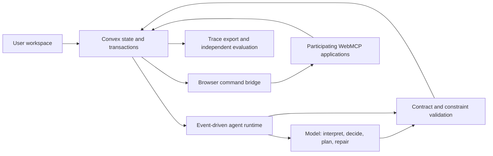

# Travel Personal Agent: Design, Delivery, and Research

This folder consolidates the project discussions into an English design package. It is the current planning reference; the earlier material in [`research/`](../research/) has also been translated into English and remains the research history. Legacy `_ZH` filenames are retained to preserve links.

**Status:** design and research only. No application, deployed integration, benchmark implementation, measured performance improvement, or confirmed sponsor eligibility has been produced by this documentation task. External capabilities are documented separately from capabilities we propose to build.

**Active design update:** October 22, 2026, America/Los_Angeles. Travel sources have their own review record; this update does not reverify all October 17–18 sources.

## Current implementation

The local travel companion is implemented. Read the [verification report](verification-report.md) for test results, live-model/browser evidence, and limits; use the [root README](../README.md) to run it.

## Design and implementation handoff

Start with [16 — Travel system design](16-travel-agent-system-design.md), then [08 — Delivery roadmap and demo](08-delivery-roadmap-and-demo.md). Use the [copy-ready /goal prompt](prompts/travel-agent-goal.md) to give an implementation agent the complete task. Design 16 takes precedence over historical shopping scope, benchmark sizes, incremental-planning priorities, and browser-first requirements.

The active product is one Tokyo arrival journey with imported flight, guest bus, and hotel confirmations. A persistent controller selects sourced local procedures, carries out changes through two controlled provider adapters, and verifies their outcomes. Start with structured replanning and deterministic constraints. Optimized incremental repair, multi-mission resource allocation, and production supplier integrations come later.

The first success condition is confirmed arrival arrangements, not proof that the traveler has physically arrived. Simulated events, inventory, and payments remain clearly labeled. The [travel research](../exa-results/travel-personal-agent-2026-10-22.md) explains the competitive overlap and the narrower hypothesis being tested.

**October 18 extension:** [14 — Personal-agent system variations](14-personal-agent-system-variations.md) compares six product/runtime configurations using the newly supplied sources. [15 — Persistent runtime design](15-persistent-agent-runtime-design.md) specifies the task, wake-up, memory, execution, and delivery lifecycle. The [system atlas](diagrams/atlas/README.md) draws the full system, all six variations, and four detailed engineering views in editable Excalidraw format. Their source notes have their own review dates; this addition does not silently reverify every older source.

## Earlier exploration

The earlier discussion added six product candidates: **DataPatch, Agent Crash Lab, LiveOps, SupplyWatch, SpendRail, and CloseProof**. The [experiment portfolio](11-experiment-portfolio.md) preserves their comparison and detailed designs.

The original personal-agent design below remains architectural background. Its shopping-specific architecture and evaluation are not active travel requirements. Earlier portfolio priorities are historical recommendations; the current implementation target is the travel scope in design 16.

## Original personal-agent direction — historical scope

Build a personal agent that maintains several persistent user goals, operates participating websites through WebMCP, and repairs its remaining work when the user or environment changes. Use Convex for authoritative state, transactional updates, and durable coordination. Use a model for interpreting intent, proposing plans, and making ambiguous next-action decisions. Keep execution validity, resource accounting, and outcome verification deterministic.

The research question is narrow enough to test:

> Under the same model, tools, information, and resource budget, can explicit decision dependencies and incremental repair preserve task quality while reducing recovery work in changing environments?

Shopping is the initial product example because quantities, stock, deadlines, preferences, and budgets provide observable constraints and a plausible Visa shopping-track connection. It is a proposed validation domain, not a claim of demonstrated customer demand or unique market position.

## Read this package

| Document | What it answers |
|---|---|
| [01 — Product and research thesis](01-product-and-research-thesis.md) | What are we building, for whom, and why is it more than a chat interface? |
| [02 — System design alternatives](02-system-design-alternatives.md) | Which architecture should we choose, and when might a simpler alternative win? |
| [03 — Personal agent runtime](03-personal-agent-runtime.md) | How do state, dependencies, commands, resources, and recovery work? |
| [04 — Model and decision layer](04-model-and-decision-layer.md) | Where do model calls happen, and what does the decision model decide? |
| [05 — Deployment and operations](05-deployment-and-operations.md) | What runs in the browser, Convex, or a separate worker, and how do we deploy it? |
| [06 — Evaluation and experiments](06-evaluation-and-experiments.md) | What would constitute credible evidence that the system helps? |
| [07 — Sponsor track strategy](07-sponsor-track-strategy.md) | How does the deployed product demonstrate substantive sponsor use? |
| [08 — Delivery roadmap and demo](08-delivery-roadmap-and-demo.md) | What are the milestones, acceptance gates, and presentation assets? |
| [09 — Decisions and open questions](09-decisions-and-open-questions.md) | What is recommended, provisional, unresolved, or explicitly out of scope? |
| [10 — Sources and evidence](10-sources-and-evidence.md) | Which claims have primary-source support and which remain hypotheses? |
| [11 — Experiment portfolio](11-experiment-portfolio.md) | How do six additional product directions compare, and which experiment should we try first? |
| [12 — TypeScript, Rust, Convex, and WebMCP](12-typescript-rust-convex-webmcp.md) | Which language owns each layer, and how do browser tools, backend state, WASM, and workers connect? |
| [13 — Past Cal Hacks projects](13-past-cal-hacks-projects.md) | Which earlier award recipients are relevant, what did they build, and how should those precedents sharpen our scope and evidence? |
| [14 — Personal-agent system variations](14-personal-agent-system-variations.md) | How do browser, persistent, incremental, protocol, commerce, and delegation configurations compare? |
| [15 — Persistent runtime design](15-persistent-agent-runtime-design.md) | How do saved task specifications, wake-up policies, task runs, memory, adapters, credentials, and delivery fit together? |
| [16 — Travel system design](16-travel-agent-system-design.md) | What exactly should the active arrival companion implement, and which provider outcomes must it verify? |
| [Implementation /goal prompt](prompts/travel-agent-goal.md) | What complete task should an implementation agent run against this repository? |

Detailed candidate designs: [DataPatch](experiments/datapatch.md), [Agent Crash Lab](experiments/agent-crash-lab.md), [LiveOps](experiments/liveops.md), [SupplyWatch](experiments/supplywatch.md), [SpendRail](experiments/spendrail.md), and [CloseProof](experiments/closeproof.md).

For active implementation, read 16 and 08 first, then use 03–05 and 15 for supporting contracts. For historical product alternatives, read 01, 02, 11, and 13. Before making comparative performance claims, define a travel-specific protocol; 06 remains an earlier shopping experiment. Event submissions are a separate concern described in 07 and 09.

For the persistent runtime's background, read 14 and 15. Source reviews: [Stripe and Sierra/PAP](research/personal-agents-commerce-and-protocols.md), [Decagon/PACT and Profound](research/personal-agents-harness-and-experience.md), and [the X posts and supplied architecture](research/personal-agents-social-and-reference-architecture.md).

## Agreed direction versus provisional choices

The user wants a technically substantial personal-agent project, meaningful evaluations, and sponsor relevance. The user explicitly removed the assumption that total development must fit into 36 hours: the intended product process is to establish the core first and refine it later.

Convex remains the selected backend in the active travel design. Start with one logical personal agent and one journey controller, with server adapters for two controlled providers. WebMCP can expose the same supported operations on our own pages as a separately tested extension. A continuously running model process is unnecessary.

The browser host, exact model version, solver implementation, initial real application integration, and detailed sponsor eligibility remain choices to validate. References to Gemini or an extension are recommendations, not completed integrations.

## General-runtime architecture — reference

The active travel diagram is in [16](16-travel-agent-system-design.md#3-architecture-and-ownership). The [11-view hand-drawn system atlas](diagrams/atlas/README.md) and diagram below describe the earlier general/browser-centered configurations; they are not updated travel topology or completed integrations.

## Rules for reading and updating these docs

- A **proposal** describes intended behavior, not a deployed guarantee.
- A **hypothesis** needs a frozen evaluation protocol and measured results.
- A **confirmed source claim** is supported by the linked source, within its stated scope.
- A **submission requirement** must come from the relevant current event, not a different sponsor hackathon.
- No synthetic performance table should be presented as an experiment result.
- All comparison agents receive the same platform protections and externally available information.

Cal Hacks' reviewed homepage states that work must be done during the hackathon. The user's preferred development schedule therefore requires a separate eligibility clarification; removing the engineering time cap does not establish permission to submit prebuilt work. This does not prevent completing the design package. See the precise boundary in [07](07-sponsor-track-strategy.md).
