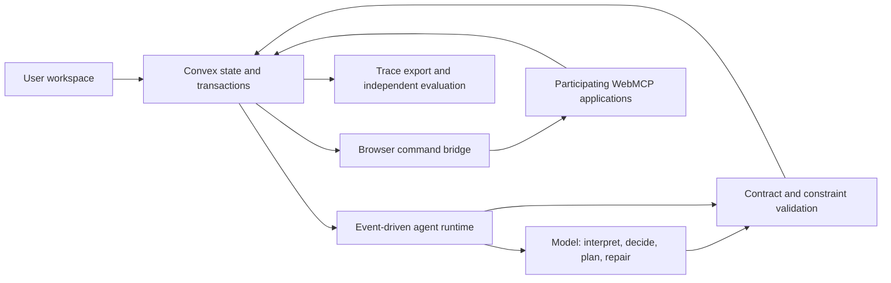

# Agent Projects: Product, Architecture, Evaluation, and Sponsor Strategy

This folder consolidates the project discussions into an English design package. It is the current planning reference; the earlier material in [`research/`](../research/) has also been translated into English and remains the research history. Legacy `_ZH` filenames are retained to preserve links.

**Status:** design and research only. No application, deployed integration, benchmark implementation, measured performance improvement, or confirmed sponsor eligibility has been produced by this documentation task. External capabilities are documented separately from capabilities we propose to build.

**Evidence review date:** October 17, 2026, America/Los_Angeles.

**October 18 extension:** [14 — Personal-agent system variations](14-personal-agent-system-variations.md) compares six product/runtime configurations using the newly supplied sources. [15 — Persistent runtime design](15-persistent-agent-runtime-design.md) specifies the task, wake-up, memory, execution, and delivery lifecycle. Their source notes have their own review dates; this addition does not silently reverify every older source.

## Current exploration

The latest discussion adds six product candidates: **DataPatch, Agent Crash Lab, LiveOps, SupplyWatch, SpendRail, and CloseProof**. Start with the [experiment portfolio](11-experiment-portfolio.md) for their comparison and the six detailed designs. Convex is a possible foundation across products; WebMCP is used when external agents need to operate the application, not imposed on every candidate.

The original personal-agent design below remains a developed option. Its shopping-specific architecture and evaluation are not universal requirements for the new directions. No final product pivot has been selected. For the stated agent/backend/data interests, the proposed discovery order is DataPatch, LiveOps, then SupplyWatch, subject to the evidence from their first experiments.

## Original personal-agent direction

Build a personal agent that maintains several persistent user goals, operates participating websites through WebMCP, and repairs its remaining work when the user or environment changes. Use Convex for authoritative state, transactional updates, and durable coordination. Use a model for interpreting intent, proposing plans, and making ambiguous next-action decisions. Keep execution validity, resource accounting, and outcome verification deterministic.

The research question is narrow enough to test:

> Under the same model, tools, information, and resource budget, can explicit decision dependencies and incremental repair preserve task quality while reducing recovery work in changing environments?

Shopping is the initial product example because quantities, stock, deadlines, preferences, and budgets provide observable constraints and a plausible Visa shopping-track connection. It is a proposed validation domain, not a claim of demonstrated customer demand or unique market position.

## Read this package

| Document | What it answers |
|---|---|
| [01 — Product and research thesis](01-product-and-research-thesis.md) | What are we building, for whom, and why is it more than a chat interface? |
| [02 — System design alternatives](02-system-design-alternatives.md) | Which architecture should we choose, and when might a simpler alternative win? |
| [03 — Personal agent runtime](03-personal-agent-runtime.md) | How do state, dependencies, commands, resources, and recovery work? |
| [04 — Model and decision layer](04-model-and-decision-layer.md) | Where do model calls happen, and what does the decision model decide? |
| [05 — Deployment and operations](05-deployment-and-operations.md) | What runs in the browser, Convex, or a separate worker, and how do we deploy it? |
| [06 — Evaluation and experiments](06-evaluation-and-experiments.md) | What would constitute credible evidence that the system helps? |
| [07 — Sponsor track strategy](07-sponsor-track-strategy.md) | How does the deployed product demonstrate substantive sponsor use? |
| [08 — Delivery roadmap and demo](08-delivery-roadmap-and-demo.md) | What are the milestones, acceptance gates, and presentation assets? |
| [09 — Decisions and open questions](09-decisions-and-open-questions.md) | What is recommended, provisional, unresolved, or explicitly out of scope? |
| [10 — Sources and evidence](10-sources-and-evidence.md) | Which claims have primary-source support and which remain hypotheses? |
| [11 — Experiment portfolio](11-experiment-portfolio.md) | How do six additional product directions compare, and which experiment should we try first? |
| [12 — TypeScript, Rust, Convex, and WebMCP](12-typescript-rust-convex-webmcp.md) | Which language owns each layer, and how do browser tools, backend state, WASM, and workers connect? |
| [13 — Past Cal Hacks projects](13-past-cal-hacks-projects.md) | Which earlier award recipients are relevant, what did they build, and how should those precedents sharpen our scope and evidence? |
| [14 — Personal-agent system variations](14-personal-agent-system-variations.md) | How do browser, persistent, incremental, protocol, commerce, and delegation configurations compare? |
| [15 — Persistent runtime design](15-persistent-agent-runtime-design.md) | How do saved task specifications, wake-up policies, task runs, memory, adapters, credentials, and delivery fit together? |

Detailed candidate designs: [DataPatch](experiments/datapatch.md), [Agent Crash Lab](experiments/agent-crash-lab.md), [LiveOps](experiments/liveops.md), [SupplyWatch](experiments/supplywatch.md), [SpendRail](experiments/spendrail.md), and [CloseProof](experiments/closeproof.md).

For product discussion, read 01, 02, 07, 11, and 13. For implementation, read 03–05 and 12. Before making performance claims, read 06 and the chosen product's protocol. Before deciding what can be submitted to the event, read 07 and 09.

For the latest personal-agent scope discussion, start with 14, then 15. Source reviews: [Stripe and Sierra/PAP](research/personal-agents-commerce-and-protocols.md), [Decagon/PACT and Profound](research/personal-agents-harness-and-experience.md), and [the X posts and supplied architecture](research/personal-agents-social-and-reference-architecture.md).

## Agreed direction versus provisional choices

The user wants a technically substantial personal-agent project, meaningful evaluations, and sponsor relevance. The user explicitly removed the assumption that total development must fit into 36 hours: the intended product process is to establish the core first and refine it later.

Convex is the preferred sponsor-aligned backend for the personal-agent branch and several portfolio candidates. WebMCP remains core to the original branch and optional elsewhere. Within the personal-agent branch, a single logical agent per user with multiple missions is recommended; that does not require a continuously running model process or a separately trained model for each person.

The browser host, exact model version, solver implementation, initial real application integration, and detailed sponsor eligibility remain choices to validate. References to Gemini or an extension are recommendations, not completed integrations.

## Personal-agent architecture at a glance

[View the hand-drawn architecture and download its editable Excalidraw source](diagrams/README.md). It expands the overview below into the repair loop, browser execution boundary, outcome reconciliation, and independent evaluation.

## Rules for reading and updating these docs

- A **proposal** describes intended behavior, not a deployed guarantee.
- A **hypothesis** needs a frozen evaluation protocol and measured results.
- A **confirmed source claim** is supported by the linked source, within its stated scope.
- A **submission requirement** must come from the relevant current event, not a different sponsor hackathon.
- No synthetic performance table should be presented as an experiment result.
- All comparison agents receive the same platform protections and externally available information.

Cal Hacks' reviewed homepage states that work must be done during the hackathon. The user's preferred development schedule therefore requires a separate eligibility clarification; removing the engineering time cap does not establish permission to submit prebuilt work. This does not prevent completing the design package. See the precise boundary in [07](07-sponsor-track-strategy.md).
