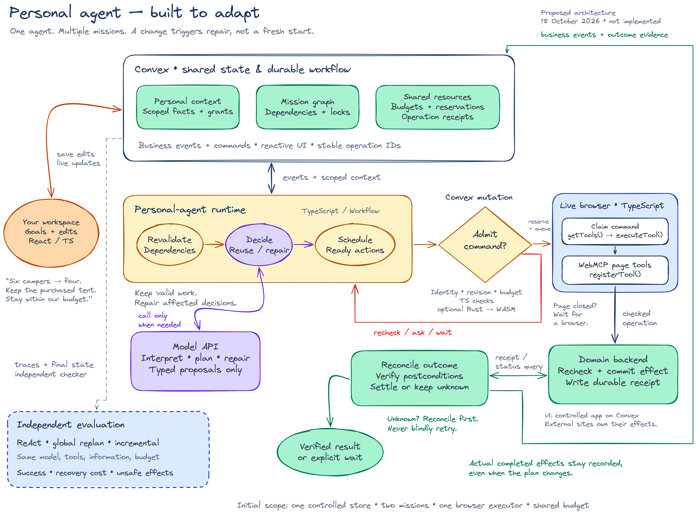

# Personal-agent architecture — editable whiteboard

[Open the editable Excalidraw file](personal-agent-architecture.excalidraw) · [Full-resolution PNG](personal-agent-architecture.png)

Download the `.excalidraw` file and open it with the **Open** command in [Excalidraw](https://excalidraw.com/). Every shape, label, and arrow is editable. The PNG is a presentation preview of the same scene.

**Status: proposed architecture, October 18, 2026.** This visual describes the original personal-agent candidate. It does not select a final product from the experiment portfolio or claim an implemented system. The hand-drawn style follows the supplied reference; the content comes from our architecture documents.

## How to read the loop

1. **The workspace records goals and changes.** Convex stores scoped personal context, mission dependencies, resource reservations, and operation receipts. Its reactive queries update the user interface.
2. **The runtime revalidates affected decisions.** It preserves still-valid work, identifies dependencies invalidated by an event, and decides whether to reuse a result, repair a plan, ask for missing authority, or wait. Persistent missions do not require a continuously running model process.
3. **The model proposes; deterministic code admits.** Model API calls interpret ambiguous intent and produce typed candidate plans or repairs. A Convex mutation reads current identity, grants, revisions, and resource availability before reserving resources and queuing a command. The displayed checks are representative, not the complete admission contract.
4. **A live browser executes a registered page tool.** The browser executor claims an admitted command, discovers currently accessible tool descriptors through `document.modelContext.getTools()`, and invokes one with `document.modelContext.executeTool()`. Participating pages expose handlers through `document.modelContext.registerTool()`. Page lifecycle and permitted frame/origin access constrain availability; an unavailable browser leaves the command waiting.
5. **The domain backend checks and commits the effect.** Admission does not make an old command permanently valid. The tool handler calls an authenticated backend operation, which rechecks current authority and state. In our controlled first application, Convex can commit the business effect and its durable receipt in the same transaction. External applications own their effects and receipts; this diagram does not imply a transaction across arbitrary websites.
6. **Reconciliation closes the loop.** The runtime queries receipts or authoritative status, verifies postconditions, and settles accounting. A lost response leaves an unknown outcome until reconciled; it does not justify blindly repeating the effect. Already completed effects remain in history even after a plan changes.

The outer green arrow carries business events and observed outcomes into the next state update. This feedback, plus dependency-based repair, is the mechanism we want to compare against ordinary agent loops.

## Deployment and language boundaries

The runtime, admission diamond, and reconciler are **logical responsibilities**, not three required services. For the proposed first version, Convex TypeScript functions and durable Workflow orchestration own these responsibilities. External model calls run through actions, outside database transactions. The browser is a separate TypeScript execution environment; Convex cannot directly invoke a live page's `document` APIs.

Rust is optional. A bounded, pure constraint/dependency kernel can compile to WASM and run inside a TypeScript Convex function. TypeScript still owns database reads, authentication, and writes. An external native Rust service is not required by this diagram.

The initial scope remains one controlled store, two missions, one browser executor, and a shared budget. The camper-count edit on the canvas is an illustrative demo input, not a measured result.

## Evaluation is outside the agent

The dashed panel compares ReAct, global replanning, and incremental repair under the same model, tool access, information, and budget. An independent checker uses execution traces and authoritative final state to assess success, recovery cost, and unsafe effects. Hidden fixture truth belongs to the evaluator; it is not added to the tested agents' context. The visual contains no fabricated benchmark scores.

## Detailed contracts and sources

- [Runtime and recovery contracts](../03-personal-agent-runtime.md)
- [Model and decision layer](../04-model-and-decision-layer.md)
- [Evaluation protocol](../06-evaluation-and-experiments.md)
- [TypeScript, Rust, Convex, and WebMCP integration](../12-typescript-rust-convex-webmcp.md)
- [Chrome WebMCP imperative API](https://developer.chrome.com/docs/ai/webmcp/imperative-api) — browser method names and tool access; checked October 18, 2026.
- [Convex WebAssembly support](https://docs.convex.dev/functions/runtimes#running-webassembly) — optional WASM execution inside JavaScript/TypeScript functions; checked October 18, 2026.
