# Personal-agent system atlas

Eleven editable whiteboards cover the complete proposed personal-agent system, six product/runtime variations, and four detailed engineering views. Each board has a native `.excalidraw` file and a matching PNG preview. The hand-drawn style follows the supplied reference; the architecture is our proposed design.

**Status: design only, October 18, 2026.** These are alternatives and contracts for discussion, not deployed integrations or measured results. The six variations are the personal-agent configurations in [document 14](../../14-personal-agent-system-variations.md), rather than the separate product candidates in the [experiment portfolio](../../11-experiment-portfolio.md).

Download any `.excalidraw` file, then use **Open** in [Excalidraw](https://excalidraw.com/). Shapes, text, and arrows remain individually editable. Use the PNG links for full-resolution viewing or presentations.

## Reading order

| View | Question answered | Editable source | Preview |
|---|---|---|---|
| **00 — Complete persistent system** | How do inputs, Convex, models, workers, memory, execution, and delivery connect? | [Excalidraw](00-persistent-system.excalidraw) | [PNG](00-persistent-system.png) |
| **01 — A: Browser copilot** | What is the smallest complete WebMCP-to-backend system? | [Excalidraw](01-browser-copilot.excalidraw) | [PNG](01-browser-copilot.png) |
| **02 — B: Persistent assistant** | What makes a task continue across sessions and worker restarts? | [Excalidraw](02-persistent-assistant.excalidraw) | [PNG](02-persistent-assistant.png) |
| **03 — C: Adaptive coordinator** | How do we repair unfinished decisions across shared resources? | [Excalidraw](03-adaptive-coordinator.excalidraw) | [PNG](03-adaptive-coordinator.png) |
| **04 — D: Protocol concierge** | Where do the personal agent, company agent, user, and company backend exchange authority? | [Excalidraw](04-protocol-concierge.excalidraw) | [PNG](04-protocol-concierge.png) |
| **05 — E: Commerce specialist** | How do recommendations, quotes, resource reservations, approval, and checkout differ? | [Excalidraw](05-commerce-specialist.excalidraw) | [PNG](05-commerce-specialist.png) |
| **06 — F: Delegation platform** | How can other agents submit bounded missions and recover across supported adapters? | [Excalidraw](06-delegation-platform.excalidraw) | [PNG](06-delegation-platform.png) |
| **07 — Task lifecycles** | Why are task, wake-up, run, operation, and delivery separate identities? | [Excalidraw](07-task-lifecycles.excalidraw) | [PNG](07-task-lifecycles.png) |
| **08 — Memory and context** | How do scoped facts, corrections, consolidation, and operational truth interact? | [Excalidraw](08-memory-and-context.excalidraw) | [PNG](08-memory-and-context.png) |
| **09 — Execution and authority** | Which checks run locally, and which must the remote system enforce? | [Excalidraw](09-execution-and-authority.excalidraw) | [PNG](09-execution-and-authority.png) |
| **10 — Evaluation** | How do we isolate our contribution and measure actual outcomes? | [Excalidraw](10-evaluation-design.excalidraw) | [PNG](10-evaluation-design.png) |

Start with **00** for the whole system and **01–06** to discuss product scope. Then use **07–10** to inspect the engineering contracts and evidence plan. A reasonable first path remains the browser execution foundation, a narrow persistent task, and an independently evaluated repair policy; the diagrams do not commit us to shipping every optional adapter.

## Visual conventions

- **Orange:** an input, event, or waiting work.
- **Green:** durable state, verified evidence, or recorded outcomes. A green box does not imply that every outcome is successful.
- **Purple:** model reasoning, working context, or a candidate decision.
- **Yellow:** a policy, validity, resource, or authorization check.
- **Dashed blue:** an optional integration or a separately isolated evaluation component; its label identifies which.
- **Red:** an uncertainty or recovery condition that changes what execution is allowed to do.

Boxes represent logical responsibilities. They do not require one deployed service per box. TypeScript owns the React/browser and Convex layers. A bounded Rust/WASM kernel is optional; it does not replace Convex's TypeScript runtime. An optional leased sandbox supplies execution resources, while durable task state remains in Convex.

## 00 — Complete persistent system

This view connects authenticated inputs, versioned task specifications, wake-up admission, scoped context, bounded runs, model proposals, checked command admission, execution adapters, outcome reconciliation, delivery, and independent evaluation. The feedback paths make the system persistent: verified effects and relevant changes influence subsequent work without erasing completed actions.

[Edit in Excalidraw](00-persistent-system.excalidraw) · [Full-resolution PNG](00-persistent-system.png) · [Runtime contracts](../../15-persistent-agent-runtime-design.md)

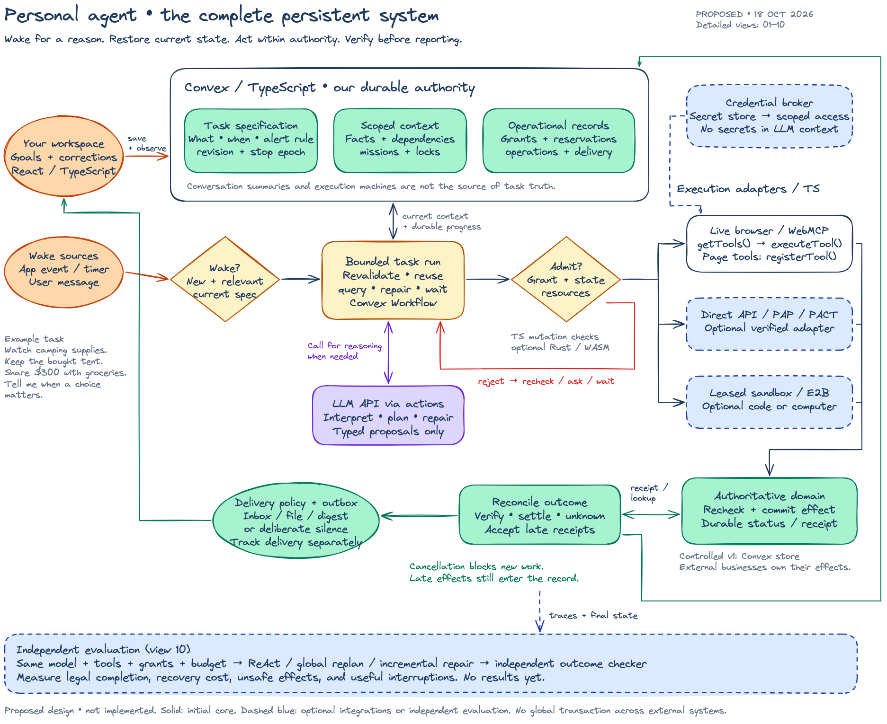

## 01 — A: Browser-centered personal copilot

The browser is an explicit availability dependency. A registered page tool calls a checked domain backend; model output does not directly commit the business effect. The board includes the benefit, operational limits, and disconnect/recovery experiment.

[Edit in Excalidraw](01-browser-copilot.excalidraw) · [Full-resolution PNG](01-browser-copilot.png) · [Full comparison](../../14-personal-agent-system-variations.md#a-browser-centered-personal-copilot)

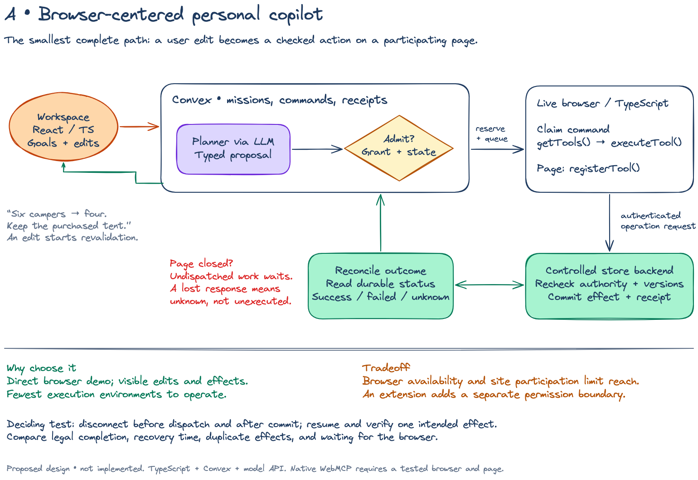

## 02 — B: Persistent personal assistant

A saved task can wait without an active model call or live VM. Wake-up validation restores current context, bounded workers execute permitted work, and a separate delivery policy decides whether and when the user needs an update.

[Edit in Excalidraw](02-persistent-assistant.excalidraw) · [Full-resolution PNG](02-persistent-assistant.png) · [Full comparison](../../14-personal-agent-system-variations.md#b-persistent-personal-assistant)

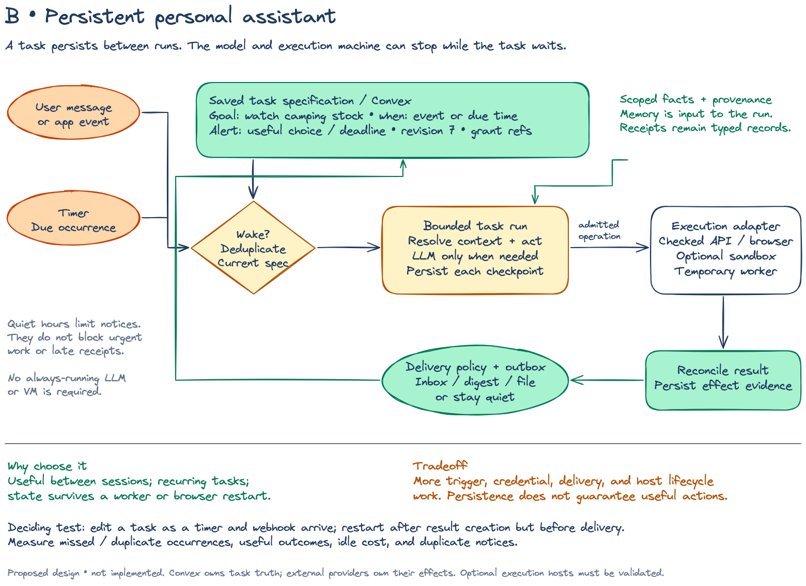

## 03 — C: Adaptive mission coordinator

Changes invalidate evidence or decisions, not automatically every completed step. Revalidation chooses reuse, selective repair, or a larger fallback. Multiple missions share a resource ledger, so a locally feasible repair must still pass shared constraints before new effects are admitted.

[Edit in Excalidraw](03-adaptive-coordinator.excalidraw) · [Full-resolution PNG](03-adaptive-coordinator.png) · [Full comparison](../../14-personal-agent-system-variations.md#c-adaptive-mission-coordinator)

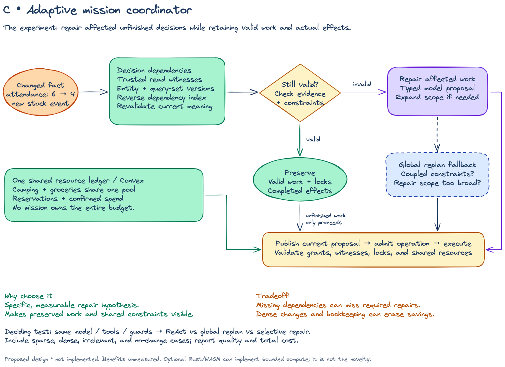

## 04 — D: Protocol-first concierge

The personal agent negotiates with a separate company agent, which acts through its own business backend. Missing user authority is requested explicitly. The drawing distinguishes a PAP-style operation example from a separate PACT adapter; neither protocol is presented as an automatic substitute for WebMCP.

[Edit in Excalidraw](04-protocol-concierge.excalidraw) · [Full-resolution PNG](04-protocol-concierge.png) · [Full comparison](../../14-personal-agent-system-variations.md#d-protocol-first-concierge)

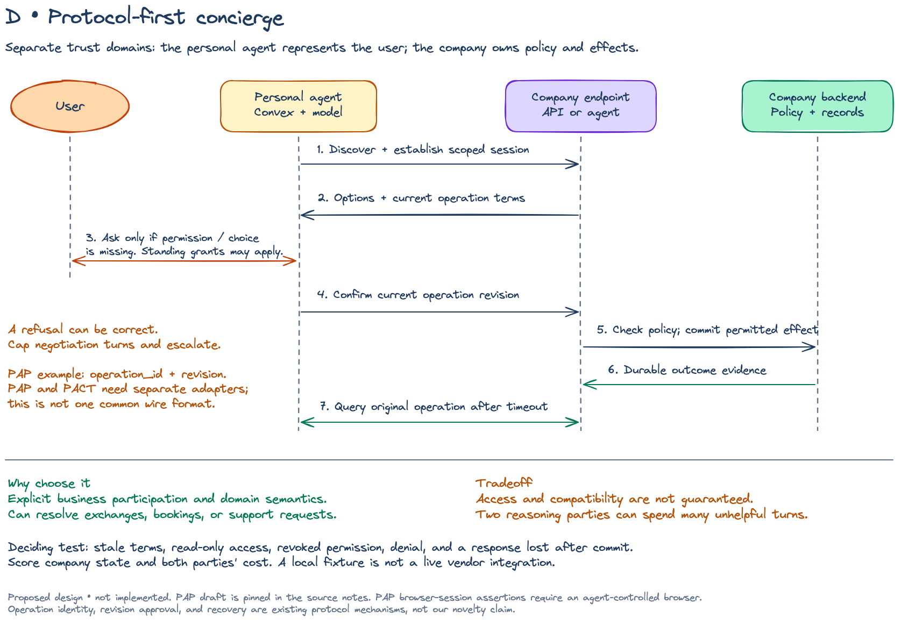

## 05 — E: Commerce specialist

Selection, fresh terms, shared purchase capacity, provider approval, merchant acceptance, and fulfillment are separate states. A changed quote returns through resource accounting before approval. An unknown checkout enters reconciliation instead of becoming a fresh duplicate purchase.

[Edit in Excalidraw](05-commerce-specialist.excalidraw) · [Full-resolution PNG](05-commerce-specialist.png) · [Full comparison](../../14-personal-agent-system-variations.md#e-commerce-specialist)

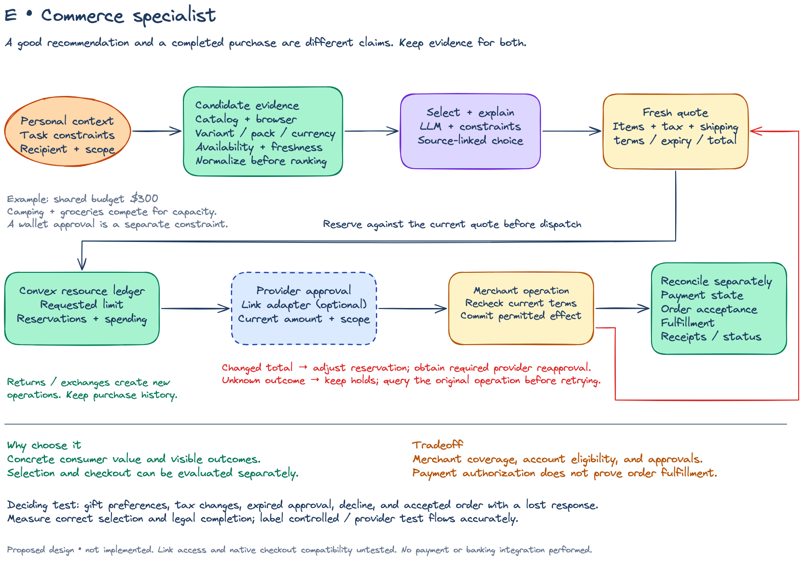

## 06 — F: Delegation and recovery platform

Other agents submit bounded missions through an API and receive durable status and evidence. Routing checks authority, support, and availability. Recovery can cross adapters only when operation identity and provider contracts make that safe; a different route does not erase an uncertain prior effect.

[Edit in Excalidraw](06-delegation-platform.excalidraw) · [Full-resolution PNG](06-delegation-platform.png) · [Full comparison](../../14-personal-agent-system-variations.md#f-delegation-and-recovery-platform)

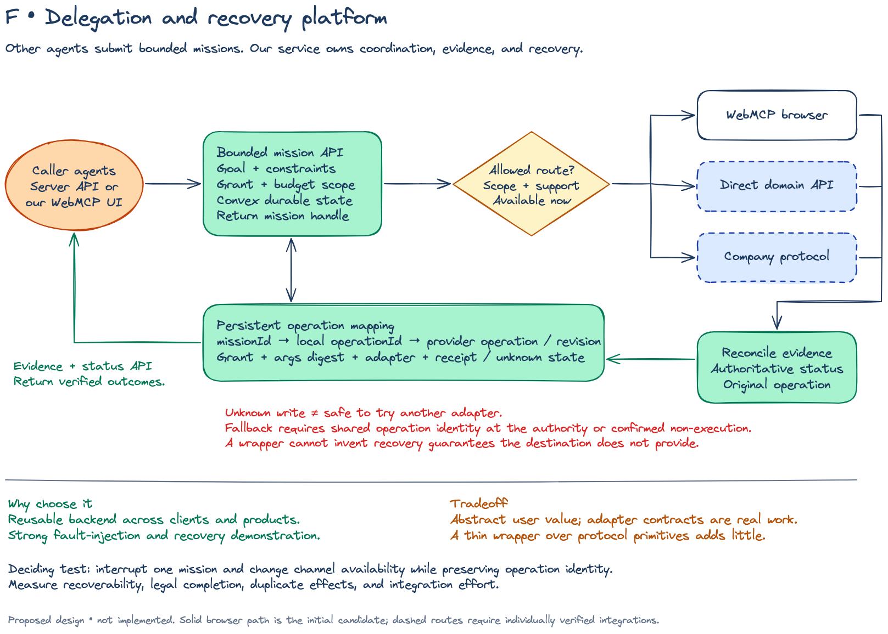

## 07 — Task lifecycles

The five lanes are **schematic paths, not an exhaustive state-transition specification**. A recurring task can remain active after a successful run. A changed plan can coexist with a completed purchase and an undelivered message. Late receipts remain admissible after cancellation; lease expiry is not proof that a remote operation did not execute.

[Edit in Excalidraw](07-task-lifecycles.excalidraw) · [Full-resolution PNG](07-task-lifecycles.png) · [State contracts](../../15-persistent-agent-runtime-design.md#3-task-run-effect-and-message-are-separate-state-machines)

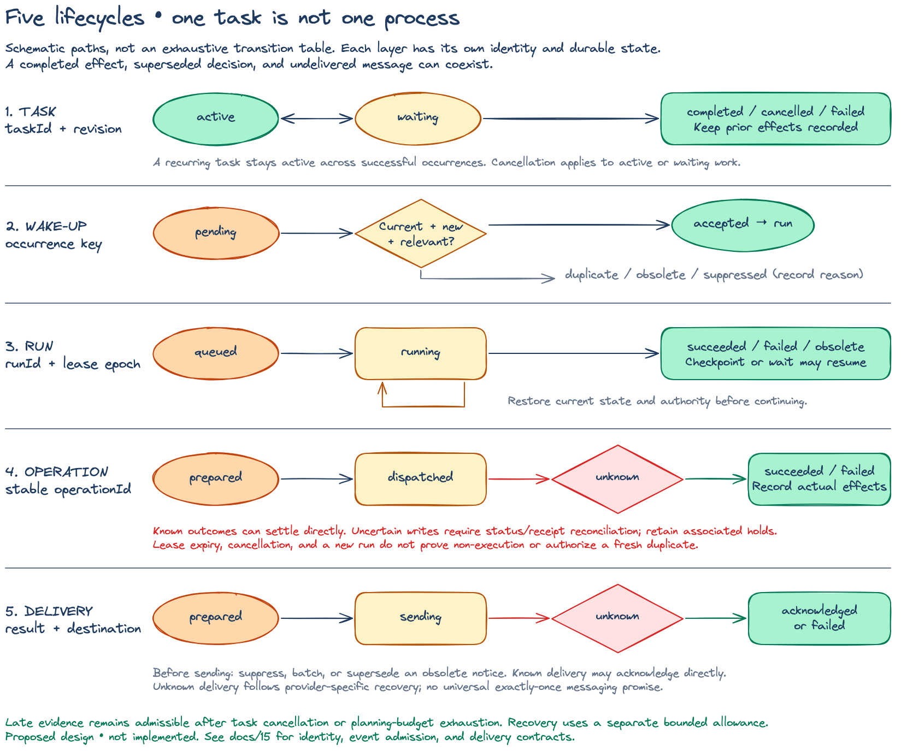

## 08 — Memory and context

Explicit corrections update scoped facts and invalidate derived context. A memory worker proposes evidence-backed changes; it cannot create a spending grant. Operational records remain separately authoritative, so rewriting a summary cannot erase an actual business effect.

[Edit in Excalidraw](08-memory-and-context.excalidraw) · [Full-resolution PNG](08-memory-and-context.png) · [Memory contracts](../../15-persistent-agent-runtime-design.md#5-memory-and-context)

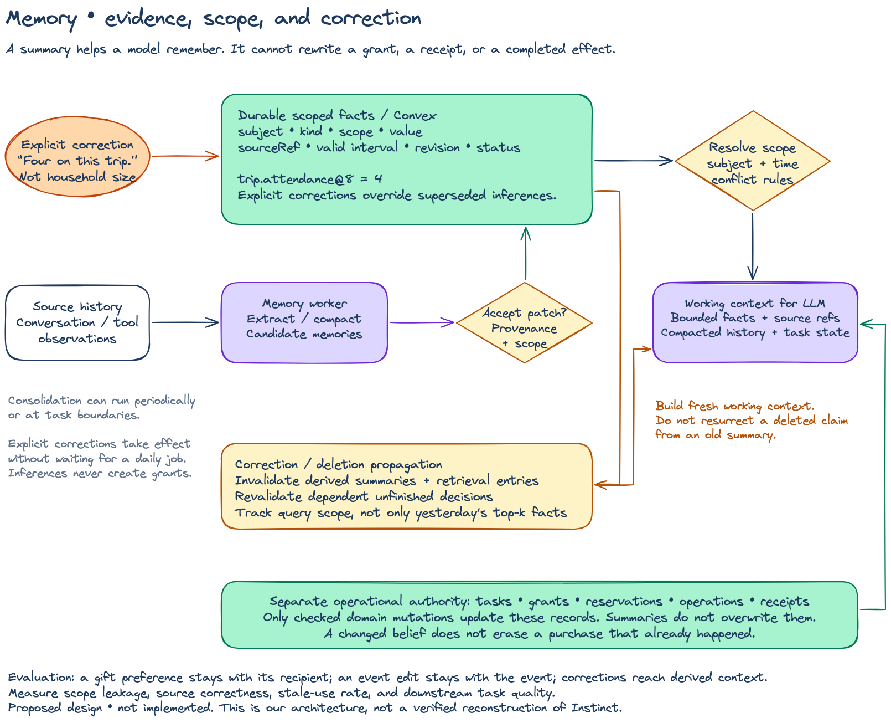

## 09 — Execution and authority

The Convex transaction admits local work and reserves capacity. The remote endpoint must enforce its own business conditions and operation identity. Receipt ingestion is a separate path that records late effects without granting new authority. Optional credential brokering supplies scoped capabilities to executors, not raw secrets to model context.

[Edit in Excalidraw](09-execution-and-authority.excalidraw) · [Full-resolution PNG](09-execution-and-authority.png) · [Language and integration boundaries](../../12-typescript-rust-convex-webmcp.md)

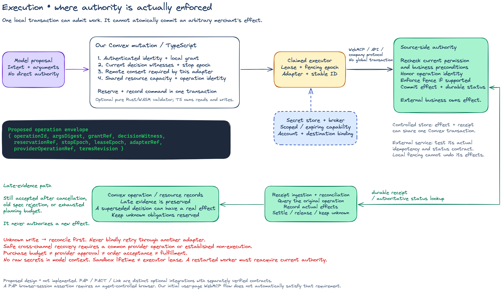

## 10 — Evaluation

Strong ReAct, structured global replanning, and incremental repair receive the same model, tools, observations, budgets, and platform safeguards. An independent checker assesses traces and authoritative outcomes. Hidden evaluation truth never enters planner context. Quality and unsafe effects are reported before efficiency, with failures and overhead included.

[Edit in Excalidraw](10-evaluation-design.excalidraw) · [Full-resolution PNG](10-evaluation-design.png) · [Evaluation protocol](../../06-evaluation-and-experiments.md)

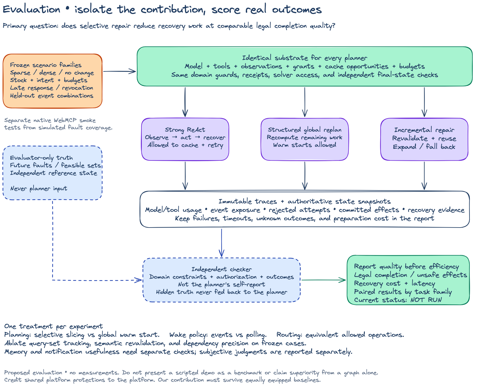

## Evidence and scope

These drawings synthesize [system variations](../../14-personal-agent-system-variations.md), [persistent runtime contracts](../../15-persistent-agent-runtime-design.md), and [TypeScript/Rust/Convex/WebMCP boundaries](../../12-typescript-rust-convex-webmcp.md). Consult those documents for details omitted from the boards. The [earlier mission-loop whiteboard](../README.md#original-mission-repair-loop) remains available for a more focused interactive execution discussion.

The source reviews distinguish public capabilities from our proposals: [Stripe and Sierra/PAP](../../research/personal-agents-commerce-and-protocols.md), [Decagon/PACT and Profound](../../research/personal-agents-harness-and-experience.md), and [social posts and the supplied architecture](../../research/personal-agents-social-and-reference-architecture.md). This atlas is not a reconstruction of any company's private implementation. Optional Link, PAP, PACT, and sandbox adapters still require their own access and contract validation.
