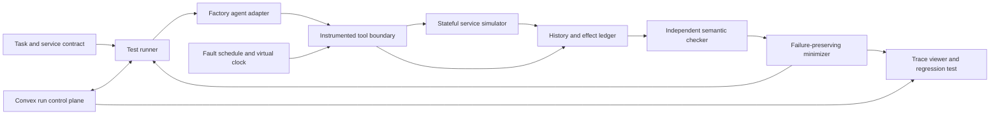

# Agent Crash Lab: Reproducible Failure Testing for Tool-Using Agents

**Status:** product and experiment proposal; no agent run, vulnerability discovery, benchmark result, or deployed protection is claimed.
**Evidence reviewed:** October 17, 2026. This is an additional product branch; the [personal-agent design](../README.md) remains intact.
**Navigation:** [experiment portfolio](../11-experiment-portfolio.md), [DataPatch](datapatch.md).

## 1. User, problem, and first product

The initial user is a developer shipping an agent that creates resources through tools and must recover after timeouts, restarts, or conflicting updates.
The agent's chat transcript can look sensible while a lost response leads it to create the same resource twice or report success without authoritative evidence.
The first product is a local test runner and trace viewer for a Python tool-using agent against one simulated preview-environment service.
Given an agent adapter, service contract, task, and fault schedule, it returns a reproducible history, independently checked violations, and a smaller failing schedule.
The concrete initial task is: create one preview environment for a named commit and report its verified URL without duplicating the intended resource.
Supported tool semantics include create, query outcome, read resource, and revoke a scoped grant; the service is controlled test infrastructure, not a live cloud account.
The output is a failing integration test plus evidence a developer can inspect, rather than an LLM opinion about whether the agent seemed safe.
The first release detects failures. A protective gateway is a separate optional mode with separately measured intervention and compatibility costs.

## 2. Technical hypothesis and attribution

The [historical project review](../13-past-cal-hacks-projects.md) provides two useful presentation references: Duck Duck Goose for inspectable execution and comparison machinery, and Unreal EngJam for a developer tool with a visible executable result. Crash Lab's corresponding artifact is a minimal failing test plus independently checked history, not only a trace visualization. These are design references, not evidence that our fault model works.

The hypothesis is that **contract-aware exploration and causal schedule minimization discover actionable agent recovery failures faster than equal-budget random fault injection**.
The model under test may be sophisticated or entirely scripted; the core scheduler and checker should work without another model.
The hard work is defining observable semantics, representing uncertainty honestly, generating valid concurrent histories, and preserving the same failure while shrinking a trace.
Fault injection, linearizability checking, and delta debugging are established techniques; this product does not claim to invent them.
The proposed value is applying them to the boundary between an agent's intent, tool attempts, uncertain outcomes, and the service's actual effects.
Keep three kinds of credit separate: the agent selected a safe recovery, the gateway prevented a bad request, or the service deduplicated it itself.
A service that deduplicates everything cannot by itself demonstrate that the agent learned robust recovery.

## 3. Architecture alternatives and recommendation

| Option | Useful evidence | Missing capability | When it wins |
|---|---|---|---|
| Prompt-only adversarial testing | Cheap narrative edge cases | No trustworthy external effect history | Early policy exploration |
| HTTP proxy with random faults | Tests a real adapter with low modeling cost | Limited control over commit boundaries and expected outcomes | Existing services with known contracts |
| Stateful simulator and deterministic scheduler | Explicit effects, valid interleavings, replay, small counterexamples | Fidelity depends on the model | Initial research product |
| Runtime protective gateway | Can block defined bad requests | Changes behavior and may lack service-side authority | Later prevention product |

Recommend the stateful simulator first, then validate a subset against a local reference HTTP service using the same contract.
Keep the gateway disabled in discovery mode so it does not hide the very failure being measured.
Use a small bounded scheduler rather than promise exhaustive exploration of an unbounded language-model system.

## 4. Simulator semantics before agent integration

The service state contains resources, grants and their revisions, request-key records, queued requests, effect receipts, and a simulated clock.
The executable contract defines which preconditions are checked at commit and which errors establish definite non-execution.
`create_preview(intentId, requestKey, commitHash, grant)` may create a resource; the contract explicitly states whether the endpoint supports idempotency.
`query_request(requestKey)` returns a committed receipt, definitive rejection, pending state, or unknown, according to the declared retention and consistency contract.
`get_preview(resourceId)` returns a versioned resource or documented absence; absence from a stale replica is not automatically definitive non-execution.
`revoke_grant(grantId, expectedRevision)` changes authority atomically in the controlled service; a completed earlier effect remains historical fact.
Run two separate endpoint profiles: one deduplicates a stable key with matching arguments, and one allows repeated creates and offers only the declared reconciliation evidence.
The second profile may require abstention when a lost result cannot be resolved; do not demand both guaranteed progress and guaranteed nonduplication when the interface cannot provide them.
Define idempotency-key scope, argument mismatch behavior, retention, and query guarantees explicitly; these properties cannot be inferred from the tool's JSON Schema.
AWS's description of retry-safe APIs illustrates why client request identity and atomic effect/key recording matter, and why identical arguments need not mean identical intent. [AWS Builders' Library](https://aws.amazon.com/builders-library/making-retries-safe-with-idempotent-APIs/)

## 5. Histories, linearization, and semantic checks

Each invocation records client, logical intent, attempt ID, request key, argument digest, call sequence, and relevant contract version.
Each response records return sequence, observed result, and classification: success, definite rejection, or uncertain transport outcome.
The simulator separately records commit events, grant changes, and authoritative effects; these oracle records are never shown to the agent unless exposed by a permitted tool.
Represent a timeout as an observation of uncertainty. Do not turn it into a definite failed service operation or an invented successful return.
For a linearizable endpoint, check whether completed operations and eligible completions of pending operations admit a legal sequential history preserving real-time precedence.
Do not require a linearization point to equal request arrival or response delivery; either would rule out legitimate concurrent behavior.
Use a reviewed executable sequential specification and a bounded checker; Porcupine is an established implementation that accepts a model and concurrent history. [Porcupine](https://github.com/anishathalye/porcupine)
Linearizability concerns the declared object boundary and its real-time operation ordering; it does not mean an entire cross-service agent task is transactional. [Jepsen model explanation](https://jepsen.io/consistency/models/linearizable)
A history can be linearizable while containing two legally created resources from two distinct request keys; the mission-level no-duplicate-intent invariant must detect that separately.
Additional invariants check truthful completion reports, scope-respecting calls, preservation of uncertain outcomes, and no new effect after a grant was revoked before its checked commit.
Check liveness only after the fault schedule permits a fair recovery window; an indefinitely unavailable service must not produce a false agent-failure label.
Return `pass_within_bound`, `violation`, `inconclusive`, or `checker_error`; timeout of the checker is not evidence that the agent passed.

## 6. Module and API contracts

These names are proposed application interfaces, not methods supplied by an agent SDK.
`ServiceSpec` contains state transitions, result semantics, effect identities, authority rules, consistency profile, and idempotency retention.
`Scenario` contains initial state, task, actor set, permitted fault sites, duration bound, and fairness conditions.
`FaultAction` identifies a semantic site and occurrence: delay request, drop before acceptance, commit then drop response, restart client, or deliver a stale read.
`HistoryEvent` contains monotonic local sequence, logical clock, actor, event type, parent operation, payload digest, and public/private visibility.
`Violation` contains invariant ID, minimal witness references, observed versus allowed behavior, confidence category, and whether a gateway intervened.
`ReplayManifest` pins service spec, agent config, dependency image, scenario seed, event schedule, and recorded model/tool observations.

| Interface | Purpose | Boundary |
|---|---|---|
| `start_run(manifest)` | Create isolated run | Immutable experiment configuration |
| `invoke(tool, arguments, attempt)` | Intercept an agent action | All effects must traverse instrumented boundary |
| `advance(scheduleAction)` | Deliver a permitted event | Respect causal prerequisites |
| `check(history, spec)` | Evaluate independent invariants | Agent cannot edit checker or oracle |
| `minimize(failureId, budget)` | Shrink schedule retaining witness | Re-execute and validate each accepted reduction |
| `export_regression(failureId)` | Save replayable test and trace | Disclose replay mode and scope |

Persist run metadata and histories append-only; an interrupted minimization run can resume from its last validated candidate without erasing the original witness.
Bound history length, actor count, pending requests, retained snapshots, and checker time; an expensive checker is part of the product's cost.

## 7. Non-linear incident and ambiguity

The agent requests a preview; the service creates resource P1, but the scheduler drops the response after the commit.
The agent times out and queries the request; a permitted stale read returns `unknown`, while a second actor revokes the grant.
One branch waits for stronger evidence; another retries the same key; a flawed branch invents a fresh key and asks for a second create.
In the idempotent profile, the original key can retrieve the existing outcome without authorizing a new effect; a new key is checked against current authority.
In the non-idempotent profile, retrying may duplicate the intended resource if still authorized; an unknown first result remains a real unresolved obligation.
The checker distinguishes the unsafe recovery attempt, an actually duplicated resource, and a rejection by the service or optional gateway.
A fresh-key retry can be a mission violation even when both individual calls satisfy the endpoint's sequential specification.
The minimizer removes an unrelated read, reduces delays, and drops unnecessary actor steps while preserving the same invariant and causal failure signature.
It must not replace a lost-result duplicate with a different easier bug merely because both runs are labeled failures.
The trace viewer shows what the agent knew at each decision separately from the private effect ledger, making the ambiguity visible rather than hindsight-obvious.

## 8. Exploration and reproducibility

Begin with a catalog of semantic fault sites and systematic one-fault schedules; add bounded pairs around read/commit/respond boundaries.
Compare this contract-aware enumeration with equal-budget seeded random schedules using the same available fault sites and severity distribution.
Partial-order reductions are optional later work; apply them only after showing the proposed independent events commute under the modeled contract.
Minimization uses deletion and parameter simplification under a replay budget; report a locally minimal witness under the tested reductions, not a globally shortest trace.
Separate **trace replay**, which freezes recorded agent decisions, from **live rerun**, which calls the model again under the same scenario and may diverge.
Trace replay establishes simulator and checker reproducibility; live repeated runs estimate how often the actual agent exhibits the failure.
Do not claim determinism of hosted model generation from a seed or temperature setting; record actual responses and configuration.
Use logical event positions and causal prerequisites instead of fragile wall-clock sleep values when defining replayable schedules.

## 9. Isolation, security, and optional prevention

Run only against owned simulators and explicitly authorized test endpoints; no live cloud provisioning or third-party disruption is needed for the core product.
The target agent receives fake credentials restricted to its run, visible tools, and task context; it does not receive the oracle ledger or fault schedule.
Disable unrestricted shell/network escape routes in the target-agent adapter, or instrument them as additional tools; otherwise the test does not cover all effects.
Keep custom adapter code and optional generated repair code in separate restricted workers, without host credentials or mounts from other runs.
Sandbox choice must match the threat model; stronger application-kernel isolation is available but brings compatibility costs. [gVisor](https://gvisor.dev/docs/)
An authorized security extension can inject a forged tool result requesting a broader grant, a cross-tenant resource ID, or an exfiltration action to a local sink.
Measure whether the agent attempts the forbidden action and whether the service enforces authorization; these are different findings.
The optional gateway can validate scope, request identity, and known uncertainty before dispatch, but cannot undo a remote commit or enforce idempotency the service lacks.
Report attempted violations, blocked attempts, escaped effects, and benign-task completion separately; a gateway that blocks everything is not useful protection.

## 10. Factory and Convex deployment and sponsor evidence

Use the current Python SDK to run the actual Droid agent under test, attach instrumented application tools, stream tool events, and record per-turn usage. A session has one active turn; separate sessions are needed for concurrent agents. [Factory Python SDK](https://docs.factory.com/sdk/python)
The SDK's in-process MCP support supplies a convenient boundary for simulated service calls; the test runner still owns faults, histories, and verdicts.
This is a runtime SDK integration, not merely asking a coding assistant to build a chaos-testing UI.
Deploy initially as a local Python runner with an isolated service process, an optional Go checker helper, and a browser trace viewer; no always-on cloud service is required.
Pin the installed CLI/SDK and available model, keep credentials in the agent worker, and verify that tool restrictions cover every path before accepting a test run.
For the hosted sponsor-target tier, recommend Convex for run control and shared review, with isolated Python run workers; the local runner remains a complete, simpler alternative.
Development and staging use reviewed fixtures; the demo tenant is resettable; production adoption starts with a customer's staging integration and an explicit service contract.
Factory evidence should show a real SDK execution, the intercepted tool boundary, a fault-triggered decision, the independent witness, and a generated regression artifact.
`[Factory] Best Use of the Factory Droid SDK` is a confirmed category; specific qualification remains unconfirmed. See [track strategy](../07-sponsor-track-strategy.md).
`[Armadin] Best Security Hack` is also confirmed, but ordinary retry testing is reliability work. Treat security alignment as conditional on a real authorized threat-boundary experiment and sponsor confirmation.

### Convex run control without contaminating the experiment

Use `scenarios`, `testRuns`, `runJobs`, `checkResults`, `reviewDecisions`, and scoped `grants` for metadata; keep immutable history chunks, replay manifests, and simulator snapshots in object storage behind access-controlled artifact references.
An authenticated `startRun` mutation freezes the manifest hash, reserves the run budget, creates a job, and schedules dispatch atomically. Worker delivery remains outside that transaction and needs application-level reconciliation. [Convex mutations](https://docs.convex.dev/functions/mutation-functions), [scheduling](https://docs.convex.dev/scheduling/scheduled-functions)
A claim mutation grants an attempt/lease/fence; signed or equivalent authenticated callbacks bind worker identity, run, attempt, and manifest hash, then enter an internal mutation to record accepted progress or completion. Never expose a deployment key to the target agent. [HTTP actions](https://docs.convex.dev/functions/http-actions)
After worker disconnection, reconcile its durable manifest before replacement. A repeated execution becomes a distinct recorded attempt with its own cost; duplicate callbacks cannot replace a newer accepted result. A lease is not exactly-once execution.
Keep the virtual clock, request ordering, private effect ledger, and fault injection inside the isolated run worker. Convex query timing and network latency must not become unintended fault inputs or privileged hints to the target agent.
Use reactive queries for a developer and reviewer to inspect the same accepted run status and artifact references. Preserve explicit progress records/cursors when event history matters; reactive snapshots alone are not a lossless trace. [Realtime](https://docs.convex.dev/realtime)
For sponsor proof, show a run launched in one client, reviewed in a second, interrupted and reconciled under the same frozen manifest, with an old-attempt callback rejected and the original witness preserved.
Apply the same Convex orchestration, authorization, and callback guards to all tested agents and search strategies. Report orchestration failures separately from simulated service faults; the control plane's protections are not agent-recovery achievements.

## 11. Optional WebMCP role

The core simulator is transport-independent and does not require WebMCP.
A later browser adapter can test a participating page's registered tools and inject navigation, registry replacement, or a disconnect after a service effect.
Current Chrome provides an evolving WebMCP API and local/origin-trial paths; the product must verify the intended browser, page, and origin rather than assume universal support. [Chrome WebMCP](https://developer.chrome.com/docs/ai/webmcp)
Use `document.modelContext` according to the current imperative documentation, and explicitly build the bridge between browser execution and the test runner. [Imperative API](https://developer.chrome.com/docs/ai/webmcp/imperative-api)
The browser closing does not roll back committed effects; a trace may end with an unknown outcome requiring service evidence.
Simulator success cannot establish arbitrary-site reliability, cross-origin access, or coverage of uninstrumented native browser actions.

## 12. Fair baselines and held-out evaluation

Separate **tester quality** from **agent quality**: the former compares fault-search methods against fixed targets, while the latter compares agents on the same frozen schedules.
For tester quality, compare B0 no faults, B1 seeded random injection, B2 systematic single-fault enumeration, and C contract-aware bounded exploration plus minimization.
Give B1, B2, and C the same semantic fault sites, simulator access, run limits, wall-time allowance, and target versions; C gains organization, not a private failure oracle.
For agent quality, include a scripted retry client, a scripted reconciliation client, and the same Droid agent with baseline versus proposed recovery instructions or runtime.
Every agent receives the same task, tools, state visibility, service profile, permissions, gateway configuration, and total model/tool budget within each comparison cell.
Cross gateway off/on and service idempotent/non-idempotent conditions explicitly; do not aggregate away the source of protection.
Use reviewed known-correct and deliberately faulty scripted clients to test checker false positives and sensitivity before judging a model.
Develop on one service/task family; reserve different task wording, service-contract variants, fault compositions, and independently reviewed agent mutants for final evaluation.
A proposed final matrix contains four held-out contract variants, six fault families, and three frozen scenario seeds: **72 scenarios per agent/configuration cell**.
This is a prospective bounded matrix, not an observed result or a claim that nearby scenarios are statistically independent.
Freeze manifests, correctness specifications, severity distribution, repetition count, model configuration, budgets, and scoring before opening the final set.
Keep fault schedules and effect oracles out of target-agent prompts; permit outcome evidence only through the same public tool contract.
Do not tune instructions after seeing final failures; fixes use development cases and are evaluated on a new untouched set or disclosed as post-hoc work.

## 13. Metrics, ablations, and decisive experiment

Tester metrics are distinct verified failure signatures found per fixed budget, time to first actionable witness, false-positive rate, and successful live reproduction rate.
Avoid counting many seeds of the same bug as many discoveries; deduplicate by invariant, affected recovery decision, and causal witness.
Minimizer metrics are retained failure identity, reduction in events and actors, replay cost, and fraction of witnesses a developer can turn into a regression test.
Agent metrics are actual duplicate effects, unsafe attempts, unsupported success claims, authorized task completion, safe unresolved outcomes, latency, and total usage.
Report uncertain or checker-timeout cases separately; compute uncertainty over independent target/task families and disclose the small number of families.
**Ablation A:** remove semantic targeting while retaining sites and budget; this isolates search strategy.
**Ablation B:** disable minimization; measure debugging usefulness and total cost, not agent safety improvement.
**Ablation C:** compare textual transcript judging with independent effect checks on labeled cases; this measures verdict reliability.
**Ablation D:** gateway off/on with identical agents and service semantics; this attributes prevention to the gateway rather than the model.
The decisive minimum experiment uses a reviewed correct client, a fresh-key retry mutant, and the same SDK agent against commit-then-drop-response schedules.
Require the checker to distinguish all three outcomes: safe reconciliation, definite duplicate effect, and unresolved outcome without false completion.
Then test whether contract-aware exploration reaches the mutant's witness faster than equal-budget random injection and whether minimization preserves it under replay.
If it cannot outperform a short hand-written regression suite on this narrow case, do not add multi-agent orchestration or a polished hosted dashboard yet.

## 14. Demo, milestones, and kill criteria

Demo step 1: show a fault-free preview creation, its tool transcript, and authoritative effect ledger.
Demo step 2: enable commit-then-drop-response and let the agent make a recovery decision; reveal only the evidence it legitimately saw.
Demo step 3: show the independent mission invariant, endpoint history check, and a smaller replayable counterexample if a real failure occurred.
Demo step 4: toggle the gateway or a reviewed fix, then label which layer prevented the effect and what completion cost it introduced.
Use a scripted mutant for a reliable live demonstration if needed, explicitly labeled; show real model failures only when actually observed and reproducible.
Milestone 1 delivers executable service semantics and hand-checked histories; milestone 2 delivers the SDK boundary and fault scheduler.
Milestone 3 delivers independent checks, replay, and minimization; milestone 4 delivers fair evaluation and a staging adapter for one consenting user.
Kill or narrow the project if service contracts cannot establish outcomes, simulator/reference behavior diverges materially, or the checker falsely condemns valid clients.
Stop claiming agent-specific value if all gains come from ordinary server idempotency or the gateway, and stop security framing if the evidence only concerns availability.
Open questions remain about real-user integration effort, model-run reproducibility, useful fault distributions, and the cost of maintaining service specifications.
All proposed interfaces, scenario counts, and product benefits require implementation and measurement; the linked sources establish components and concepts, not these results.
