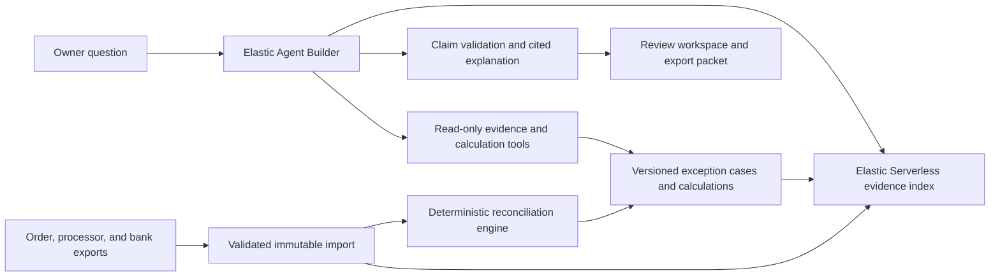

# CloseProof — explain reconciliation exceptions with verifiable evidence

Status: candidate product and proposed experiments, reviewed October 17, 2026. No integrations, deployments, reconciliations, user studies, or measured improvements have been completed.
Read with the [documentation index](../README.md), [experiment portfolio](../11-experiment-portfolio.md), and [evaluation principles](../06-evaluation-and-experiments.md).

## 1. Narrow user and problem

CloseProof serves the owner-operator of a small online store who reviews weekly orders, processor payouts, and bank deposits without a dedicated finance operations team.
The first question is concrete: “Why does this bank deposit differ from these orders, and which difference still needs investigation?”
Input is one store's order export, one payment processor's transaction and automatic-payout exports, and one bank statement export, all scoped to an explicit review cutoff.
The output is a read-only reconciliation workspace: supported matches, expected timing differences, genuine unexplained differences, and ambiguous cases with the missing evidence named.
The product does not post journal entries, amend books, initiate refunds, dispute payments, certify a close, or offer financial or legal advice.

The strongest objection is existing processor functionality. Stripe already provides payout reconciliation with itemized transactions and different reporting paths for automatic versus manual payouts. [Payout reconciliation report](https://docs.stripe.com/reports/payout-reconciliation).
The proposed wedge is cross-source exception investigation and a reusable evidence trail for a busy individual, not rediscovering that net payouts differ from gross sales.
If the same user's work is already solved by an export, exact joins, and a short checklist, retain that workflow; an agent must earn its additional complexity.

## 2. Exact product behavior

The [AgentOverflow and SecondSearch precedents](../13-past-cal-hacks-projects.md) reinforce an evidence-first interface: put the calculation and exact supporting records on the shortest review path. Their awards do not validate financial reconciliation or our proposed agent. Keep arithmetic, source completeness, and explanation correctness separately testable.

1. The user imports fixture exports and selects the merchant, review period, cutoff, reporting currency, and known settlement conventions.
2. CloseProof validates schemas, identifiers, currencies, and completeness declarations, then shows import errors before attempting reconciliation.
3. A deterministic engine joins explicit references, computes per-currency totals, and creates exception cases; uncertain candidate links remain visibly uncertain.
4. The user asks a natural-language question. An agent retrieves the relevant rows and policy documents, then explains the engine's calculation with clickable evidence.
5. Each claim shows its source row, source version, calculation, and observation cutoff. A claim without sufficient evidence is withheld or marked unresolved.
6. A later export updates affected cases. The workspace shows the prior explanation, new evidence, and reason the status changed.
7. The user can export a review packet and add annotations. These annotations never overwrite source data or silently turn an inferred match into financial truth.

The initial persona-specific memory contains explicit merchant mappings, chosen cutoff conventions, display preferences, and prior approved annotation patterns.
It must not learn “this processor is always correct,” treat a previous equal-amount match as a universal rule, or suppress future discrepancies because the owner dismissed an earlier alert.

## 3. Architecture alternatives and recommendation

| Alternative | Strength | Limitation or fair comparison |
|---|---|---|
| Processor report plus spreadsheet joins | Cheap, transparent, strong for explicit IDs | Mandatory baseline; may already solve the complete workflow |
| General RAG over uploaded exports | Fast conversational prototype | Retrieval similarity does not establish identity, completeness, or correct arithmetic |
| Deterministic reconciliation plus evidence-bound agent | Separates calculations from investigation and explanation | Recommended; agent value must appear in exception handling or reviewer effort |
| Fully autonomous finance operator | Broad actions across accounting systems | Changes risk and product scope before read-only correctness is established |

Keep original exports immutable in object storage and canonical records in a transactional database. Elasticsearch is a searchable read model, not the sole authority for exact balances.
For a first prototype, SQLite or Postgres can hold normalized records and calculation outputs; Convex is an alternative if shared live review and existing runtime reuse matter.
Store ingestion and index watermarks. A query over a stale or partial index cannot justify a claim that no corresponding payment exists.
Use batch recomputation initially; add dependency-based case invalidation only after measuring enough repeated investigation to justify it.

## 4. Canonical records and provenance

| Record | Required fields |
|---|---|
| Import manifest | Merchant, source kind, file hash, schema version, extraction time, declared coverage, row count, source totals where available |
| Order | Source/order ID, gross amount, currency, tax/shipping/discount fields if present, status, payment references, source row |
| Payment | Processor ID, order reference when supplied, charge/capture status, amount/currency, event time, source row |
| Balance entry | Entry ID, source object, signed gross, fee, net, currency, category, created/available times, payout reference |
| Payout | Payout ID, amount/currency, status, included-entry references, estimated arrival, source row |
| Bank entry | Account alias, bank transaction ID if present, signed amount/currency, posting/value date, reference, source row |
| Candidate link | Entity IDs, link rule, supporting evidence, conflicting candidates, accepted/rejected/ambiguous disposition |
| Case | Case ID, affected entities, state, cutoff, calculation version, input hashes, data coverage status, prior case version |
| Claim | Typed assertion, operands, result, evidence references, validity interval, case version, explanation text |

Every normalized field retains a path to the original file and row. Preserve original text alongside parsed values so a reviewer can inspect parsing errors.
Stable source identifiers deduplicate repeated imports. Same source ID with changed content creates a version or conflict; it must not silently add another transaction.
When IDs are absent, a row fingerprint can identify exact repeated rows but cannot prove two equal-looking real transactions are the same.
Separate source event time, effective/available date, bank posting date, and observed/import time. None is a substitute for the others.

## 5. Money and reconciliation rules

Use integer minor units per currency for stored amounts and exact decimal or rational representations for supplied exchange rates; never add unlike currencies.
Currency precision comes from a pinned supported-currency table. Reject an unsupported currency rather than treating every amount as two decimal places.
For a supported processor balance entry, check the documented signed relation `net = amount - fee`; aggregate only entries with the same currency and balance meaning. [Balance transaction fields](https://docs.stripe.com/api/balance_transactions/object).
Keep order totals, captured payments, processor balance entries, payout composition, and bank deposits as separate levels with explicit reconciliation equations.
Order gross may include tax, shipping, or discounts. Compare only equivalent definitions; missing component mappings create a data-quality case, not an automatic shortage.
For an automatic payout with authoritative membership, sum eligible net entries and compare with the payout amount. Then independently compare the payout with the bank posting.
Do not infer payout membership merely because an arbitrary subset of transactions sums to the right number. Multiple valid subsets create ambiguity.
Represent refunds, refund failures, reversals, disputes, fees, and adjustments as separate signed events with their source relationships; do not rewrite the original sale.
A refund request is not proof of completed customer reimbursement or a particular bank posting. Status and financial effect require their own evidence. [Refund lifecycle](https://docs.stripe.com/refunds).
For FX, retain source amount/currency, settlement amount/currency, supplied rate, rounding rule, and explicit conversion fee when available.
When no authoritative FX mapping or rate exists, abstain from proving a match. A current market quote cannot reconstruct the processor's historical settlement calculation.
Zero tolerance applies to exact same-currency equations after declared rounding. Any permitted rounding tolerance must be currency/rule-specific, predeclared, and visible in the result.

## 6. Timing, completeness, and status semantics

| State | Required meaning |
|---|---|
| `matched` | Supported links and equations hold at the stated cutoff; no unresolved relevant data gap |
| `expected_timing` | Evidence supports a known pending settlement or posting stage; this is not proof that arrival will occur |
| `unexplained_difference` | Comparable, sufficiently covered records disagree; no supported explanation closes the difference |
| `ambiguous_match` | Multiple plausible entity links remain and available evidence does not identify one |
| `data_gap` | Missing coverage, unknown schema, stale index, or absent essential reference prevents a defensible comparison |
| `unsupported` | The flow exceeds the implemented model, such as manual payout allocation or an unsupported FX arrangement |

Store a case's components separately: a payout can match the processor ledger while its bank posting remains pending, missing, or ambiguous.
Stripe's report uses estimated payout arrival for grouping, and bank posting and report availability can follow different timing. A missing row at one instant is not sufficient evidence of missing money. [Reporting timing](https://docs.stripe.com/reports/payout-reconciliation#payout-timing-and-report-availability).
Use a source- and merchant-specific expected-window policy only when provided and validated; do not invent a universal two-day or three-day grace period.
Once the expected window passes, escalate to investigation if coverage is sufficient. “Overdue” remains different from a proven lost payment or fraud claim.
If coverage is incomplete, preserve `data_gap` even if a heuristic explanation sounds plausible. Absence of evidence is not a balancing adjustment.

## 7. Agent tools and model responsibilities

`listCases(merchant, cutoff, states)` returns typed case summaries, versions, coverage flags, and pagination; merchant scope comes from authenticated context.
`getCase(caseId, version)` returns the exact entities, equations, competing links, and evidence requirements used to derive the state.
`getEvidence(evidenceIds)` returns bounded original rows plus source hashes; it enforces tenant access and does not trust an agent-supplied file path.
`searchEvidence(query, filters, watermark)` retrieves candidates with explicit index coverage and truncation markers; top-k results are never treated as exhaustive.
`calculate(ruleId, operandIds, cutoff)` executes a versioned deterministic rule, returning operands, result, currency, and rounding policy.
`proposeLink(entityIds, evidenceIds)` creates a suggestion for review or validation; it cannot change processor records or assert an unsupported match.
`renderClaim(claimSpec, caseVersion)` validates a typed claim against current calculation outputs before returning a user-facing explanation.

The model selects relevant tools, explains differences, asks for missing references, and compares plausible hypotheses. It does not perform final arithmetic or manufacture a missing transaction.
Claims use typed categories such as `sum_matches`, `fee_explains`, `pending_at_cutoff`, and `ambiguous_reference`; each has a deterministic evidence requirement.
Treat source descriptions and imported notes as untrusted data, including text that tells the agent to ignore discrepancies or reveal another merchant's files.
Unknown categories and malformed exports go to a review queue. A confident language-model interpretation cannot silently widen the supported accounting model.

## 8. A nonlinear example

The owner sees orders totaling 30,000 cents and a bank deposit of 17,300 cents, initially appearing to be a 12,700-cent shortfall.
Authoritative processor evidence shows 10,000 cents of captured sales not yet included in this payout, 2,000 cents of refunds in this payout, and 700 cents of fees.
For the documented included entries, `30,000 - 10,000 - 2,000 - 700 = 17,300`; the payout-to-bank link is supported by an explicit reference.
CloseProof can explain the aggregate while separately leaving two same-amount order-to-charge links ambiguous because their identifiers are missing.
The next import shows a refund failure and a corresponding +2,000-cent return entry assigned to a later payout. The old payout remains historically matched; the later case changes.
If that return entry is absent, the agent must not add an imaginary +2,000 balancing item. It identifies the missing evidence and preserves the unresolved state.
This scenario requires versioned evidence and stage-specific reasoning. It is not solved by declaring every numerical difference either fraud or a fee.

## 9. Elastic deployment and sponsor evidence

Deploy a private Elastic Serverless project with the required Agent Builder feature tier, evidence indices, a custom agent, and a restricted set of tools. Access and actual costs must be checked in the account. [Agent Builder setup](https://www.elastic.co/docs/explore-analyze/ai-features/agent-builder/get-started).
Parameterized ES|QL tools can expose repeatable evidence lookups with predictable tabular results. Use these for bounded retrieval; retain authoritative arithmetic in the tested calculation service. [ES|QL tools](https://www.elastic.co/docs/explore-analyze/ai-features/agent-builder/tools/esql-tools).
Give runtime principals only required Agent Builder and index-read privileges; use a separate ingestion principal. Permissions apply to feature access, indices, and Kibana spaces. [Access control](https://www.elastic.co/docs/explore-analyze/ai-features/agent-builder/permissions).
Use a dedicated per-merchant index or an equally verified isolation mechanism for the prototype. A tenant parameter in a prompt is not access control.
A small backend authenticates the user, serves read-only calculation/evidence tools, and invokes Agent Builder through supported programmatic access. [Programmatic interfaces](https://www.elastic.co/docs/explore-analyze/ai-features/agent-builder/programmatic-access).
The [current Cal Hacks page](https://cal-hacks-13-0.devpost.com/) lists an Elastic Agent Builder prize requiring a Serverless instance in its title, and a Hyphenate finance-autonomy category.
Elastic is a natural technical candidate if deployed Agent Builder actually investigates the evidence. Hyphenate remains a thematic candidate; required technology, eligible autonomy, and read-only qualification are unknown.
Proof would include the actual Serverless project, custom tools, bounded queries, a trace containing evidence IDs, and the verified review packet. A mocked conversation does not demonstrate this integration.
WebMCP is optional for a participating review workspace to expose `getCase` and `getEvidence`. The first workflow can use ordinary application APIs; browser tooling is not the reconciliation contribution.
Use synthetic or explicitly authorized de-identified exports. The prototype requires no production processor credentials and performs no bookkeeping writes.

## 10. Baselines that could beat the product

| System | Required implementation |
|---|---|
| B0: deterministic review workflow | Native report information, exact joins, fee/timing rules, exception list, and searchable evidence table |
| B1: strong general tool-using agent | Same model, data, calculation tools, search access, coverage markers, and budgets; tuned prompts and ability to abstain |
| P: evidence-bound CloseProof | Same capabilities plus typed claim validation, case lineage, and structured ambiguity handling |

All systems use the same import validation, tenant controls, source data, cutoff, currency rules, and deterministic calculator. Do not let B1 lose because it was forced to do arithmetic in prose.
Test claim validation as an explicit ablation rather than hiding it in infrastructure. Measure incorrect proposed claims separately from incorrect claims that reach the user.
H1: P reduces unsupported explanations; H2: it preserves useful coverage while abstaining on ambiguity; H3: it reduces actual human review effort beyond B0.
The first two hypotheses can use fixture evaluation. The third requires observed reviewer behavior and cannot be established by counting model tokens or simulating an accountant.

## 11. Domain-specific frozen evaluation

Build eight development merchant-week bundles, then 30 held-out bundles across six strata: exact matches, fee/refund effects, timing, ambiguous identity, FX, and incomplete or contradictory imports.
Each bundle contains raw exports, an as-of cutoff, independent ground-truth entity links, true financial events, source availability times, and questions whose answers may legitimately be unresolved.
Include five bundles per stratum, with combinations held out across merchant format, cutoff pattern, and transaction topology; varying names and values alone is insufficient.
Run B0 once per deterministic bundle, and B1/P for three trials each: `30 × (1 + 3 + 3) = 210 planned bundle executions`. This is not a measured result or the original shopping benchmark.
Repeat B0 only if its implementation has genuine stochastic behavior. Separate per-question scores from independent bundle counts when reporting uncertainty.
Freeze data hashes, model settings, tool schemas, prompts, cutoff rules, matching tolerances, question wording, budgets, and scoring logic before test execution.
Keep hidden links, missing-event truth, future imports, and valid answer paths outside the agent's context. A second author should review labels without using the product's matching code.
Use a separate temporal suite: deliver a new import at a shared semantic checkpoint after the initial case assessment, then test revised claims and preservation of historical explanations.
Manual payouts, multi-processor netting, unsupported currencies, and unusual funding flows should appear as declared out-of-domain rejection tests, not silently enter the supported accuracy denominator.

## 12. Concrete assertions and outcome metrics

| Case | Independent expected assertion |
|---|---|
| 10,000 gross, 300 fee, 9,700 bank deposit | Match only when references and payout membership support it; show exact 300 fee effect |
| Same deposit absent before known arrival window | Report the supported pending stage; do not declare a financial shortage or guaranteed future arrival |
| Two equal charges and one order without references | Preserve multiple candidates; no unique identity claim based only on amount |
| Partial refund followed by refund failure | Count distinct supported ledger effects once at their correct cutoffs; preserve original charge |
| EUR charge and USD settlement | Use supplied conversion evidence and declared rounding; otherwise return unsupported or data gap |
| Reimported source ID with changed amount | Version or flag conflict; never double-count as a second independent transaction |
| Missing final export page | Report incomplete coverage; absence from retrieved rows cannot establish absence from the account |
| Later import resolves a case | New case version cites new evidence; original explanation remains reproducible at its original cutoff |

Report match precision and recall, ambiguity preservation, false discrepancy alerts, missed real differences, and correct data-gap/timing classification separately.
For every displayed monetary claim, score exact arithmetic, correct currency, correct operands, relevant evidence, and whether the evidence entails the claim at that cutoff.
Measure useful answer coverage together with error rate; an agent that refuses everything must not win by having no unsupported assertions.
Report full bundle success, per-stratum results, model/tool cost, latency, and retrieval volume; never present row-level precision alone as close-level reliability.
Use paired comparisons by merchant-week and confidence intervals clustered by independent merchant or generator family when shared templates create dependence.
For reviewer effort, use a separate consented study with counterbalanced task order, comparable unseen bundles, completion time, correction count, and blinded accuracy scoring; do not fabricate a savings percentage.

## 13. Ablations and minimal decisive experiment

Ablate typed claim validation, ambiguity tracking, coverage/watermark checks, source-row citations, and case-version lineage one at a time; keep access control and calculator correctness intact.
Compare Elastic exact-filter retrieval with hybrid retrieval where narrative notes matter. Embeddings must earn retrieval value; they are unnecessary for a known transaction ID.
The smallest decisive prototype includes four complete bundles and two ambiguous/incomplete bundles, an exact-rule baseline, one agent, and an independent expected-claims file.
Require correct arithmetic and reproducible citations on complete bundles, plus explicit abstention where identity or coverage is insufficient, before building a polished conversational UI.
This development gate is not confirmatory evidence. Only the frozen held-out suite can support an accuracy claim; only actual reviewer observation can support a time-savings claim.

## 14. Demo, milestones, and kill criteria

A three-minute demo begins with the apparent 12,700-cent gap, opens the fee/refund/timing evidence, preserves an ambiguous order match, and revises one case after a new import.
Show the raw row behind one claim and the exact arithmetic behind another. End with the unresolved evidence request, demonstrating that a defensible partial answer is a product outcome.
Milestones are validated imports and calculator; independent labeled bundles; B0 review table; real Serverless Agent Builder tools; evidence-bound explanations; held-out comparison; reviewer study; demo refinement.
There is no assumed 36-hour development cap. Hackathon eligibility for earlier work remains governed by the event's rules and any organizer clarification.
Kill the agent-specific claim if it only paraphrases already-clear report totals, if false explanations remain common, or if abstention destroys coverage relative to B0.
Narrow the domain if source completeness cannot be established, FX dominates unsupported cases, or users need write-back before the read-only workflow creates value.
Do not claim generalized accounting accuracy, autonomous financial close, or financial recovery. The deliverable is a bounded, evidence-backed exception review assistant.

## 15. Sources and remaining checks

- [Stripe payout reconciliation](https://docs.stripe.com/reports/payout-reconciliation): establishes a strong existing baseline and automatic-payout scope; source export availability must be verified.
- [Stripe balance transactions](https://docs.stripe.com/api/balance_transactions/object) and [refunds](https://docs.stripe.com/refunds): inform supported fields and state distinctions; they are not a universal schema for other processors.
- [Elastic Agent Builder](https://www.elastic.co/docs/explore-analyze/ai-features/elastic-agent-builder), [setup](https://www.elastic.co/docs/explore-analyze/ai-features/agent-builder/get-started), and [ES|QL tools](https://www.elastic.co/docs/explore-analyze/ai-features/agent-builder/tools/esql-tools): support the proposed integration; actual tier, costs, model, and limits remain account checks.
- [Elastic permissions](https://www.elastic.co/docs/explore-analyze/ai-features/agent-builder/permissions): supports least-privilege deployment; tenant-isolation behavior still requires implementation tests.
- [Cal Hacks event](https://cal-hacks-13-0.devpost.com/): current candidate tracks, not confirmation of sponsor qualification; see [sponsor strategy](../07-sponsor-track-strategy.md).
