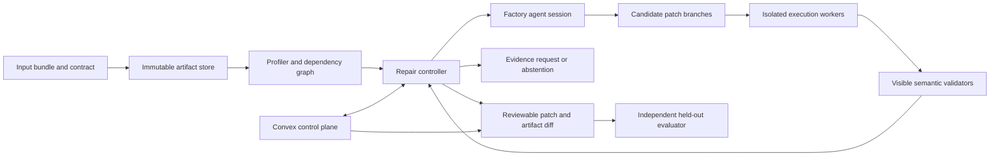

# DataPatch: Evidence-Guided Repair of Data Artifacts

**Status:** product and experiment proposal; no application, repair run, benchmark result, or deployment is claimed.
**Evidence reviewed:** October 17, 2026. This is an additional product branch, not a replacement for the [personal-agent design](../README.md).
**Navigation:** [experiment portfolio](../11-experiment-portfolio.md), [Agent Crash Lab](agent-crash-lab.md).

## 1. User, failure, and narrow promise

The initial user is an analyst maintaining a recurring operational report from several CSV or Parquet exports and a short Python transformation.
The report suddenly changes after a supplier modifies a field, switches units, repeats records, or changes a join key; the script may still exit successfully.
The user needs a reviewed repair candidate and an explanation of which evidence supports it, rather than a plausible new chart that silently changes the business definition.
The first product accepts an immutable input bundle, the existing transformation, a last accepted output, and an explicit data contract.
It returns a candidate transformation, rebuilt artifacts, a semantic diff, executable validation evidence, and unresolved questions.
It never overwrites the uploaded inputs and initially exports a reviewable patch rather than updating a production pipeline.
The initial supported pipeline has at most three input tables, a documented join, aggregation, and one tabular output; arbitrary notebooks and distributed ETL are later work.
This scope is a product hypothesis, not evidence that analysts will adopt it; interview users with actual historical incidents before expanding connectors.

## 2. What would make this technically different?

The hypothesis is that **explicit artifact dependencies and bounded competing repairs improve semantic correctness per unit of computation**, compared with the same coding agent working on the same incident directly.
The runtime preserves input identities, separates observations from assumptions, and re-executes the affected descendants of a candidate change.
It can compare two repairs that both pass a visible test, discover a discriminating observation, and abstain if the data cannot establish which interpretation is correct.
The contribution is the orchestration and evidence discipline around an existing agent, not a new language model or an invented data-validation technique.
Neither successful execution nor matching last week's totals proves that the new output is correct: genuine business changes must remain possible.
An advantage caused only by giving DataPatch better tests, more context, a safer sandbox, or extra model calls would not establish the hypothesis.

## 3. Architecture alternatives

| Option | Strength | Limitation | Appropriate use |
|---|---|---|---|
| Ordinary coding-agent repair | Minimal integration; strong baseline for local code defects | May fix the symptom without retaining semantic alternatives | Known exception with a precise test |
| Validation rules and manual correction | Predictable checks; no model cost | Cannot choose an undocumented meaning or synthesize a novel fix | Stable schemas with recurring known drift |
| Whole-pipeline candidate search | Broad exploration; easy baseline | Repeats unaffected work and can spend budget on unrelated edits | Small pipelines or badly localized incidents |
| Artifact-local repair with bounded branches | Makes competing interpretations and affected outputs inspectable | Requires explicit dependencies and reliable validators | Recurring reports with sparse drift |

Recommend the fourth option, but ship a direct coding-agent mode beside it and retain it if the more complex controller does not improve the evaluation.
Start with a declared artifact graph and instrumented supported operators; do not claim automatic precise lineage for arbitrary Python.
A node whose reads cannot be determined conservatively invalidates the entire downstream pipeline; opaque code is not permission to reuse stale output.

## 4. Modules and concrete contracts

All interfaces below are proposed application contracts, not Factory SDK methods.
`Bundle` contains owner, bundle ID, immutable file hashes, schema snapshots, transformation hash, contract version, and allowed output paths.
`ArtifactNode` contains node ID, parent IDs, code hash, input hashes, operator kind, declared reads, environment hash, and output hashes.
`Observation` contains measurement, affected columns/keys, source artifact hash, query or validator identity, and a distinction between measured and asserted evidence.
`SemanticContract` declares key identity, units, null policy, expected join cardinality, aggregation meaning, allowed tolerances, and who supplied each assertion.
`RepairCandidate` contains parent candidate, patch hash, affected-node set, hypothesis, assumptions, expected semantic changes, and evidence references.
`ValidationReport` contains validator version, candidate hash, check outcomes, counterexample references, execution cost, and unresolved dimensions.
`Disposition` is one of `candidate_ready`, `needs_evidence`, `rejected`, or `budget_exhausted`; no model-generated field can assert authoritative correctness.

| Interface | Input → output | Enforced boundary |
|---|---|---|
| `profile(bundleId, artifactId)` | Immutable artifact → schema, counts, distributions | Read-only, bounded scans |
| `inspect_rows(artifactId, predicate, limit)` | Validated query → redacted evidence | Owner scope and row limit |
| `branch_patch(baseHash, patch)` | Proposed edit → isolated candidate ID | Editable transformation allowlist |
| `run_candidate(candidateId, targetNodes)` | Candidate → output hashes and execution trace | No input or evaluator writes |
| `validate(candidateId, suiteId)` | Candidate → visible checks | Frozen public suite only |
| `request_evidence(question, alternatives)` | Concrete ambiguity → owner response or pending state | Response becomes versioned evidence |
| `export_candidate(candidateId)` | Accepted review candidate → patch and manifest | No implicit production publication |

Cache keys include inputs, code, dependencies, contract, environment, and validator versions; a previous pass under a different contract is not reusable proof.
Commit the exported manifest against the expected bundle and contract hashes; if either changed during a model call, revalidate or reject that candidate.
A local transactional metadata store plus content-addressed files remains the simpler offline alternative; for the sponsor-target product, recommend a hosted Convex control plane with separate Python workers.

## 5. Model and deterministic responsibilities

The model proposes fault hypotheses, transformation patches, discriminating queries, and a short explanation of why an ambiguity matters.
It can select `inspect`, `branch`, `run`, `compare`, `ask`, or `stop` within the available budget; it need not traverse a fixed linear repair pipeline.
Code enforces artifact identity, file scope, process limits, typed contract fields, dependency invalidation, check execution, and export eligibility.
Statistical drift is a signal for inspection, not a hard semantic rule unless the owner explicitly made it one.
Unit conversion requires a supplied unit declaration or independently verifiable metadata; inferring cents from a value distribution alone remains an assumption.
Deduplication requires a record identity and duplicate policy; two identical rows can represent two legitimate events.
Join validity includes multiplicity and unmatched rows, not just syntactic key compatibility.
For example, pandas offers join-cardinality validation but permits many-to-many joins without uniqueness checks; null keys also have behavior that differs from usual SQL joins. These are explicit test cases, not automatic business semantics. [pandas merge](https://pandas.pydata.org/docs/reference/api/pandas.merge.html)
Reusable schema libraries can enforce declared types, required columns, and checks; they cannot supply an undocumented business definition. [Pandera schemas](https://pandera.readthedocs.io/en/stable/dataframe_schemas.html)

## 6. A non-linear incident, including an unresolved branch

An analyst uploads a weekly shipping-cost report whose total rose sharply after a carrier changed its export.
The profiler observes a new `amount_minor` field and repeated order IDs; the report's currency contract says the final amount is in USD.
The model proposes both a unit-conversion repair and a deduplication repair; neither is automatically selected.
A visible metadata file confirms that `amount_minor` is cents, so the controller accepts a conversion candidate and rebuilds affected artifacts.
The report still overcounts; a join diagnostic shows two carrier rows for one shipment, and a second branch tests a shipment-level join.
Some rows represent legitimate partial shipments. Blindly keeping the first row improves the total but violates the documented shipment identity.
The controller rejects that candidate, preserves the evidence, and asks whether a newly introduced adjustment record is additive or replacement data.
If the owner cannot provide that definition, the product exports the confirmed unit repair with the remaining output clearly unresolved, or abstains from offering a final report.
If a corrected contract arrives, only candidates depending on that definition are revalidated; a simultaneously uploaded new input version makes old export manifests stale.
The demo must show both an accepted semantic correction and a justified unresolved case, rather than engineering every incident to end in a green badge.

## 7. Isolated execution and data boundaries

Treat transformation code, input text, filenames, and model output as untrusted. A spreadsheet cell containing instructions is data, not policy.
The control plane owns immutable inputs and validators; an execution worker receives read-only data and a writable temporary output directory.
Do not mount the host home directory, credentials, Docker socket, evaluator source, hidden data, or another customer's artifacts.
Disable network access in candidate execution; the separate agent process has only the egress needed for its configured model service and approved tools.
Use fixed package images, CPU/memory/disk/process/time limits, archive expansion limits, and output-size caps; an unbounded dataframe join is a resource failure.
An ordinary container is a useful packaging boundary, not a claim that hostile code cannot escape; a hosted untrusted-code tier should evaluate gVisor or a dedicated VM boundary.
gVisor introduces a distinct application-kernel isolation layer with compatibility and performance tradeoffs, which must be tested against the chosen data stack. [gVisor architecture](https://gvisor.dev/docs/)
For a local prototype using team-authored transformations, state that limited trust model explicitly instead of advertising hardened multi-tenant execution.
Redact sensitive samples before model submission, expose the actual data-transfer policy, and retain only the minimum artifacts needed for review and reproducibility.

## 8. Convex and Factory integration and deployment

The current Python SDK runs a local Droid subprocess and exposes persistent `Session` turns through `stream()`; it supports structured outputs, tool restrictions, permission handlers, and in-process MCP tools. Python 3.10+, an installed Droid CLI, and authentication are required. [Factory Python SDK](https://docs.factory.com/sdk/python)
Use that SDK inside a dedicated Python agent worker, with application tools for artifact inspection, branch creation, validation, and export preparation.
The controller, rather than a shell prompt, owns candidate IDs, hashes, evaluation access, and publication state; a generic command wrapper alone would not demonstrate this integration.
Keep the agent worker separate from code-execution workers so uploaded code never inherits the Factory credential.
Pin the SDK, CLI, model identifier, package image, prompts, and public validator suite; record actual model/tool usage and cap aggregate branch cost.
Build the sponsor-target version as a React review UI, Convex control plane, object storage, and separately deployed agent/execution workers; keep the local-only mode as an explicit alternative.
Development uses synthetic data; staging uses frozen fixtures; a demo tenant has resettable bundles; production requires explicit retention and data-sharing policies.
On restart, reload immutable candidates and reports, then resume only unresolved work; never rerun a production publication as a side effect of reopening an agent session.
Show sponsor proof as an actual SDK session trace, selected application tools, candidate artifacts, structured disposition, and measured usage—not a logo or development-only invocation.
`[Factory] Best Use of the Factory Droid SDK` is a confirmed track name; this product is a candidate, and detailed qualification remains to be confirmed in the [track strategy](../07-sponsor-track-strategy.md).
Armadin alignment is conditional: data correctness alone is not a security result. A separate authorized malicious-input or sandbox-boundary experiment would be necessary to support that framing.

### Convex control-plane contract and proof

Store `incidents` (owner, current bundle/contract revisions), `candidates` (parent, patch hash, dependency witnesses, review status), `executionJobs` (candidate, attempt, lease, fence, outcome), `validationRuns` (suite version, candidate hash, verdict/artifact references), and `grants` (principal, incident scope, permitted actions, expiry/revocation).
Store bulk datasets, transformed files, and verbose traces as immutable objects with hashes and access-controlled references; do not put every row or full trace into reactive documents.
`requestRepair` authenticates the user, checks the incident grant, inserts the job, and schedules a bounded dispatcher in one mutation. Convex supports transactional mutations and atomic scheduling from a mutation; the subsequent external worker request is a separate operation. [Mutations](https://docs.convex.dev/functions/mutation-functions), [scheduling](https://docs.convex.dev/scheduling/scheduled-functions)
The dispatcher passes a stable job ID to the Python service; a claim mutation assigns an attempt and lease. Python/Factory and candidate execution remain external processes, not native Convex Python functions.
Worker callbacks enter an HTTP action that verifies a short-lived credential bound to worker, job, and attempt before invoking an internal mutation. Recheck tenant scope, grant, attempt/fence, artifact hashes, and terminal-state compatibility there; a caller-supplied owner ID is not authentication. [HTTP actions](https://docs.convex.dev/functions/http-actions)
`publishCandidate` atomically compares the current incident bundle/contract revisions, candidate hash, required validation records, and reviewer authority before changing the selected export manifest. Database transaction isolation does not automatically reject assumptions from an earlier model call; these comparisons are application logic.
On lease expiry, reconcile the worker's durable completion manifest and immutable output hashes before issuing replacement work. Duplicate callbacks are idempotent; late results remain attributable to their original attempt and cannot silently publish over a newer candidate.
If worker outcome cannot be recovered, mark it unknown and allow an explicitly tracked rerun of this isolated computation; charge its extra cost. This is not an exactly-once execution guarantee, and production publication remains a separate authorized step.
Both analyst and reviewer subscribe to owner-scoped incident/candidate queries. Convex reactive queries update those views, while explicit job records and scheduled work drive processing; a subscription is not a durable event log. [Realtime](https://docs.convex.dev/realtime)
The integration demonstration uses two authenticated clients: one changes the semantic contract while the other reviews an old candidate; stale publication is rejected, both views show the new state, and reconnecting a worker reconciles its existing job without losing evidence.
Capture the mutation/job IDs, stale-publication rejection, callback reconciliation, and both client views as Convex proof, alongside the Factory session trace. Use the same control-plane protections for every evaluation arm so infrastructure safety is not credited to the repair method.

## 9. Optional WebMCP surface

WebMCP is unnecessary for the first repair engine: local files and an authenticated upload API suffice.
A participating data-dashboard page could later expose `export_snapshot`, `describe_dataset`, and `open_candidate_preview` tools to a browser agent.
That integration still needs an explicit browser host and origin permissions; the SDK's MCP tools do not automatically become WebMCP tools.
Current Chrome documentation uses `document.modelContext` for the imperative API; browser support and tool discovery must be checked on the actual demo machine. [WebMCP imperative API](https://developer.chrome.com/docs/ai/webmcp/imperative-api)
Do not promise access to arbitrary dashboards, background browser execution after closure, or website session transfer into the Python worker.

## 10. Fair baselines and frozen held-out protocol

**B0:** existing transformation plus declared validators, with no repair; this measures detection coverage and establishes how many incidents actually require an agent.
**B1:** the same Factory coding agent directly repairs the transformation with the same data, documentation, visible tests, tools, execution environment, and total budget.
**B2:** the same agent may generate competing whole-pipeline candidates and select using the same visible validator feedback; this is the strong search baseline.
**D:** DataPatch changes candidate localization, dependency reuse, and ambiguity handling; it receives no privileged oracle, additional rule, hidden test, or free inspection call.
Expose the same artifact/branch tools to B1 and B2. If the direct agent learns to use them effectively, that is a legitimate baseline success.
Count planning, branch generation, failed attempts, profile scans, validation runs, human questions, and any auxiliary-model calls in each arm's budget.
Separate an artifact-runtime comparison using shared static profiling from an end-to-end comparison that includes profiling overhead.
Freeze public inputs, contracts, prompts, versioned dependencies, candidate limits, seeds, and scoring before opening the final set.
Use distinct base pipelines for development and evaluation, not random rows from the same template; near-duplicate transformations belong in the same split.
A proposed final set is **48 incidents from eight unseen base pipelines**, with six reviewed variants per pipeline: schema, units, duplicate identity, join multiplicity, null/key semantics, and ambiguity.
Keep a separate development set; pilot its variance to set the final repetition count before running the held-out set. The number 48 is a proposed design, not a completed sample.
Some incidents contain compound drift; include clean but genuinely changed business outputs so restoring old totals is penalized when incorrect.
An independent evaluator owns expected outputs, row-level semantic checks, untouched regression fixtures, and ambiguity labels; none are mounted in agent workers.
All arms receive the same public validator feedback during repair. Hidden tests run only on each arm's frozen final candidate, without feedback-driven retries.
Owner answers, when allowed, come from the same frozen evidence bundle with equal question limits; unavailable definitions are unavailable to every arm.
Keep model runs paired by incident and repetition, randomize arm order, and report uncertainty clustered by base pipeline; eight templates limit generalization.

## 11. Metrics and ablations

The primary measure is **fully correct repair rate at a fixed total budget on resolvable incidents**, requiring all independent semantic and regression checks to pass.
Separately report false acceptance, correct abstention on underdetermined incidents, and unnecessary abstention on resolvable ones; never count every refusal as a success.
Report quality versus budget and coverage versus error, rather than hiding the tradeoff in one weighted score.
Secondary measures are unaffected-artifact regressions, time to reviewed candidate, model cost, CPU time, bytes rescanned, questions asked, and invalidated work recomputed.
Classify failures by missing evidence, wrong interpretation, incorrect code, stale artifact reuse, resource exhaustion, and evaluator/infrastructure failure.
**Ablation A:** recompute every artifact while retaining the same repair controller; this isolates caching and dependency reuse.
**Ablation B:** remove branch comparison while retaining validation and budget; this tests whether competing interpretations help.
**Ablation C:** remove localization but retain candidate count and evidence access; this tests the proposed orchestration advantage over broad editing.
**Ablation D:** remove explicit assumption tracking without weakening the common export rules; measure whether ambiguity handling improves decisions.
Do not claim universal correctness, automatic lineage discovery, or superiority to coding agents unless the comparison supports the scoped statement.

## 12. Decisive minimum experiment

Before building connectors, use a small development pilot with twelve independently reviewed incidents across at least three pipelines, including ambiguous and clean-change controls.
Run B1, B2, and D with the same pinned agent, visible evidence, candidate cap, and aggregate budget; have the external evaluator score final artifacts.
The key observation is whether D solves semantic cases that the strong baseline misses, or matches correctness with materially less repair work, without more false acceptance.
If every advantage disappears when B2 receives the same validators and branch tools, keep those tools but abandon the claim that a specialized controller is needed.
If the evaluator cannot distinguish a legitimate business change from corruption, improve the task definition before collecting model results.

## 13. Demonstration, milestones, and stop conditions

Demo step 1: upload the shipping bundle and show that the original script executes while producing an incorrect report.
Demo step 2: inspect a competing pair of repairs, the exact evidence that rejects one, and the artifacts each candidate changes.
Demo step 3: reveal the unresolved adjustment semantics, provide a documented answer, then export the versioned patch and semantic diff.
Demo step 4: show held-out evaluation and total costs only if actually measured; otherwise label the comparison panel as an experiment plan.
Milestone 1 delivers immutable bundles, one supported pipeline graph, and a manually verified semantic evaluator.
Milestone 2 delivers the SDK tool integration, isolated candidate execution, evidence requests, and review exports.
Milestone 3 delivers fair baseline runs, ablations, and a frozen held-out protocol; milestone 4 pilots a real recurring workflow with user consent.
Stop expanding if artifact instrumentation costs more than repairing the incident, users cannot supply meaningful contracts, or the strong coding baseline consistently matches the method more simply.
Stop publication on missing semantic evidence; stop the hosted tier on unproven isolation; neither condition requires discarding the local review tool.

## 14. Open risks and evidence boundaries

The main unresolved questions are whether users possess usable semantic contracts, whether sparse drift is common enough, and whether selective repair wins after instrumentation overhead.
Current SDK compatibility, account model access, deployed worker cleanup, and sandbox package support remain implementation checks; reading documentation does not verify them.
Schema tooling, sandboxing, branch search, and caching are existing engineering techniques; the proposed product combination has not been established as novel or effective.
Primary references above support specific platform behavior. The architecture, incident counts, interfaces, milestones, and claimed research opportunity are our proposals.
