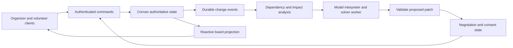

# LiveOps: Partial Repair for Volunteer and Room Coordination

Status: **candidate experiment, not a product pivot or a completed implementation**.
Prepared on **2026-10-17, America/Los_Angeles**; technical sources below were checked on this date.
Return to the [experiment portfolio](../11-experiment-portfolio.md) or [documentation index](../README.md).
This document preserves the personal-agent direction while testing whether a bounded coordination problem exposes its runtime value more clearly.
No deployment, volunteer outreach, experiment, or external message was performed to prepare this specification.

## 1. User, problem, and initial boundary

The initial user is a volunteer coordinator running a one-day campus workshop with eight volunteers, three rooms, and six sessions.
They need to preserve a workable event after someone withdraws, attendance changes, or a room becomes unavailable.
The current hypothesis is that a shared board reveals the disruption but leaves the coordinator to reason through its consequences and obtain agreement.
That hypothesis needs interviews and observed tasks; it is not established market demand.
The product should answer: which commitments can stay, what must change, whose agreement is missing, and what is actually confirmed?

Start with one venue, a fixed session list, explicit skill tags, known room capacities/equipment, and declared volunteer availability.
Model setup/teardown time and travel between rooms; two adjacent calendar blocks are not automatically compatible assignments.
Do not initially optimize ticket sales, staffing contracts, emergency response, venue booking, or anonymous crowd dispatch.
The organizer can authorize internal planning and room allocation, but cannot consent to a new shift on another volunteer's behalf.
Persistent mission authority permits in-scope revalidation and proposed repairs without another organizer approval after each event.
Required volunteer consent is a domain condition, not a generic approval dialog added to every model output.

## 2. Claim worth testing

**Hypothesis:** dependency-guided partial repair can restore valid, consented coverage with fewer unnecessary changes than full replanning, without reducing coverage or hiding unresolved work.
The user-facing result is a confirmed arrangement plus clearly identified gaps, not an attractive schedule that silently assumes acceptance.
The technical challenge combines resource constraints, negotiated commitments, concurrent updates, and preservation of completed or locked work.
The novelty claim is deliberately limited: scheduling, event boards, negotiation, and incremental repair already exist.
This candidate succeeds only if the integrated behavior saves coordinator effort compared with strong scheduling and board baselines.

## 3. Architecture alternatives

| Alternative | Strength | Limitation to test |
|---|---|---|
| Shared board with conflict rules | Cheap, inspectable, useful without AI | Coordinator still searches and negotiates repairs |
| Full deterministic reoptimization | Strong feasible baseline with a clear objective | Can reconsider more variables than needed; churn can be penalized |
| LLM rewrites the entire roster | Handles natural-language constraints | Must still pass deterministic checks and obtain consent |
| Dependency-guided solver with an agent interface | Preserves boundaries and tracks negotiations | More state and implementation cost; benefit is not assumed |

Recommend the fourth architecture for the experiment, with the second as its main competitor.
Use the same solver, objective, tie-breaking, commit checks, and consent rules in both; change only repair scope and associated context work.
For the bounded problem, a CP-SAT service is practical to investigate; Google's [employee scheduling example](https://developers.google.com/optimization/scheduling/employee_scheduling) demonstrates the underlying assignment approach, not this product's effectiveness.

The board is a projection, not authority: dragging an assignment submits a command with an expected revision.
A stale client cannot create a valid assignment merely by displaying it; server state decides whether a command commits.
Convex [reactive queries](https://docs.convex.dev/realtime) support the shared view, while the application defines business dependencies and acceptance rules.

## 4. State and ownership contracts

| Record | Required content and invariant |
|---|---|
| `eventMission` | Owner, venue timezone, objective, allowed planning scope, `planningAttemptId`, `stopEpoch` |
| `session` | Interval, required roles, attendee demand, accessibility/equipment requirements, lock state |
| `volunteer` | Identity, verified skill claims, declared availability, workload limit, private preferences |
| `room` | Capacity, equipment, availability intervals, source and revision |
| `assignment` | Session-role-volunteer-room binding, `nodeRevision`, status, consent and dependency references |
| `proposal` | Patch, affected nodes, snapshot witnesses, solver status, objective vector, expiry |
| `negotiation` | Offer version, participants, exact terms digest, responses, deadline, committed outcome |
| `eventLog` | Idempotent command ID, principal, change type, affected resources, sequence |
| `notificationDraft` | Recipient, channel, exact content, purpose, authorization reference, delivery status |

Availability is declared evidence; it is not agreement to every possible shift in that interval.
Separate tentative offers, participant acceptance, committed assignments, check-in, and completed work.
Use half-open time intervals in UTC and retain the venue timezone for display and local input interpretation.
Keep private availability reasons out of the public board; expose only the constraint needed for coordination.
Do not infer qualifications from an LLM's impression of a biography; unverified skill evidence remains unverified.

## 5. Modules and command contracts

| Module/API | Input | Output and checks |
|---|---|---|
| `recordAvailability` | Actor identity, interval patch, expected revision, command ID | New revision and impact event; self-edit or explicit delegated scope |
| `changeRoom` | Room revision and capacity/equipment/availability delta | Organizer-authorized change; affected reservations identified |
| `requestRepair` | Mission, affected resources, existing planning grant | Durable repair job; coalesces redundant state changes |
| `solvePatch` | Immutable snapshot, frozen boundary, objective, budget | Candidate assignments, unresolved gaps, solver status; no database writes |
| `publishProposal` | Attempt ID, node revisions, dependency witnesses, stop epoch | Current proposal or typed stale/conflict rejection |
| `respondToOffer` | Participant, offer version, accept/reject/withdraw, command ID | Idempotent response; only current exact terms can be accepted |
| `commitNegotiation` | Offer ID and expected terms | Atomic assignment swap only if every required condition still holds |
| `dispatchNotification` | Approved draft and explicit send grant | Separate external delivery attempt and receipt; disabled in the first prototype |

Trace actual solver inputs and collection dependencies, including the eligible volunteer set and compatible room set.
A newly available qualified volunteer can change the feasible repair even if no current assignment changed.
Validate `planningAttemptId` at proposal admission, individual `nodeRevision` values at replacement, and `stopEpoch` for cancelled missions.
One update must not invalidate unrelated accepted assignments through a user-global revision counter.
Store change events and schedule processing in the same mutation; Convex documents this atomicity for [scheduled functions](https://docs.convex.dev/scheduling/scheduled-functions).
Begin repair with reverse dependencies, then include shared role, room, equipment, and volunteer constraints in the affected closure.
Freeze compatible accepted assignments as the first boundary; if that subproblem is infeasible, expand the boundary and negotiate any changed terms.
Retain completed work as history, and expose invalidated future commitments as `at risk` until they are repaired or explicitly released.
Count expansion/full reoptimization in the trace; a small local search is not evidence of a globally optimal schedule.

## 6. Negotiation and concurrent behavior

An offer moves through `draft`, `offered`, and then `committed`, `rejected`, `expired`, or `superseded`; participant responses are separate records.
For a two-person swap, one acceptance is partial progress, not confirmation of either replacement assignment.
Keep the old feasible arrangement until the replacement commits; if the old arrangement is already invalid, expose its coverage gap explicitly.
Any tentative capacity hold must have a declared expiry and must not be displayed as final coverage.
When two accepted offers compete for one room/volunteer interval, a transaction admits at most one compatible set.
The losing offer receives a conflict outcome and can be repaired; do not silently reinterpret a participant's acceptance as acceptance of new terms.
A withdrawal before commit invalidates the corresponding consent; after commit it creates a new disruption rather than erasing the historical agreement.
Duplicate responses return the recorded outcome, and an expired or superseded offer cannot revive a commitment.
Convex [OCC and atomicity](https://docs.convex.dev/database/advanced/occ) support transactional checks; they do not validate the assumptions of an earlier model or solver run.
Publish and commit must re-read the relevant revisions, capacity, consent, and authority inside the transaction.

No email, Slack message, SMS, or push is sent merely because the model drafted a repair.
The initial version keeps offers in the app and lets the coordinator explicitly choose any external communication.
A later send grant must identify recipients, channel, purpose, and limits; message retries require delivery-aware deduplication.
Changing a participant or shift beyond accepted terms requires new consent even when the organizer's planning mission remains active.

## 7. Model versus deterministic responsibilities

The model interprets a coordinator's message, proposes structured constraints, and explains a candidate repair with references to actual changes.
It may identify an ambiguity such as “I can help after lunch,” but must not invent the start time or mark the person available.
The solver enforces role coverage, qualifications, availability, room capacity/equipment, setup intervals, workload, locks, and required consent.
The verifier independently recomputes those conditions from current state and checks the patch boundary.
The objective is lexicographic: minimize uncovered required role-minutes, then changes to valid commitments, then preference/workload costs.
Never trade an unauthorized assignment for a better weighted score; authority and compatibility are validity gates.
Allow an honest infeasible/unknown result when constraints conflict or the solver times out; retain the last known valid commitments.
If a rule-based form and deterministic solver match the agent's results and usability, remove the model from the critical path.

## 8. Nonlinear scenario for the prototype

Start with two simultaneous workshops and a later plenary; only two volunteers have the required AV skill.
Room A holds 40 attendees and has AV; Room B holds 25 with AV; Room C holds 50 but lacks installed AV.
A registration change raises one workshop from 24 to 35 people, making its current Room B assignment infeasible.
Moving it to Room A displaces another session; moving it to Room C requires the portable AV kit and a setup-qualified volunteer.
One AV volunteer then withdraws, while the other is already committed to the plenary setup window.
The solver proposes a room/session adjustment and a two-person duty swap, preserving a locked check-in assignment.
While one volunteer accepts, another client submits a competing offer for the same setup-qualified volunteer.
The second participant withdraws before the first swap commits; an old solver response arrives afterward.
Expected result: no double booking, no fabricated acceptance, no stale overwrite, and a repaired proposal or explicit unresolved coverage gap.
The interaction matters: changing only a room label or independently filling each empty cell cannot solve the coupled constraints.

## 9. Deployment and sponsor evidence

Deploy a React/TypeScript UI to Vercel and authoritative state/functions to Convex; the [official deployment guide](https://docs.convex.dev/production/hosting/vercel) covers that hosting pairing.
Run OR-Tools in a small authenticated Python container service; it returns proposals and never commits assignments directly.
Keep the model key and worker credentials server-side; enforce event membership through [authenticated Convex functions](https://docs.convex.dev/auth/functions-auth).
Use separate development and demonstration datasets, a repeatable reset, server timestamps, and a deployment manifest with code/model/solver/schema versions.
The current [Cal Hacks Devpost page](https://cal-hacks-13-0.devpost.com/) lists **[Convex] Best use of Convex**; LiveOps is a candidate fit, with detailed eligibility still unconfirmed.
Meaningful evidence would be two authenticated clients, a transactional contested acceptance, a stale proposal rejection, and a durable repair after refresh.
Capture a production URL, exact backend deployment, sanitized event trace, solver request, and before/after assignment IDs.
Use a model sponsor only with actual API calls and recorded model IDs; a static explanation is not evidence of an integration.
WebMCP is optional: expose the owned coordination page's query/proposal commands to an authorized personal agent using the [current browser API](https://developer.chrome.com/docs/ai/webmcp/imperative-api).
Native application commands are sufficient for the experiment; WebMCP does not provide volunteer consent, assignment transactions, or external messaging authority.

## 10. Frozen evaluation design

Create a domain-specific suite; do not reuse a shopping case count, benchmark name, or success definition.
Use 12 development scenarios, then freeze 48 held-out scenarios: eight per family across absence, room loss, demand growth, skill scarcity, competing consent, and compound disruptions.
Each case contains initial state, hidden event schedule, simulated participant response policy, feasible reference outcomes, and scoring code.
Hold out event combinations and venue/skill configurations, not merely paraphrases of prompts used in development.
Before the scored run, hash the fixtures, seeds, policy, solver limits, metric definitions, and configuration; do not tune on failed held-out cases.
For small cases, enumerate or solve to proven optimality for a reference; label timeout cases without presenting a best-known solution as optimal.
Participant simulation tests runtime behavior, not whether real volunteers will agree; conduct a separate consented usability study later.
Release the same exogenous events to every system, using the same virtual clock and action-latency accounting.
Provide identical observation/authority access and charge every solver call, model call, retry, and validation pass.

| Baseline | Purpose |
|---|---|
| Board plus deterministic conflict warnings | Measures value beyond shared visibility; human timing is a separate study |
| Full CP-SAT reoptimization with preservation penalties | Main strong algorithmic comparator |
| Full LLM-assisted proposal with the same verifier/solver | Tests context/repair strategy without weaker commit rules |
| Dependency-guided partial solve with expansion fallback | Proposed system |

All automated baselines use identical commit transactions, consent states, objectives, and model settings where applicable.
Partial repair expands when the boundary is infeasible; count expansion and full fallback costs rather than hiding them.
Report paired per-scenario differences and uncertainty across repeated model runs; do not treat events within one scenario as independent samples.

## 11. Domain scoring, metrics, and ablations

A newly committed assignment must satisfy current capacity, timing, skill, consent, lock, and authorization rules.
An external withdrawal can invalidate an earlier legitimate commitment; score the resulting coverage gap and recovery, not the historical commit as an agent violation.
Report invalid-commit and unauthorized-send counts separately; aggregate coverage cannot compensate for them.
Primary quality is uncovered required role-minutes in the schedule after each repair window; recovery latency is reported separately.
Also report final valid coverage, time to recover feasible coverage, changed valid commitments, offers per successful repair, and participant response burden.
Track solver/model latency, total compute/API cost, stale proposals rejected, negotiation conflicts, and preserved assignment fraction.
Measure board staleness separately from backend correctness; a fast animation does not establish fast valid repair.
Ablate dependency indexing, preservation penalties, structured interpretation, and partial-scope expansion one at a time.
Use unsafe “no commit validation” only as a labeled fault-injection diagnostic, never as the headline baseline.
Compare skill/room collection dependencies against entity-only witnesses to expose missed newly feasible alternatives.

## 12. Minimum decisive experiment and demo

First implement six development cases around the compound scenario, with two browser clients and deterministic participant scripts.
Compare partial and full solver runs before adding a language model or polished board.
Provisional continuation gate: zero invalid commits; equal feasible coverage; at least 25% less median solver work or end-to-end repair latency, with no extra changes to valid commitments.
Treat that threshold as a product decision rule, not a discovered scientific boundary; freeze it before measurements.
Choose the primary efficiency measure before comparing systems; do not select whichever metric improves after seeing results.
If both algorithms are already effectively instantaneous at this scale, test coordinator interaction burden rather than claiming a useful compute win.
Demo 0:00–0:35 shows the confirmed roster and its constraints; 0:35–1:10 introduces demand/room trouble; 1:10–1:50 shows the proposed partial repair and required consent.
Demo 1:50–2:25 races acceptance with withdrawal and a stale solver response; 2:25–3:00 ends on verified coverage and an explicit gap if needed.
Label scripted people and injected latency; show one actual transactional outcome and the current backend projection.

## 13. Milestones and kill criteria

1. Validate the coordinator problem with observed repair tasks; reject a scenario invented only to fit the runtime.
2. Build authoritative assignments, consent states, and contested-acceptance tests before the model interface.
3. Add full reoptimization, then partial repair, then the six-case decisive comparison.
4. Add language interpretation only if it reduces measured input/clarification effort.
5. Freeze and run the held-out suite; deploy only after the behavior is understood.

Stop or narrow the candidate if a board with warnings solves observed work just as well, consent overhead dominates any saved effort, or meaningful scale requires unattainable organizational integration.
Kill the “autonomous coordinator” claim if the system cannot distinguish proposals from accepted assignments or cannot survive withdrawal races.
Retain useful runtime findings in the personal-agent branch even if LiveOps is not selected.
