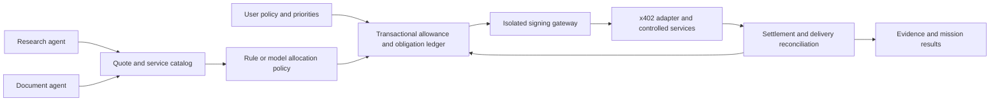

# SpendRail — a shared purchasing boundary for personal agents

Status: candidate product and proposed experiments, reviewed October 17, 2026. No application, wallet, deployment, payment, or evaluation has been created or run by this document.
Read with the [documentation index](../README.md), [experiment portfolio](../11-experiment-portfolio.md), and [common evaluation principles](../06-evaluation-and-experiments.md).

## 1. Product thesis and the strongest objection

SpendRail lets one person give two agents a shared, bounded allowance for paid digital services, then see which purchases were authorized, paid, delivered, or remain unresolved.
The first user is a developer running a research agent and a document-processing agent for the same project; both may buy extraction or data-enrichment calls from controlled test services.
The problem is not displaying a wallet balance. Concurrent requests, changing priorities, and lost responses make that balance insufficient to decide what can safely be bought next.
The proposed product is a purchasing coordinator with a personal policy, persistent obligations, and service-level evidence; the payment protocol is one adapter.

**Existing functionality is substantial:** Coinbase's current TypeScript client already supports per-payment and cumulative limits, network restrictions, reservation before payment, and retention of reservations for ambiguous outcomes. A budget-cap wrapper is therefore not a credible differentiation. [Client configuration](https://docs.cdp.coinbase.com/x402/buyer/client-configuration).
The narrow hypothesis is that shared mission allocation and recovery of the purchased result improve task completion over that existing client plus a simple central queue.
If a fixed-rule queue achieves the same useful work, safety, and recovery cost, ship that simpler product or abandon the agent-specific claim.

## 2. Exact first experience

1. The user creates two missions, sets one test-token allowance, chooses a priority, and permits a small allowlist of service, asset, and network combinations.
2. Both agents obtain explicit quotes; the workspace shows the price, fee responsibility, result contract, and mission that benefits from each proposed call.
3. The coordinator reserves the complete bounded liability before the isolated signer can create a payment authorization.
4. A competing request can wait, select a cheaper acceptable service, or ask for a changed allowance; it cannot consume the first request's unresolved hold.
5. The user sees separate payment and service statuses. A lost HTTP response appears as unresolved rather than automatically failed or delivered.
6. Reconciliation recovers the original receipt or result when possible. The agent resumes the affected mission without silently buying the same result again.
7. A final report links each completed mission step to its purchase, amount, settlement evidence, delivered artifact, and policy version.

The initial service catalog contains two extraction tiers and one enrichment service with known output schemas. It excludes open-ended merchant discovery, transfers to arbitrary addresses, subscriptions, trading, and automatic refunds.
All demonstrations use controlled services and test assets; the user experience must label these clearly. No real-money operation is needed to evaluate the thesis.

## 3. Architecture alternatives

| Alternative | Strength | Limitation or decisive comparison |
|---|---|---|
| Native x402 client controls per agent | Small integration; existing payment limits and lifecycle hooks | First inspect actual SDK persistence and concurrency semantics; do not invent an unsupported deficiency |
| One shared deterministic payment gateway | Central allowance, FIFO or priority queue, persistent recovery | Strong recommended starting point and mandatory baseline |
| Shared gateway plus mission-aware decision policy | Can trade service quality, urgency, and remaining work across missions | Worth retaining only if measured completion improves after model and coordination cost |
| General autonomous wallet platform | Broad service and asset support | Expands custody, protocol, and pricing questions before this product proves value |

Recommend the shared deterministic gateway first, with a replaceable decision module. Keep payment correctness independent of whether allocation is rule-based or model-assisted.

Use Convex as the recommended sponsor-target authoritative ledger: a mutation admits the reservation and writes its outbox command atomically; a server worker performs signing/network work and submits an idempotent evidence callback mutation.
External signing and network calls do not run inside retryable database transactions. A local transactional database remains a development alternative for the mechanics harness.
Elasticsearch is optional for searching traces at scale, not a required financial ledger or a substitute for atomic reservation.

## 4. Keep four meanings separate

| Meaning | Evidence and state | What it does not establish |
|---|---|---|
| User permission | Versioned grant permitting specified expenditure | Money reserved, signature created, or service obtained |
| Internal reservation | Atomic hold against the shared allowance | Funds escrowed onchain or a merchant promise |
| Payment authorization and settlement | Signed instrument, then adapter-verified settlement evidence | Useful service output was produced or delivered |
| Service fulfillment | Result receipt, content hash, schema validation, and retrieval | That a charge settled or that the result is factually useful |

Coinbase documents an x402 sequence in which verification precedes service work, and settlement follows that work. Model work production, settlement, and response delivery independently; do not impose an imaginary universal order. [How x402 works](https://docs.cdp.coinbase.com/x402/how-it-works).
Use separate fields: `authorizationState`, `settlementState`, `serviceState`, and `missionDisposition`. Avoid a single `success` boolean.
Settlement states include `not_submitted`, `pending`, `confirmed`, `definitively_failed`, and `unknown`; service states include `not_started`, `produced`, `delivered`, `invalid`, and `unknown`.
Cancellation stops future dispatch. It does not prove an existing signature is unusable, undo a settlement, or establish a refund.

## 5. Minimal data model

| Record | Required fields |
|---|---|
| Allowance | Owner, asset identifier, network, integer limit, spent amount, active liabilities, period, revision, overcommitted flag |
| Grant | Allowed services/payees, asset/network, per-operation cap, fee ceiling, expiry, revision, explicit approval source |
| Mission | Owner, priority, deadline, accepted result contract, remaining steps, references to obligations |
| Quote | Service, resource/request digest, quoted units, price, fee responsibility, expiry, adapter version, quote digest |
| Purchase intent | Stable logical purchase ID, mission ID, request digest, quote digest, expected result schema, disposition |
| Reservation | Purchase ID, asset-specific maximum liability, grant revision, lifecycle, reason for retention or release |
| Payment attempt | Attempt ID, authorization digest/reference, nonce reference where applicable, signer policy version, settlement evidence |
| Service receipt | Purchase/request digest, producer, result reference and hash, production time, retrieval evidence, validation result |
| Event | Event ID, entity revisions, causation ID, observed time, source time, prior/new state, evidence references |

Never store private keys, wallet secrets, full usable payment signatures, or API secrets in model context or ordinary traces. Store protected references and safe digests instead.
Raw payment evidence belongs in an access-controlled store; the UI exposes only the fields necessary to explain a purchase.

## 6. Amounts, fees, and concurrent admission

Represent amounts as integer atomic units with explicit asset and network identifiers; use decimal strings at JSON boundaries and integer arithmetic internally.
Token display decimals are metadata, not permission to use floating-point arithmetic. Reject unknown precision, incompatible assets, negative charges, and arithmetic overflow.
For each budgeted asset, compute `available = limit - confirmedSpend - unresolvedMaximumLiability - unsignedReservations` without double-counting the same obligation.
Admission atomically checks the current grant, allowance, quote, and idempotency record before adding a reservation. Two independent reads followed by writes are insufficient.
Example fixture: a 100,000-unit limit cannot admit concurrent all-in liabilities of 70,000 and 60,000. At most one can be admitted until something changes.
If the user lowers the limit below existing obligations, show negative availability and overcommitment, deny new reservations or increases, and preserve historical authorized spending.
Separate merchant price, buyer-paid network costs, facilitator costs paid by another party, and application service fees. Do not automatically charge the buyer for every ecosystem fee.
If fees are paid in another asset, maintain a separate bounded pool or explicitly record third-party sponsorship. The first version rejects unbounded or unknown buyer fee liability.
Fee schedules and who pays depend on the selected adapter and service contract; pin these assumptions in the fixture and verify them in protocol smoke tests. [CDP facilitator](https://docs.cdp.coinbase.com/x402/seller/facilitator).
Reserve the maximum authorized amount; on final evidence, move the actual amount to confirmed spend and release only the definitively unused remainder.
Use an isolated test wallet controlled exclusively by this gateway. An externally spendable wallet requires independent balance monitoring and can invalidate assumptions about available funds.

## 7. Contracts and the signing boundary

`getQuote(serviceId, requestDigest)` returns a bounded price, expiry, accepted network/asset, fee contract, and service-result contract; an untrusted quote cannot expand a grant.
`proposePurchase(missionId, logicalPurchaseId, quoteDigest)` is advisory. It contains no signature and cannot itself change wallet state.
`reservePurchase(intent, expectedRevisions)` returns an obligation ID or a typed rejection such as `stale_quote`, `budget_exhausted`, or `grant_revoked`.
`authorizePurchase(obligationId)` is callable only by the gateway. It checks current relevant policy immediately before signing and durably records signing intent first.
Signing and a database write cannot be one transaction. A crash in that gap creates `authorization_unknown`; retain liability and reconcile rather than blindly signing again.
Use signer-supported request idempotency where available and verify its actual contract. Otherwise retain the same durable authorization parameters and fail closed when prior signing cannot be established.
`reconcilePurchase(logicalPurchaseId)` returns separately sourced settlement and service observations; a timeout or a missing search result is not proof of non-payment.
`getResult(logicalPurchaseId)` retrieves the existing artifact without another payable business operation only for a permitted requester whose settlement or other entitlement is verified by the service; produced-but-unpaid output is not automatically accessible.
`cancelUndispatchedPurchase` releases only a reservation proven not to have issued a usable authorization. An unknown or already authorized purchase remains an obligation.

The LLM never receives signing credentials or an arbitrary signing tool. It sees redacted quotes, mission utility, remaining allowance, unresolved liabilities, and machine-readable denial reasons.
The signer permits only the chosen test network, token, payees, bounded amounts, and supported scheme. It rejects mainnet independently of any UI setting.
Quote expiry, grant revocation, and policy changes affect future authorizations. Previously issued instruments require scheme-specific expiry or revocation evidence; application cancellation alone is insufficient.

## 8. Idempotency and service-level recovery

Keep `logicalPurchaseId` stable across transport retries; create an `attemptId` per network attempt. Same logical ID with a different request digest must be rejected.
The controlled service persists a deduplication record and original result. Retrying an accepted request retrieves that result or its status rather than running the business effect again.
A payment nonce or replay rule is not application-level exactly-once service execution. x402 does not by itself prevent two different authorizations from buying the same logical result.
Do not issue a replacement authorization while the original can still settle unless the user explicitly authorizes the additional worst-case liability and duplicate outcome risk.
Receipt ingestion is idempotent. A late confirmed settlement updates spending even when its mission was cancelled or superseded; it must not restart cancelled downstream work.
After an authorization expires, allow release only under an adapter-defined terminality policy that rules out earlier settlement and accounts for observation lag; local wall-clock expiry alone is insufficient.
Service output validation checks schema, request binding, and artifact integrity. It does not imply the data is correct; mission-specific quality checks are separate.

## 9. A nonlinear failure that earns the product

The research agent reserves 60,000 units for extraction; the document agent proposes 50,000 against the same 100,000-unit allowance and must wait or revise.
Extraction is produced and payment settles, but the final HTTP response is lost. The workspace has an unresolved payment and an unavailable result, not 60,000 newly spendable units.
The user then cancels research and lowers the allowance to 40,000. A naive retry or automatic hold release would enable another purchase and hide the old obligation.
SpendRail keeps the unknown hold, marks the pool overcommitted, and records the late settlement. Retrieval recovers the already-produced result without a second payable request.
The cancelled mission remains cancelled; the user may explicitly reuse its artifact for the document mission. Cross-mission reuse requires a compatible result contract and permitted data scope.
Once the ledger reflects 60,000 confirmed spending, no new purchase fits the reduced limit. The correct outcome is a clear blocked plan, not an invented successful reallocation.

## 10. Model role and personalization

The model may choose `use_free_result`, `buy`, `choose_cheaper`, `wait`, `ask_user`, or `stop`, with cited quotes and a proposed allocation; hard guards validate every choice.
Useful personal state is explicit mission priority, acceptable quality, urgency, and willingness to pay. A past expensive purchase is not a new grant or permanent price preference.
Prefer deterministic routing for known denials and reconciliation events. Test a model only for ambiguous quality-versus-cost choices or cross-mission tradeoffs.
No separately trained decision model is required. Compare a rule policy, a same-model reasoning policy, and the cost of invoking that policy before adding another model.

## 11. Deployment and sponsor fit

Use a web workspace, Convex ledger and reactive queries, protected Node worker, isolated CDP test wallet, and two controlled x402 services with durable operation/result records.
Demonstrate Convex with two live agent clients contending for one allowance, the atomic mutation/outbox history, worker restart and callback deduplication, and both clients observing the same resolved obligation.
Pin development mode, Base Sepolia, the test-token contract, scheme, SDK versions, and endpoint allowlist. Coinbase's example defaults to mainnet if development configuration is omitted. [Buyer quickstart](https://docs.cdp.coinbase.com/x402/buyer/quickstart).
Keep signer credentials only in the worker's secret store. The browser submits intents and receives redacted evidence; it never calls a generic wallet-signing endpoint.
Start with one fixed-price scheme. Usage-based settlement, multiple chains, arbitrary payees, and production wallet operations are later independent integrations.
The current [Cal Hacks event page](https://cal-hacks-13-0.devpost.com/) lists Coinbase x402 and Convex prizes. Real protocol payments and durable shared-ledger coordination provide distinct proposed evidence for those tracks; neither listing confirms qualification.
Substantive evidence would be an actual testnet x402 purchase, verified settlement reference, delivered artifact, and recovery trace. A simulator alone cannot establish protocol integration.
Elastic could support trace search, but it should not be added solely for another prize. Sponsor eligibility, credits, supported accounts, and required submission artifacts remain to verify in [sponsor strategy](../07-sponsor-track-strategy.md).
WebMCP is optional: a participating service dashboard may expose quote/result tools to the personal agent. Server-to-server x402 does not require browser WebMCP; do not conflate it with ordinary MCP.

## 12. Fair baselines and hypotheses

| System | Required capabilities |
|---|---|
| B0: deterministic shared gateway | Native SDK controls plus durable shared ledger, priority/FIFO allocation, safe retries, service-result recovery |
| B1: strong same-model planner | Same gateway, information, catalog, history, result checks, and budget; global reconsideration of remaining purchases |
| P: mission-aware incremental coordinator | Same model and gateway; dependency-aware reuse, scoped reconsideration, and optional decision policy |

Do not compare P to agents allowed to overspend. SDK controls and platform invariants protect all systems; distinguish rejected invalid attempts from committed invalid effects.
H1: P completes more declared mission value at a fixed all-in budget; H2: it recovers from sparse changes with less total work; H3: model allocation beats B0 enough to justify its cost.
Measure dense changes, no-change overhead, equal-priority contention, and impossible budgets. Predeclare useful gain and allowable quality loss before seeing holdout results.
Model-based systems use the identical model and settings; all systems receive the same event observations, known quote alternatives, authorization, tool budgets, and user-response policy. Charge every planning, querying, recovery, and failed call to the comparison.

## 13. Domain-specific held-out protocol

Plan eight development worlds and 24 held-out worlds, each containing two missions, a bounded service catalog, and an independent event schedule.
Allocate four held-out worlds each to no change, contention, quote/fee change, uncertain payment, uncertain delivery, and cancellation/policy change; cross-tag sparse/dense impacts and feasible/infeasible outcomes.
Three allocation systems with three trials give `24 × 3 × 3 = 216 planned end-to-end episodes`; this count excludes mechanics tests and testnet integration smoke tests. None has run.
Share each prespecified transport/scheduling seed across systems. Repetitions of a deterministic strategy do not create additional independent worlds or establish stronger statistical evidence.
Hold out combinations of task dependencies, priority changes, service equivalence, and faults; changing only prices or mission names is insufficient generalization.
Inject at shared semantic barriers: two requests ready for reservation, authorization issued, work produced, settlement observed by the service, or result response lost.
Keep an independent simulator ledger of actual payments and service effects; agents see only public contracts and observations, never future events, correct allocation, or oracle outcomes.
Freeze world hashes, objective weights, quality contracts, prompts, SDK versions, seeds, budgets, retry policy, terminality policy, and scoring code before confirmatory runs.
Use local deterministic protocol doubles for comprehensive failure injection, then separate testnet smoke tests for real signing, 402 negotiation, settlement evidence, and result retrieval.

## 14. Assertions, metrics, and ablations

| Test or metric | Exact interpretation |
|---|---|
| Concurrent 70,000/60,000 admission | At most one reservation succeeds under a fixed 100,000 limit; no float rounding can change admission |
| Dropped response after settlement | Exactly one logical paid effect; original receipt reconciles; no replacement purchase without additional explicit authorization |
| Fee increase or new asset | Reserve the bounded increase atomically or reject; never assume an unknown fee is zero |
| User reduces allowance below obligations | Preserve authorized historical spend and unknown holds; block new admission; report overcommitment separately from admission violations |
| Late settlement after cancellation | Count spend once, preserve evidence, and do not dispatch cancelled descendants |
| Completion value | Sum predeclared quality-qualified mission value, report each mission too; do not invent real monetary ROI |
| Recovery work | Tokens, model cost, tool calls, elapsed time, duplicate result computation, and reconciliation queries from fault to terminal disposition |
| Safety and unresolved liability | Invalid effects, invalid attempts, duplicate logical charges, stranded holds, and unresolved amount at a fixed observation horizon |

Ablate model allocation versus deterministic routing; dependency reuse versus cached global replanning; service receipt binding versus payment-only status; and shared allocation versus fixed per-mission partitions.
Never disable hard guards in real payment tests. A deliberately broken simulator can verify that the evaluator detects duplicate spending, but its scores are not a fair baseline.
Report quality-versus-budget and completion-versus-cost curves, including timeout/abstention outcomes. Pair comparisons by world and cluster confidence intervals by independent world or generator family, not by repeated trial.

## 15. Minimum decisive experiment, demo, and stop rules

First implement one contested allowance, two service qualities, one lost response, and one cancellation. Prove the deterministic ledger against an independent oracle before adding model allocation.
Any committed unauthorized test payment, duplicate logical charge without explicit additional authorization, or incorrectly released live liability blocks advancement until repaired and rerun on fresh regression cases.
Then run the frozen comparison above. Retain the model only if its completion or recovery benefit survives its own inference cost and the strong shared-gateway baseline.
A three-minute demo shows the two requests, one blocked admission, a lost-result obligation, the late original receipt, and recovery without another purchase; display the separate payment/service timeline.
Milestones are evidence gates: contracts and oracle; safe shared gateway; controlled-service recovery; real testnet protocol proof; held-out comparison; presentation polish. There is no imposed 36-hour engineering cap.
Stop or narrow if most value is already native SDK configuration, if service providers cannot expose recoverable operation identity, or if the model does not outperform explicit allocation rules.
Do not claim production wallet safety, universal exactly-once effects, or arbitrary merchant support from this prototype. Competition rules on pre-event work remain a separate submission constraint.

## 16. Evidence register and unresolved checks

- [Coinbase x402 overview](https://docs.cdp.coinbase.com/x402/welcome): paid resource access and facilitator role; not evidence of our application working.
- [Client configuration](https://docs.cdp.coinbase.com/x402/buyer/client-configuration): existing controls are a baseline; verify persistence, multi-process behavior, and supported hooks against the pinned SDK.
- [How x402 works](https://docs.cdp.coinbase.com/x402/how-it-works): payment flow; verify the selected scheme's terminality and replay semantics before defining release rules.
- [Buyer quickstart](https://docs.cdp.coinbase.com/x402/buyer/quickstart) and [facilitator](https://docs.cdp.coinbase.com/x402/seller/facilitator): test integration starting points; actual account availability and fee responsibility remain integration checks.
- [Convex concurrency control](https://docs.convex.dev/database/advanced/occ): candidate atomic admission infrastructure; external effects still require durable orchestration.
- [Cal Hacks](https://cal-hacks-13-0.devpost.com/): track listing only; technical eligibility and submitted-work requirements must be confirmed independently.
