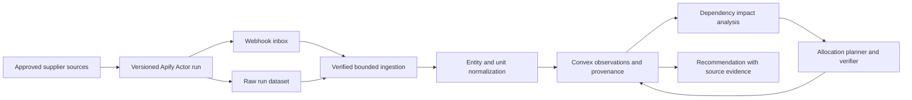

# SupplyWatch: Source-Grounded Replenishment Repair

Status: **candidate experiment, not a product pivot, deployed monitor, or benchmark result**.
Prepared on **2026-10-17, America/Los_Angeles**; official technical sources below were checked on this date.
Return to the [experiment portfolio](../11-experiment-portfolio.md) or [documentation index](../README.md).
This tests whether the personal-agent runtime is useful when external commercial observations change after a recommendation is prepared.
No supplier was scraped, Actor run launched, monitoring schedule enabled, order placed, or experiment executed for this document.

## 1. User and deliberately narrow scope

The first user is a campus club operations lead replenishing copier paper for recurring workshops.
Start with one category: white A4 80 gsm copier paper, purchased in known ream/carton sizes from three approved suppliers.
The user specifies required sheet counts, delivery deadlines, destination, allowed brands/substitutions, storage capacity, and a spending cap.
Keep at most 20 relevant listings; support one delivery destination and explicit supplier price/shipping rules.
The initial product recommends a feasible order allocation and explains changes; it does not place real orders.
Whether this user checks enough suppliers often enough to value automation is an unvalidated demand hypothesis.
Choose this category for transparent identity and quantity rules, not because copier paper is assumed to be the best market.
Do not expand initially into arbitrary procurement, negotiated enterprise pricing, live freight, medicines, or cross-border tax advice.

## 2. Product hypothesis and completion contract

**Hypothesis:** when a supplier observation changes, a source-grounded agent can repair only the affected procurement decisions while preserving valid choices and making uncertainty visible.
A price alert alone is insufficient: the product must determine whether the changed listing affects a particular user's feasible order plan.
Completion means a current, reproducible recommendation with traceable quantities, evidence, freshness, and unresolved fields.
“Recommended,” “quote requested,” “order submitted,” and “supplier confirmed” are distinct states.
Existing orders remain commitments; a lower new price cannot rewrite purchase history or automatically cancel an order.
The active mission authorizes agreed monitoring and in-scope recommendation repair, not spending money or contacting suppliers.
Any later purchase or supplier message requires a separate existing grant covering that effect; no such action occurs in this experiment.

## 3. Architecture choices

| Alternative | Useful property | Limitation |
|---|---|---|
| Watchlist with price/stock alerts | Minimal, easy to verify | Makes the user recompute the order plan |
| Full recomputation after every snapshot | Strong simple baseline for a small catalog | Repeats normalization/reasoning; may create avoidable recommendation churn |
| LLM browsing and rewriting an order | Flexible extraction | Difficult to reproduce source timing and quantity assumptions |
| Versioned observations plus dependency-guided repair | Traceable impacts and preserved boundaries | Extra ingestion and data-quality work may outweigh repair savings |

Recommend the fourth for research, but implement full deterministic recomputation first.
Use Apify for bounded acquisition and raw result storage, Convex for current authoritative application state, and a stateless planner for recommendations.
Neither an Apify result nor a model answer is a supplier guarantee.

## 4. Acquisition and attribution contracts

Apify [Actors](https://docs.apify.com/actors) accept structured input and run acquisition/processing programs; pin the actual Actor build and input configuration used.
Input includes approved URLs, category filters, maximum pages/items, request budget, destination assumptions, and extraction schema version.
Use supplier-approved feeds or accessible pages the team is authorized to process; authenticated accounts and access expansion are outside this first scope.
Record source URL, supplier identity, Actor/run/build IDs, dataset item reference, fetch time, parser version, raw fields, and extraction errors.
Keep `observedAt`, source-stated effective time, and application `ingestedAt` separate; a late webhook must not make old data appear new.
Store an immutable application observation revision even when a raw dataset is later removed by retention policy.
Apify [datasets](https://docs.apify.com/storage/dataset) are append-only result storage; define retention/export deliberately rather than assuming every unnamed run remains available.
Keep a lawful, minimal audit excerpt or structured source evidence sufficient to reproduce parsing; do not publish account details or entire supplier sites.
The UI distinguishes `live source observation`, `recorded source replay`, and `synthetic supplier fixture` on every demonstration.
Never describe replayed stock as current inventory or an Actor's successful exit as proof that all listings were extracted correctly.

## 5. Reliable ingestion, not webhook-driven truth

Use a dedicated [Convex HTTP action](https://docs.convex.dev/functions/http-actions) as a webhook inbox, with a configured secret header and strict payload validation.
Apify documents custom headers, retries, and possible duplicate deliveries in [webhook actions](https://docs.apify.com/integrations/webhooks/actions); do not assume exactly-once delivery or an undocumented signature scheme.
Persist the accepted event and ingestion work before acknowledging success, then process the dataset in bounded batches.
Deduplicate by verified run/event identity and item identity; duplicate delivery must not create a second price change or second recommendation.
Handle `SUCCEEDED`, `FAILED`, `ABORTED`, and `TIMED_OUT` distinctly using the documented [Actor run event types](https://docs.apify.com/integrations/webhooks/events).
Verify that the run belongs to the expected Actor/task and approved request using [run metadata](https://docs.apify.com/api/v2/actor-run-get) before fetching associated results with server-side credentials.
A failed or partial collection updates source health; absent rows are not automatically out-of-stock products.
When two runs arrive out of order, compare source observation versions/times; retain both evidence records and select current state explicitly.
One configured scheduler owns refresh cadence, with backoff and a crawl budget; webhook retries must not recursively launch new crawls.
Poll/reconcile run status only as a bounded recovery path for missed events, not as a second independent monitoring system.

## 6. Identity, normalization, and uncertainty

| Field | Required rule |
|---|---|
| Product identity | Prefer supplier SKU plus explicit manufacturer/GTIN evidence; keep offer identity separate from product identity |
| Compatibility | A4 dimensions, 80 gsm, color, intended use, and user-approved substitution rules must match |
| Pack quantity | Parse sheets per ream and reams per carton separately; never equate one carton with one ream |
| Price | Store integer minor units, currency, price basis, tax inclusion status, quantity tier, and timestamp |
| Currency | Compare using a pinned, attributed FX observation; expose rate age and rounding; do not invent a live conversion |
| Shipping | Destination, per-order/per-item charges, free-shipping threshold, minimum quantity, and arrival evidence |
| Availability | Explicit stock status/quantity when supplied; otherwise `unknown`, not an inferred unlimited quantity |
| Confidence | Field-level evidence class and ambiguity reason; model confidence is not calibrated truth |

Convert to a common sheet count only after pack interpretation is confirmed; A4 and US Letter remain different products.
Unknown tax or shipping means landed cost is an interval or incomplete value, not a precise cheapest-price claim.
Use supplier basket-level shipping rules when comparing allocations; a normalized unit price cannot capture a threshold discount.
A stated dispatch estimate is not guaranteed arrival; preserve the wording and confidence level in the deadline check.
If a match is ambiguous, hold it out of automatic allocation and request clarification or retain it as an explicitly uncertain alternative.
Build a small labeled matching set with hard negative pairs; false merges can be more damaging than missing a possible substitute.

## 7. Application state and API contracts

| Record/API | Minimum contract |
|---|---|
| `supplierSource` | Approved origin, Actor/build, health, refresh policy, last complete observation |
| `rawObservation` | Source/run/item identity, raw fields, provenance, three timestamps, parse outcome |
| `product` / `offerVersion` | Canonical identity, compatibility, pack, price, stock, shipping policy references, field uncertainty |
| `demand` / `inventory` | Required sheets by deadline, owned stock, committed inbound orders, storage constraint, revision |
| `recommendationNode` | Supplier allocation, integer pack count, cost interval, dependency witnesses, `nodeRevision` |
| `ingestRun` | Verified run ID, cursor, idempotency key; returns imported/rejected counts and source health |
| `resolveMatch` | Candidate pair, explicit decision, evidence, expected revision; never silently retroactively merges commitments |
| `planAllocation` | Frozen demand/offers/policies/FX snapshot and objective; returns plan, gaps, assumptions, solver status |
| `publishRepair` | `planningAttemptId`, affected node revisions, `stopEpoch`, witnesses; accepts current patch or rejects stale input |
| `recordOrderEvidence` | Manual or authorized adapter evidence, supplier order ID, exact lines, status; a plan is not order evidence |

Include collection dependencies for “best eligible offer,” shared shipping thresholds, FX observations, inventory, deadlines, and supplier basket totals.
A new eligible offer can affect optimality without invalidating the current plan's feasibility; mark those two outcomes separately.
Persist a change-impact trace: source field delta → changed normalized fact → failed/repriced constraint → affected allocation nodes.
The trace records actual computation dependencies, not a model-generated story after the recommendation changes.
If evidence changes but normalized values and applicable constraints do not, refresh provenance without pretending that a new allocation was necessary.
Otherwise expand the affected set through supplier-basket shipping, quantity tiers, shared budget, and inventory constraints before solving.
Keep unaffected compatible allocations fixed initially; expand or fully recompute when that boundary is infeasible or the declared cost-quality tolerance cannot be established.
Measure any optimality gap against the same full observed-catalog solution; a feasible partial repair alone does not prove minimum delivered cost.
Apply application freshness checks inside Convex mutations; [database OCC](https://docs.convex.dev/database/advanced/occ) alone cannot reject assumptions read during an earlier model call.
Keep independent valid nodes; `planningAttemptId` gates publication, `nodeRevision` gates replacement, and `stopEpoch` prevents cancelled missions from continuing.

## 8. Model and deterministic split

The model proposes field extraction or entity matches from messy text and interprets a user's replenishment request.
It produces evidence-linked candidates and ambiguity flags; deterministic parsers handle known fields and arithmetic whenever possible.
An integer allocation solver or bounded exhaustive search enforces pack multiples, stock, demand/deadlines, storage, budget, and compatibility.
Shipping thresholds and quantity tiers belong in the optimization model, not in a post-hoc explanation.
The verifier recomputes sheet totals and landed-cost bounds from the selected source versions independently of the planner's prose.
Order the objective as hard feasibility, preservation of committed orders/explicit locks, declared preference for recommendation stability, then landed cost.
Unknown facts may require an evidence request or a conditional recommendation; the model cannot promote them to confirmed facts.
If rules and exact search solve the bounded category well, retain that simpler design and measure whether language interpretation adds value.

## 9. Coupled multi-event scenario

Synthetic fixture: demand is 20 reams of 500 sheets by Friday, budget $120 including a confirmed five-ream inbound order that already cost $25 delivered.
Supplier A sells five-ream cartons for $25 with $15 shipping below $75; B sells single reams for $6 with $8 shipping; both initially show Friday arrival. C has a foreign-currency offer with uncertain arrival.
All fixture amounts include tax, and the remaining budget is $95; the prior order is counted once and remains immutable.
With sufficient A stock, three cartons cost $75 delivered, bringing the total to $100; B's 15 reams would cost $98 delivered and exceed the remaining budget.
A later observation reduces A to two available cartons; then workshop demand drops to 16 reams total, leaving 11 still needed.
Two A cartons plus one B ream cost $79 delivered, whereas 11 B reams cost $74; pack rounding and loss of A's shipping threshold change the best allocation.
The user locks the confirmed inbound order; B changes its delivery estimate; a delayed older A run arrives after the newer one.
While repair is pending, C's FX observation becomes stale and an extracted listing turns out to be Letter paper rather than A4.
Expected result: preserve the order, reject the false match, retain the newer A state, recompute coupled baskets, and expose a deadline/cost gap if no verified plan remains.
All prices and supplier identities in this scenario are synthetic; they are not market observations or claimed savings.

## 10. Deployment and meaningful integration evidence

Deploy the UI on Vercel, state/functions on Convex, and the pinned acquisition program on Apify; use the [Convex Vercel guide](https://docs.convex.dev/production/hosting/vercel) for that hosting path.
Keep Apify/model credentials and webhook secrets server-side, configure spending/page limits, and separate development from demonstration runs.
Use Convex mutations for atomic normalized-state changes plus durable work creation; [transactional scheduling](https://docs.convex.dev/scheduling/scheduled-functions) supports the event-to-repair handoff.
The current [Cal Hacks Devpost page](https://cal-hacks-13-0.devpost.com/) lists **[Apify] 1st Place Best use of Apify**, **[Apify] Best Actor sponsored by Apify**, and **[Convex] Best use of Convex**.
SupplyWatch is a candidate fit for these tracks; exact technical/submission requirements remain unconfirmed, and a named track does not establish eligibility.
Apify proof would include an actual deployed Actor, pinned input/build, real run and dataset IDs, source attribution, and a webhook-to-ingestion trace.
Convex proof would include shared current state, deduplicated concurrent ingestion, stale-patch rejection, and reactive recommendation updates.
Record production URL, repository revision, deployments, parser/model/schema versions, and a sanitized replay package for judges.
Optional WebMCP can expose the owned recommendation page to a personal agent via the [browser API](https://developer.chrome.com/docs/ai/webmcp/imperative-api); it does not make supplier sites support WebMCP.
Supplier acquisition can remain server-side; neither WebMCP nor Apify must be forced into real checkout to make this experiment meaningful.

## 11. Evaluation design and frozen held-out cases

Separate three questions: can we extract/normalize observations, repair plans correctly, and reduce the user's work?
Create 15 development episodes and 60 held-out episodes, ten each for pack identity, landed-cost thresholds, stock/deadline changes, out-of-order sources, ambiguous evidence, and compound events.
Each episode freezes supplier pages or structured observations, request context, event timestamps, ground-truth fields, and reference feasible allocations.
Use source-derived snapshots only with recorded collection provenance; keep synthetic perturbations labeled and report their scores separately.
Hold out supplier layout variants and event combinations; splits sharing near-identical listing templates must not be presented as broad extraction generalization.
Hash fixtures, seeds, parser/model versions, scoring code, budgets, and stopping rules before the held-out run.
Do not give the planner future observations, gold matches, or the evaluator's feasible-order enumeration.
Exact enumeration is available for these small catalogs; when larger solver runs time out, report bounds rather than pretending the reference is optimal.

| Baseline | Fair comparison requirement |
|---|---|
| Threshold alerts plus a normalized comparison table | Same observations; human decision time evaluated in a separate task study |
| Full deterministic recomputation | Same data, objective, locks, uncertainty policy, and exact solver |
| Full LLM-assisted recomputation | Same extraction access, model, verification, and publication checks |
| Dependency-guided partial repair | Same conditions, with scoped work and expansion/full fallback charged |

Replay identical observations at a fixed virtual cadence so a system cannot win by receiving fresher sources.
Run ingestion/extraction scoring separately from planner-only scoring on gold-normalized inputs to locate error sources.
Count acquisition and verification calls if claiming end-to-end savings; a cached planner result is not free if it required a new crawl.
Use episode-level paired comparisons and repeated model runs; publish failures and confidence intervals, not only the showcase sequence.

## 12. Domain metrics and ablations

Validity gates cover product compatibility, quantity/deadline feasibility, source freshness policy, budget treatment, locks, and order-status honesty.
Report fabricated-stock, false-match, stale-publication, and unauthorized-order counts separately; a lower price cannot offset them.
Score field extraction accuracy by field, entity-match precision/recall, pack-normalization error, and unsupported-assertion rate.
Measure demand shortfall by deadline, verified landed cost or cost interval, excess sheets, allocation churn, and unresolved uncertainty.
For feasible fully known cases, report cost regret against the exact same observed catalog; this is not regret against unknowable future market prices.
Track source age at recommendation, detection lag, valid-repair latency, calls/tokens/compute cost, and user corrections needed.
Ablate dependency scoping, collection witnesses, normalization validation, freshness handling, and model-assisted matching independently.
An entity-only dependency variant should reveal failures around new offers, shipping thresholds, and FX; do not treat those misses as acceptable savings.
Keep live extraction reliability outside a synthetic planner benchmark, and label all custom suites as custom suites.

## 13. Minimum decisive experiment and three-minute demo

First run six development episodes with three fixture suppliers and exact allocation enumeration; compare full versus scoped repair before any live crawling.
Provisional gate: zero invalid recommendations, equal feasible-demand coverage, no worse cost under the frozen objective, and at least 25% lower repair work or measured user effort.
Choose and freeze the primary efficiency measure before comparing systems; do not select a favorable measure retrospectively.
If tiny catalogs make full recomputation effectively free, the candidate must justify itself through evidence quality and reduced manual checking, not token savings alone.
Next validate a small batch of authorized real-source extractions against hand-labeled fields; do not deploy monitoring until identity/pack errors are understood.
Demo 0:00–0:40 shows the requirement, existing order, recommendation, and source timestamps; 0:40–1:20 introduces stock and demand changes.
Demo 1:20–2:10 shows the shipping/pack interaction and a rejected stale or false-match observation; 2:10–3:00 shows the repaired or honestly infeasible result with provenance.
Display replay/live labels throughout; finish on an order recommendation, never imply that an unplaced order was purchased.

## 14. Milestones and kill criteria

1. Observe a real replenishment decision and confirm the recurring cost of source comparison.
2. Implement schemas, normalized fixtures, full exact recomputation, and independent domain scoring.
3. Add provenance/version handling and the six-case decisive comparison; then test partial repair.
4. Add bounded Apify acquisition, webhook recovery, and field-level extraction checks.
5. Freeze held-out tests, evaluate, and only then select a live demonstration source.

Stop or narrow if users rely on one contracted supplier, reliable delivered-price evidence is inaccessible, entity/pack errors dominate, or full recomputation is equally useful with less complexity.
Kill autonomous-purchasing claims if current quotes and effect guarantees are absent; preserve the recommendation product if it still solves a measured problem.
Carry useful acquisition/provenance/runtime findings back to the personal-agent branch even if SupplyWatch is not selected.
