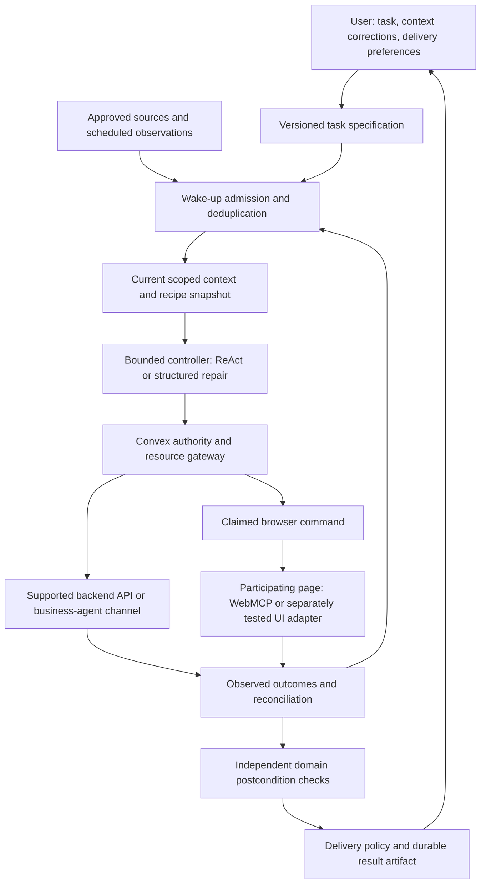

# Personal agents: harness, experience, and business integration

**Reviewed:** October 18, 2026, America/Los_Angeles. **Status:** research and proposed design only. No vendor product, reference stack, browser integration, or evaluation was executed.

Read with [system alternatives](../02-system-design-alternatives.md), [runtime contracts](../03-personal-agent-runtime.md), [TypeScript/Rust/Convex/WebMCP boundaries](../12-typescript-rust-convex-webmcp.md), and [the documentation index](../README.md).

The practical recommendation is to complete the experience around our existing runtime before adding more reasoning agents: a versioned task specification, inspectable personal context, explicit wake-up rules, an execution host that can actually be available, and useful delivery of results. Preserve the incremental-repair research question, but compare it with a strong simpler controller on this same substrate.

## 1. What the two articles actually establish

### Decagon: enterprise-facing agent access

Decagon's October 1 article announces a Personal Agent Gateway for businesses. Its account emphasizes identifying agent callers, providing an agent channel, checking customer-granted scopes, and resolving or escalating conversations. It describes business-owned Agent Operating Procedures, with permission requirements attached to workflow sections. Its airline example separates viewing alternatives from permission to rebook. The article introduces PACT as an A2A-based channel with OAuth-style delegated authority and says the specification is being refined with participants. These are vendor product descriptions, not results from an independent security or interoperability test. The article does not disclose the internal memory, scheduling, or sandbox architecture of the consumer agents it mentions. [Decagon article](https://decagon.ai/blog/personal-agents-are-here)

### Profound: observed shopping behavior and discovery

Profound's October 2 article describes personal agents using persistent context, task instructions, and live browsing. It reports Muse combining merchant-browser discovery with a product-catalog search, then filtering candidates. Its shopping observations cover 50 prompts in one retail category through one instance; they are exploratory, not a general performance benchmark. Its traffic analysis uses unverified bot-identifying requests as a proxy and explicitly acknowledges attribution uncertainty. Profound recommends accessible merchant pages, catalog presence, and clear product attributes. Profound is a primary source for its own observations, but not authoritative documentation of Muse or Instinct internals. This review did not reproduce its experiments or verify the agents' reported integrations. [Profound article](https://www.tryprofound.com/blog/the-era-of-personal-agents-muse-and-instinct)

Neither article establishes that a particular agent architecture is superior, that proactive messages improve outcomes, or that our proposed runtime is differentiated. Download counts, transaction-volume claims, and traffic proxies are not adopted here as evidence of reliability or demand for our product.

## 2. Directly linked primary documentation

The article links and their official documentation indexes led to the following sources. They concern different products and layers; Profound's own marketing Agents are not Muse or Instinct.

| Source | Documented or reported capability | What was not established |
|---|---|---|
| [Decagon AOP product page](https://decagon.ai/product/aop) | Natural-language workflow authoring, Git-based version tracking, and execution inspection are described. | Public execution semantics, sandbox isolation, or a correctness guarantee. |
| [Decagon's October 6 PACT announcement](https://decagon.ai/blog/introducing-the-personal-agent-consent-trust-protocol-pact) | Announces an open specification and collaboration with Instinct; distinguishes agent-platform identity from authority over a customer account. | Universal merchant adoption or access to a production endpoint for our project. |
| [PACT specification](https://openpactprotocol.org/spec) | PACT 1.0 defines A2A HTTP+JSON messaging, signed agent identity, and an optional delegated-authority profile using OAuth device authorization. Brand-supplied cards expose interfaces and scopes; the specification defines no registry. Provider onboarding policy varies. Repeated message IDs within a known context return a stored reply. Delegated replies carry signed receipts. Its basic task operations do not provide a general durable-job scheduler; step-up tasks can be ephemeral. | Cross-service transactions, an unrestricted automation API, or settlement correctness. |
| [PACT personal-agent integration guide](https://openpactprotocol.org/personal-agent) | The walkthrough explicitly covers the Identity profile. It says its TypeScript client is not yet on npm and points to repository source. | A complete delegated-authority integration accomplished by following that walkthrough alone. |
| [PACT repository](https://github.com/openpactprotocol/openpactprotocol) | Publishes protocol schemas, a client, reference provider/personal-agent applications, and conformance tests. | Passing results for our implementation; nothing was installed or run. |
| [Profound agent building blocks](https://docs.tryprofound.com/agents/building-blocks-of-agent.md) | Separates triggers, inputs, instructions, outputs, tools, context, and settings. Documents browser capability controls, self-update settings, and configurable behavior when a tool needs approval. | Internal model-loop design, browser isolation, or permission enforcement under adversarial inputs. |
| [Profound triggers](https://docs.tryprofound.com/agents/triggers-in-agents.md) | Documents schedule, app, web-monitor, and metric triggers. Triggered runs use the current agent version; triggers belong to their creator. Monitors suppress previously reported matches. | Exactly-once external delivery, comprehensive event coverage, or immediate detection of every website change. |
| [Profound Context Manager](https://docs.tryprofound.com/context-manager/about.md) | Describes source-linked knowledge records, user corrections taking priority, and separately editable personal context. | A formal truth-maintenance system or dependency-based repair of already-started work. |
| [Profound Agents versus Workflows](https://docs.tryprofound.com/agents/agents-vs-workflows.md) | Documents an agent calling published workflows for fixed substeps. Its comparison currently says new Agents have no API/MCP execution interface; Workflows do. Agents cannot invoke other Agents as steps. | A general embeddable harness we can directly substitute for our Convex controller. |

The directly linked Profound [product announcement](https://www.tryprofound.com/blog/introducing-the-next-generation-of-marketing-agents) describes dynamic triggers and flexible connected tools. The narrower interface limitations above come from its current operational documentation. An MCP tool an agent consumes and an MCP endpoint that runs that agent are different capabilities.

PACT evidence is pinned to official repository commit `838c6bd1da9be39da04264e8b156dbb4e848a208`, dated October 6, 2026, read on October 18: [specification snapshot](https://github.com/openpactprotocol/openpactprotocol/blob/838c6bd1da9be39da04264e8b156dbb4e848a208/docs/spec.md) and [personal-agent guide snapshot](https://github.com/openpactprotocol/openpactprotocol/blob/838c6bd1da9be39da04264e8b156dbb4e848a208/docs/personal-agent.md). Recheck changes before implementation; the pinned documentation does not certify a deployed integration.

For the two infrastructure boundaries relevant here, [Convex scheduled functions](https://docs.convex.dev/scheduling/scheduled-functions) document atomic scheduling from mutations, but actions are not transactions and are not automatically retried. Scheduled work does not inherit the caller's authentication context. [Chrome's WebMCP imperative guide](https://developer.chrome.com/docs/ai/webmcp/imperative-api) documents page-bound tools and explicit origin exposure, not a persistent autonomous browser service.

## 3. What our current architecture already covers—and what remains a design gap

The following is an assessment of our documents, not a claim about an implemented application. A capability is not missing merely because a vendor gives it a different name.

| Area | Already specified in our design | Additional contract or experience to specify |
|---|---|---|
| Memory | Typed assertions, provenance, scope, time, corrections, disputes, and dependency witnesses | Capture and review UI; retrieval limits; deletion/retention; how a user sees which memories affected a choice |
| Persistence | Missions, commands, events, receipts, durable waits, and bounded controller invocations | A user-facing task specification and its version history, distinct from one execution attempt |
| Scheduling | Transactional scheduling and event processing | Trigger ownership, timezone, missed-run policy, expiration, overlap, cooldown, and monitoring cost limits |
| Proactivity | An active mission can react within its grant | A delivery policy deciding when a change is worth interrupting the user and where the result appears |
| Browser work | Local/page executor, claims, origin contracts, reconnect, and unknown effects | Availability promises, login recovery, tenant isolation, session expiration, and an explicit hosted-browser option |
| Tools and authority | Checked adapters, grants, shared funds, admission, receipts, and reconciliation | Business-channel discovery and mapping third-party grants into our narrower local effect policy |
| Product discovery | Catalog query dependencies and item constraints | Multi-source candidate normalization, source coverage, attribution, and conflicts between merchant claims |
| Orchestration | ReAct, global replanning, incremental repair, and optional workers | Versioned reusable recipes and a clear boundary between editable instructions and enforced policy |

The largest product gap is the absence of an explicit contract connecting **what the user assigned**, **when it should run**, **what it may do**, and **how the user learns the result**. A database event loop alone does not answer those questions.

## 4. Proposed complete path

This is our proposed architecture. Model prompts are bounded execution inputs; Convex records are the coordinator's authority. External systems remain authoritative for their effects. Website prose, retrieved instructions, and merchant replies cannot enlarge a grant or replace policy checks.

### Task specifications and reusable instructions

Add a versioned `TaskSpec` containing objective, input/output contracts, relevant context scopes, recipe reference, allowed capabilities, budget references, wake policy, delivery policy, and expiration. A `TaskRun` binds a trigger occurrence to a specification revision and records attempts and results. Existing mission state can remain the execution authority; these names are conceptual additions, not platform APIs.

Keep reusable instructions separate from the model's current plan. A recipe can explain how to compare offers or reconcile a cancellation, while a deterministic operation owns arithmetic and authorization. Version recipes with provenance and review status. Do not automatically execute arbitrary instructions collected from websites as user-owned recipes.

Pin the recipe and instruction digest for each planning attempt. A changed recipe may affect future runs or explicitly revise active work; make that policy visible. Never rewrite completed effects to make them appear consistent with the new instructions. Model-proposed self-updates are proposals and cannot increase tool access, spending limits, or notification recipients.

### Memory as evidence with an editable projection

Use the existing resolver rather than a second unstructured profile as authority. Provide a small “used for this decision” view with source, scope, date, and correction control. Separate facts the user asserted from preferences inferred by the model and temporary observations from a task.

A model may propose candidate memories after a run; a policy decides whether to store them as tentative, task-local, or user-confirmed. Do not infer a durable dietary identity from an order for another person. If four people will attend this camping trip, update the event requirement, not household size.

Treat retrieval as a dependency too. A changed memory outside yesterday's top-k retrieval can become relevant today; record the retrieval query or conservatively invalidate its scope. Memory deletion should remove or redact the governed material and invalidate dependent future decisions, while preserving legally and operationally required effect history under a separately defined retention policy. Do not claim that deleting a profile row removes copies already sent to external services.

### Wake-up policy and useful delivery

Distinguish user messages, scheduled checks, source observations, and urgent reconciliation. An observation starts useful work only if it is new, relevant, permitted, and within the task's current limits. Coalesce duplicate stock changes; preserve distinct revocations and receipts.

Store occurrence identity, source cursor, earliest/latest useful execution time, timezone, overlap policy, and next due time. Define behavior for daylight-saving transitions and missed occurrences. Recurring checks should not create a new purchase intent on every run. Continue using stable logical operation identities and the existing `nodeRevision`, `planningAttemptId`, `stopEpoch`, and dependency witnesses.

Delivery is a separate state machine: `prepared`, `suppressed`, `queued`, `sent`, `acknowledged`, or `unknown`. A completed mission and an undelivered notification are different states. Start with an in-app result inbox; add external channels only with a user-authorized recipient and delivery purpose.

A delivery policy should cover changed outcomes, blocking choices, deadlines, quiet hours, digesting, and duplicate suppression. A low-cost background repair can complete without interrupting the user. Notify when the result or required choice is useful, rather than reporting every internal retry. Do not require approval after every model response or fact correction: continue within the standing mission grant and ask only for unresolved scope, a necessary choice, or an effect outside that grant.

### Execution hosts and sandbox boundaries

Keep direct supported API calls separate from browser commands. A hosted browser is a worker with a session lifecycle, credentials, resource limits, and availability costs; it is not created by persisting a command. When no compatible browser is online, expose `waiting_for_executor` and the effect on the deadline.

If a task needs code execution, put generated code in a separate constrained environment with immutable inputs and bounded outputs. Keep signing keys, service credentials, and the commit gateway outside that environment. The browser and a code sandbox are different isolation problems. Neither reviewed consumer-agent article establishes how its named products isolate either one.

## 5. Orchestration variants and tradeoffs

These are choices we can test. Reasoning policy, execution host, and external transport are independent axes; choosing a hosted browser does not imply incremental planning or a multi-agent system.

| Variant | Explicit advantages | Explicit disadvantages | Appropriate first use |
|---|---|---|---|
| Durable supervisor with one bounded ReAct worker and curated recipes | Smallest reasoning architecture; adapts to unfamiliar requests; easy to establish an end-to-end reference | Repeated interpretation can cost tokens; retained decisions need explicit artifacts to be inspectable | First complete personal-agent path and strong baseline |
| Structured global planner with deterministic subworkflows | Clear contracts; straightforward checking; effective for coupled constraints and small catalogs | Replanning can be expensive; still needs fresh evidence and external reconciliation | Strong baseline for shared-budget procurement |
| Incremental mission controller with the same recipes and gateway | Potentially reuses unaffected work; can explain the cause and scope of a repair | Dependency capture and bookkeeping overhead; local repair may need expansion; opaque model steps require conservative dependencies | Research branch for long-lived tasks with sparse change |
| Persistent workspace worker with browser and optional code sandbox | Rich artifacts and long procedures; convenient for file-heavy tasks | More session state, credentials, isolation, cleanup, and operational cost; a live process is not durable authority | Add only when task requirements cannot be met by bounded jobs |
| Delegating selected operations to a business agent | Business can interpret its policies and provide an official channel | Integration/adoption dependency; variable scopes; negotiation and uncertain effects require special handling | Optional transport adapter for one participating business |

Recommendation: add the task/recipe/delivery contracts to the existing shared substrate, implement the bounded supervisor, and keep global and incremental planning behind a common controller interface. Do not use an extra memory, scheduler, or notification LLM when deterministic logic suffices. Specialist workers are justified by independently assessable parallel work, not by assigning a different name to each function.

## 6. Business discovery, delegated authority, and recommendation evidence

For a future business-channel adapter, resolve the business endpoint from a trusted domain or explicitly configured provider. Record card location, observed version, selected interface, identity mapping, and granted capabilities. A public description of a capability is discovery evidence, not permission to invoke it on a user's account.

Keep local mission authorization and remote consent separate. Admit an effect only when both allow it and resources remain available. The user may authorize researching a cancellation locally while the remote grant permits only reading orders. The missing capability should produce one clear step-up request, then resume the same mission after a verified grant change.

Bind the remote conversation, message identity, requested effect, and receipt to our logical operation record. A signed receipt authenticates an issuer's statement; it does not independently prove delivery, refund settlement, or that a provider's implementation performed every stated action correctly. Require adapter-specific outcome queries or mark the result unresolved. Cap repeated negotiation and escalate when new messages stop adding relevant information.

For product discovery, keep catalog results and browser observations as separate evidence streams until matching resolves product identity, variant, pack size, currency, shipping, availability, and observation time. Record which source contributed each candidate. Broader catalog coverage is not equivalent to better recommendations; a merchant may supply incomplete or conflicting attributes.

The proposed ranking objective should serve the user's requirements, not a merchant's visibility. Evaluate whether sponsorship or source availability changes selection while product facts remain fixed. Keep inspectable source evidence even when the conversational response is short. This is our design choice, not a claim about the cited products.

## 7. Evaluation plan

Use the [existing evaluation protocol](../06-evaluation-and-experiments.md). The following are proposed experiments, not results or an external benchmark.

| Question | Frozen test conditions | Measures and failure evidence |
|---|---|---|
| Does personal context help? | Explicit fact, inferred preference, stale assertion, event exception, and correction; hold out combinations | Constraint satisfaction, inappropriate personalization, correction propagation, and unnecessary questions |
| Do recipes help beyond prompts? | Same model, tools, context, budget, and tasks; recipe-enabled versus concise general instructions | Valid completion, tool calls, adaptation to an unseen branch, and recipe-maintenance cost |
| Is incremental repair useful? | Sparse/dense/irrelevant changes, a locked choice, and shared resources; warm-start global baseline | Independent final-state quality, preserved commitments, total latency/cost, and repair scope |
| Is proactivity useful? | Duplicate and irrelevant events, stale alerts, quiet hours, deadlines, and missed schedules | Necessary alerts found, unnecessary interruptions, time to useful action, and completion without prompting |
| Can execution recover? | Browser unavailable, account switch, lost receipt, duplicated trigger, cancellation, and late success | Duplicate effects, unauthorized effects, unknown-outcome duration, and preserved actual history |
| Is discovery robust? | Catalog/browser disagreements, missing shipping, ambiguous variants, and equivalent unbranded products | Match precision, constraint validity, evidence coverage, calibrated abstention, and source sensitivity |
| Is delegation correct? | Read-only remote grant, partial consent, expiry, revocation, duplicate messages, and policy refusal | Scope violations, correct step-up, bounded negotiation, and independently observed business outcomes |

Freeze scenario definitions and acceptable outcomes before tuning. Split by event combinations and task families, not only paraphrased prompts. Give every controller the same memory resolver, recipes where applicable, authorization, caches, observations, and output checks. Measure recipe authoring and integration effort separately from runtime cost.

Use deterministic domain oracles for stock, budget, operation identity, and authorization. Use a blinded human review for subjective relevance or interruption usefulness when necessary; report that judgment separately. Do not score the system solely with its own planning model or its own dependency checker.

Run ablations for no personal context, no recipes, no proactive delivery, whole-plan revalidation, and no source reconciliation. Change one axis at a time. A no-authorization ablation is not a deployable comparator; test authorization failures with injected invalid requests while all real systems retain the same gateway.

Separate broad fault tests in a controlled environment from a small native WebMCP compatibility suite and any authorized external integration trial. Profound's exploratory shopping observations are background evidence, not a benchmark our custom tests reproduce.

## 8. Minimum decisive experiment and stopping conditions

Use the existing camping mission: six people, at most $300, arrive by Friday, two vegetarian guests, an owned stove, and an already purchased tent. A second grocery mission shares funds. Apply a headcount change to four, an out-of-stock item, and a user-locked replacement while planning is in flight.

Add one experience requirement: the user has closed the execution page. The system must state which backend preparation can continue, what awaits a browser, and whether a delivery deadline needs attention. On reconnection, it repairs only within the grant, preserves the purchased tent and locked choice, reconciles any uncertain effect, and leaves one useful result artifact.

Compare the bounded supervisor, warm-started global planner, and incremental controller under identical conditions. Use several held-out event orders, including no-change and dense-change controls. The single scripted demo does not establish an algorithmic advantage.

Keep a feature only if it earns its complexity. Remove automatic memory extraction if it creates more correction work than useful reuse; simplify scheduling if event checks suffice; defer a hosted browser if local execution meets the product need; narrow or remove incremental repair if the simpler controller matches it. Do not add PACT to the demo unless an actual compatible endpoint or clearly labeled reference environment is available.

## 9. Integration limits and next design decisions

- No public consumer-agent harness, task scheduler, or sandbox API was established from these two articles. Do not describe reverse-engineered workflow observations as an SDK integration.
- Confirm production access, provider onboarding, exact protocol versions, supported scopes, and outcome-query behavior before promising a business-agent connection. A reference stack is integration evidence only for that stack.
- Profound's platform features are useful design references; the documented execution-interface limitation prevents treating its new Agents as an interchangeable backend component today.
- Pin and test the chosen browser build and native tool path. An API adapter, a browser automation adapter, and WebMCP invocation must be labeled accurately in traces and demos.
- Decide the task-specification revision policy, memory review/deletion policy, missed-run behavior, and result-delivery policy before expanding the number of tools or domains.

The next deliverable should be a reviewed set of those contracts and one testable user journey. This note does not select a final portfolio product, change sponsor eligibility, or authorize any external deployment or communication.
