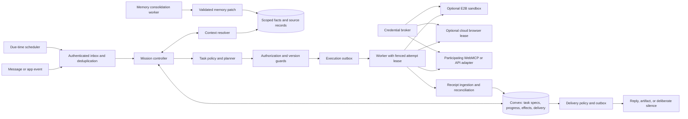

# Personal Agents: Social Sources and a Reference Architecture

Research date: 2026-10-18. Status: source review and proposed design; no implementation, deployment, or experiment results.

The useful architectural lesson is to separate conversational continuity, durable task state, and replaceable execution. Neither a coherent chat nor a persistent sandbox establishes reliable task completion. The proposed design below adds explicit ownership, authorization, reconciliation, and delivery contracts to that separation.

See the existing [runtime specification](../03-personal-agent-runtime.md), [model and decision layer](../04-model-and-decision-layer.md), [evaluation protocol](../06-evaluation-and-experiments.md), and [language/deployment architecture](../12-typescript-rust-convex-webmcp.md). This note is supporting research, not a replacement for their contracts.

## Evidence and access boundaries

The exact two user-linked X posts were investigated. Native X post and Article pages returned access errors in the research browser. Their public text and Article payloads were recovered through the third-party FxTwitter JSON mirror. This establishes what the retrieved mirror attributes to each exact post; it is weaker than reading an authenticated original. The first article also has an accessible publication on its author's company website.

Source summaries below are intentionally bounded to fewer than 180 words per source. They report authors' observations and claims without treating them as verified Instinct implementation details. No Instinct source code, internal design document, official infrastructure disclosure, or production trace was obtained.

| Evidence type | What it supports | What it does not support |
|---|---|---|
| Exact-post mirror and author publication | Attribution, article contents, author's stated method | Independent authentication of every claim about Instinct |
| Researcher's probe report | Reported observations of a particular exposed environment | Fleet-wide architecture, all roles, security guarantees, current production configuration |
| User-supplied image | Visible component labels and relationships | Provenance, implementation, behavior under failure |
| Official provider documentation | Documented provider capability | Proof that Instinct uses that capability or configuration |
| Our reference design | A concrete proposal to implement and test | Achieved reliability or measured advantage |

### S1 — Dhravya Shah: memory reconstruction

The [exact post](https://x.com/DhravyaShah/status/2101745550752428340?s=20) introduces a three-day investigation and points to [this X Article](https://x.com/i/article/2101713614994575360). Its [author-hosted publication](https://supermemory.ai/blog/reverse-engineering-instinct-memory/) describes probing the iMessage interface, explicitly without code access. The reconstruction includes versioned Markdown, keyword retrieval, an initial profile, a compacted conversation recap, and task context. It reports the answering agent as reading memory while background processing consolidates it. A roughly daily ingestion cadence is inferred from an observed delay, not scheduler configuration. Profile generation, conflict handling, and forgetting behavior remain partly unknown. The qualitative assessment is not a controlled benchmark. The Supermemory example illustrates a proposed reproduction of the pattern; it does not demonstrate equivalence to Instinct.

Access route: [exact-post mirror payload](https://api.fxtwitter.com/DhravyaShah/status/2101745550752428340). The author publication was directly readable; the native X pages were not.

### S2 — Yash: experience and harness interpretation

The [exact post](https://x.com/yashhsm/status/2105380670688346335?s=20) links to [“Why Instinct feels Magical”](https://x.com/i/article/2102030894622248960). The retrieved article combines personal experience with reverse engineering and explicit guesses. It describes one continuous user-facing conversation, a main conversational agent delegating work, and ongoing user steering. Its automation model distinguishes the objective, revisit condition, and notification rule. It attributes memory consolidation to a daily worker and describes E2B execution, cloud browser use, and credential-related capabilities. Those remain author claims. The article's task-specific skills and trust-sharing details are explicitly speculative. A single visible chat does not establish serial execution. Business metrics, valuation, and cost claims were not independently checked and are not used here.

Access route: [exact-post mirror payload](https://api.fxtwitter.com/yashhsm/status/2105380670688346335). No directly accessible original HTML version was found. Its recovered links do not provide an official technical implementation document; the supplementary sources below were located separately.

### S3 — Rohan Adwankar: exposed execution environment

[“The box an agent runs in”](https://rohanadwankar.github.io/posts/platforms.html) reports inspection through the author's terminal tool. For Instinct, it shows E2B-related environment markers, a Markdown memory repository with an S3 remote, execution/tool bridge processes, and cloud-browser lease and vault commands. The author infers that orchestration runs outside the execution machine and that browser identity persists separately. This is a primary account of the author's investigation, not an official architecture disclosure or independent replication. Reported command output is stronger evidence than an unlabeled diagram, but an absent inference process is not proof of every execution path. Git author metadata does not identify which runtime role wrote a commit. Credential expiry limits future credential use; it does not undo earlier access or effects. The article's broader security conclusions are not adopted.

### S4 — E2B persistence and lifecycle
The official [persistence documentation](https://docs.e2b.dev/sandbox/persistence) distinguishes running, paused, and killed sandboxes. It documents full-state pause/resume, an alternative filesystem-only mode, explicit cleanup, and configurable timeout behavior. The [auto-resume documentation](https://docs.e2b.dev/sandbox/auto-resume) explains request-triggered resumption and its lifecycle constraints. These capabilities make leased compute practical. They do not define application ownership, authorize resumed work, or reconcile actions against outside systems. Pin the SDK and test the selected lifecycle mode: restoring a process and cold-booting from disk are materially different failure cases. No official source reviewed here confirms Instinct's lifecycle settings.

### S5 — E2B credential injection

E2B's official [October 7 introduction of Secrets](https://changelog.e2b.dev/resources/introducing-e2b-secrets) describes keeping secret values outside the sandbox and inserting them into configured HTTPS request headers. Environment variables inside executable code are explicitly a different exposure model. The documented rotation behavior allows already-resolved requests to finish with the old value. This is a possible API-credential mechanism for our reference design. It does not establish browser password filling, per-transaction authorization, cancellation of in-flight requests, or Instinct adoption. A destination allowlist alone is insufficient to restrict which business operations an authorized API permits.

### S6 — Supermemory profiles, as an optional implementation component

The official [user-profile documentation](https://supermemory.ai/docs/concepts/user-profiles) describes automatically maintained facts associated with a namespace. That is relevant to constructing a compact context view. It does not make a profile the authoritative store for task receipts, grants, or financial commitments. Choosing this component would require separate tests for update visibility, tenant isolation, deletion, contradiction handling, and export. No comparison between this service and a local memory implementation was run.

## What the supplied image actually shows

The inspected user attachment is titled “Instinct Architecture.” Its visible path is message or connected-app event → main harness → task agent → leased execution sandbox → reply, file, or silence. The diagram labels E2B above the sandbox and connects it to apps, a cloud browser, and a credential vault. It separately depicts running context and compaction, long-term memory, and a daily memory worker. A saved task specification contains what, when, and an alert rule; scheduled time/events resume a task agent. Current task progress and delivery state occupy another store. The main harness has a memory read/write label.

The attachment itself provides no author attribution, version, implementation evidence, locking protocol, or credential contract. Its temporary local path is recorded for this review, not embedded as a durable repository asset: `/var/folders/1q/7vvn6jh12z52h0djtb68h42c0000gn/T/codex-clipboard-ea05587d-c55d-4778-af6f-394e27684517.png`.

### Ambiguities to retain rather than silently resolve

- The image permits main-harness memory writes; S1 reports a read-only answering role. These may describe different roles, versions, or abstractions. The available evidence cannot choose between them.
- The image places task state within long-term memory and also gives progress its own store. Treat one as a derived view in our design; two independently writable authorities would create contradictions.
- The image groups E2B, browser, and vault visually, without establishing co-location. S3 motivates separate resources, but does not prove the whole diagram's provenance.
- Neither a daily consolidation label nor a repository history explains how an explicit correction becomes effective before the next consolidation run.
- A result arrow does not specify whether the outside effect happened, whether its receipt was persisted, or whether the user received the message.

## Reference design: durable control plane, replaceable workers

Everything from this point is our proposed design and critique. It is not a claim about Instinct's implementation. Keep the existing TypeScript/Convex control plane; add external execution only where the selected workflow requires code or remote browser work. A Rust kernel remains an optional measured optimization for dependency analysis or validation, not a prerequisite for these semantics.

Here, a connection from the credential broker means a scoped capability or provider-side operation; it does not imply handing raw secrets to every executor. WebMCP is one adapter for a participating live document. It is not required for every scheduled task, nor a substitute for a cloud browser or authenticated backend API.

### Minimal durable records

| Record | Required fields and meaning |
|---|---|
| `TaskSpec` | Owner, objective, constraints, scope, revision, trigger definition, timezone, alert policy, grant references, stop epoch |
| `WakeEvent` | Stable source identity, task/spec reference, event time, received time, deduplication key, processing status |
| `TaskRun` | Task revision, relevant fact versions, current branch/progress, remaining work, waiting reason, next revisit decision |
| `Attempt` | Run/node identity, owner, monotonically increasing fence, lease expiry, execution state, resource references |
| `Effect` | Stable operation ID, request digest, authorization witness, dispatch state, external identity, outcome status, receipt evidence |
| `Delivery` | Semantic update ID, artifact reference, recipient/channel, policy revision, delivery state, provider acknowledgment |
| `MemoryAssertion` | Subject, kind, scope, source, validity interval, status, revision, correction/supersession links |
| `CredentialGrant` | Owner, connector/account, permitted capability, destination constraints, validity, revocation epoch; no plaintext credential |

Do not overload a run ID as an operation ID. A new worker attempt can continue investigating the same external operation. Do not use one global memory revision to invalidate every mission; record the specific resolved facts, queries, constraints, and grants each decision consumed.

### Wake-up, work, and interruption are three decisions

1. The scheduler or authenticated event creates a durable wake event. Duplicate delivery may occur and must be harmless.
2. The controller checks whether the current task revision still needs work. A stale scheduled event cannot resurrect a cancelled task.
3. The policy selects continue, gather evidence, repair, ask, wait, or stop. Deterministic guards constrain the available choices.
4. The worker acquires a fenced attempt and executes only the permitted step. External side effects need their own source-specific protections.
5. The receipt handler records what happened, including late evidence from superseded attempts. It does not grant a stale worker permission to rewrite the current plan.
6. The delivery policy decides whether a material update merits interruption. Progress can be recorded even when no message is sent.

Store recurrence intent, timezone, and computed next occurrence. Define missed-run behavior and daylight-saving transitions explicitly. A task waiting overnight should normally hold durable state, not require a continuously active execution machine.

Silence is a successful output only when the delivery policy permits it. A task requiring user action, a consequential unknown outcome, or a missed critical deadline must not disappear behind a generic preference for fewer notifications. If a channel cannot provide idempotent send or delivery lookup, an ambiguous send remains ambiguous; the application cannot promise exactly-once user-visible messages.

### Memory: immediate correctness, asynchronous consolidation

Short-term context contains recent conversation, a bounded recap, and references to current work. It is a cache, not proof of authorization or completion. Long-term context separates explicit user facts, inferred preferences, observations, and task-local exceptions. Source messages remain provenance; structured task state remains authoritative for execution.

Apply an explicit correction through a validated mutation immediately. Mark superseded assertions and revalidate only their dependent decisions. The daily worker can later organize, summarize, deduplicate, or propose inferences. Its cadence is an operational choice to evaluate, not a prerequisite for correctness.

The worker reads a snapshot and emits a patch with source references and expected revisions. Reject or recompute conflicting writes. It may not overwrite a newer correction, broaden a task-local preference into a permanent identity without evidence, turn a summary into a grant, or declare an action completed from conversation language.

Keep secrets, one-time codes, and capability-bearing URLs out of reusable summaries. Deleting a live memory record alone is insufficient if retrievable history, cached profiles, indexes, or sandbox snapshots can restore it; define deletion propagation and historical-access policy before claiming forgetting.

### Execution leases, browser sessions, and credentials

An application attempt lease controls which worker may advance current state. An E2B timeout controls a machine lifecycle. A browser lease controls access to a browsing resource. These are distinct and require separate cleanup and recovery paths.

| Boundary | Proposed contract | Failure to test |
|---|---|---|
| Control plane → worker | Task snapshot, limited tool set, fence, operation ID | Old worker resumes after ownership changes |
| Worker → sandbox | Bounded job, artifact paths, lifecycle policy | Process restore repeats an already-dispatched request |
| Worker → browser broker | Account/profile scope, lease, allowed actions, expiry | Browser outlives worker or two tasks compete for profile writes |
| Broker → credential mechanism | Source-specific capability; secret injection/fill outside model context where supported | Revocation arrives after request authorization |
| External service → receipt handler | Verify account, operation identity, provenance, and source state | Late success arrives after local timeout/cancellation |
| Receipt handler → plan | Reconcile physical outcome before choosing follow-up work | Duplicate purchase or premature resource release |

Prefer a typed connector for a supported API action. Use browser execution for a necessary interactive flow, and a sandbox for necessary computation. A general shell with credentials is not a shortcut around the command coordinator. Enforce critical limits at the broker or source when possible; a fence in Convex cannot stop an already-running remote request by itself.

A narrow reference implementation can allocate a fresh sandbox per attempt and export necessary artifacts to durable storage. Add pause/resume only when preserving process state delivers measured value. Resumed code must revalidate its grant and fence before new effects; previously issued requests still require reconciliation. Unknown effects retain relevant reservations until source evidence permits settlement or release.

For browsers, serialize profile mutations or isolate task profiles, explicitly deciding which cookies may persist. A vault-filled password still enters a web page; this is not proof that page content, scripts, recordings, or the browsing principal cannot expose it. API header injection and browser login need different threat models and integration tests.

## Tradeoffs worth testing

| Choice | Benefit | Cost or limitation | Recommendation |
|---|---|---|---|
| One conversational entry point with separate mission records | Continuity without making users manage threads | Ambiguous message-to-task routing | Attach messages to explicit missions; ask only when routing changes consequential work |
| Markdown plus keyword retrieval | Inspectable, portable, simple small-corpus baseline | Paraphrases, aliases, temporal conflicts, concurrent edits | Keep as a real baseline; typed assertions govern constraints regardless of retrieval format |
| Managed memory service | Faster integration and prepared context | Dependency, opaque policies, additional data lifecycle | Evaluate against the same correction and provenance fixtures before adoption |
| Daily consolidation | Moves expensive organization out of the response path | Stale summaries and write conflicts | Use for derived memory; process explicit corrections immediately |
| Leased execution | Resource isolation and replaceable workers | Startup, cleanup, recovery, and additional providers | Introduce when a concrete task needs it; keep truth outside the lease |
| Separate cloud browser | Browser identity can outlive computation | Another lease, credential boundary, and concurrency problem | Prefer brokered account scope and a minimal supported flow |
| Selective delivery | Lower interruption burden | Hidden failures or missed useful changes | Evaluate notification recall as well as precision |

The distinctive technical claim should concern recovery from changed facts or interrupted effects, not merely having a main agent, task agent, memory worker, and sandbox. Component count is not evidence of a better personal assistant.

## Decisive example and evaluation plan

Example: the user asks for a dinner shopping plan and a notification only if availability or total cost materially changes. Two missions share a budget. A guest's vegetarian requirement was incorrectly generalized to the user. A correction arrives while a worker is checking stock; an order acknowledgment then arrives after that worker's lease has expired.

Expected behavior: apply the correction at the right scope, repair affected uncommitted meal choices, preserve unrelated work, ingest the late order receipt, retain or settle the corresponding budget obligation, and report only the meaningful verified change. If the purchased item no longer fits, propose an authorized follow-up; never pretend that a local replan undid the purchase. These are target assertions, not achieved results.

### Fault and personalization fixtures

| Fixture | Exact measurable assertion |
|---|---|
| Duplicate scheduled event | One semantic wake is admitted; no additional external effect is produced |
| Task edited before scheduled wake | Work follows current objective/constraints; obsolete task revision cannot dispatch new effects |
| Correction before daily consolidation | The next dependent decision uses the corrected scope; an older worker patch cannot restore the superseded value |
| Friend's preference versus user's identity | Only decisions involving that friend/event depend on the preference; unrelated personal meals remain unchanged |
| Commit succeeds; response is lost | Outcome stays unknown until source lookup/receipt; retry does not create a second effect where the source contract supports deduplication |
| Expired worker returns a success receipt | Receipt is recorded and reconciled; stale ownership cannot overwrite newer plan decisions |
| Two missions request the same limited budget | Atomic admission prevents commitments beyond the unchanged fixture cap; unknown outcomes continue occupying their holds |
| User lowers cap below existing obligations | Pool becomes overcommitted; no new increase is admitted; historical authorized spending is not mislabeled as a new admission violation |
| Credential revoked during a job | New brokered actions are rejected; in-flight effects remain explicitly reconcilable rather than assumed cancelled |
| Sandbox pauses after dispatch | Restored or restarted execution queries the prior operation; pause/resume alone never releases its resources |
| Delivery acknowledgment is lost | Delivery state records uncertainty; retry obeys the actual channel's deduplication/reconciliation capabilities |
| No meaningful change | No notification under the specified policy; progress/check time is still persisted |
| Important deadline or required user input | Policy-required notification is generated within the fixture deadline; silence counts as failure |
| Injected instruction in email/page content | Content remains task evidence; it cannot expand grants, redirect delivery, or rewrite user preferences as an instruction |

Start with deterministic lifecycle fixtures and independent source simulators, then run end-to-end model trials. Inject faults at semantic checkpoints such as dispatch-before-receipt, not arbitrary wall-clock delays. Separately label real-provider integration tests; simulator success does not establish provider behavior.

Compare the same model with the same tools, grants, source contracts, and hard guards across: a competent ReAct agent with persisted summaries and global replanning; the proposed structured task runtime with full replanning; and the same runtime with dependency-based repair. Allow warm starts. Do not handicap the baseline by removing durable receipts or source protections.

Ablate memory consolidation, immediate correction propagation, notification policy, and incremental repair separately. Compare rule-based routing with model-selected next actions only under identical authorized action sets. For a sandbox experiment, compare fresh attempts with pause/resume; measure value before accepting lifecycle complexity.

Freeze fixtures and scoring before held-out evaluation. Hold out entities, preference scopes, event combinations, and fault positions, not just paraphrased prompts. Include no-change cases, sparse changes, dense changes, unavoidable infeasibility, and genuinely ambiguous evidence requiring abstention. Use paired scenario seeds and independent repetitions; do not treat many tool calls within one scenario as independent samples.

Report verified task completion, wrong-scope personalization, stale dispatches, duplicate external effects, unresolved-outcome duration, reservation errors, useful-alert precision and recall, duplicate/missed deliveries, and recovery latency. Report model calls, tokens, provider compute/browser time, and total cost at matched quality and budgets. An internal invalidation counter is not a user-value metric.

Continue only if the added runtime improves verified outcomes or reduces cost/latency at comparable quality on held-out failures. Simplify if persistent ReAct plus strong adapters matches it. Reject claims of reliable autonomy if critical unknown outcomes are silently marked complete, or if gains depend on unimplemented source-side guarantees. No measurements have yet been produced for this reference architecture.
