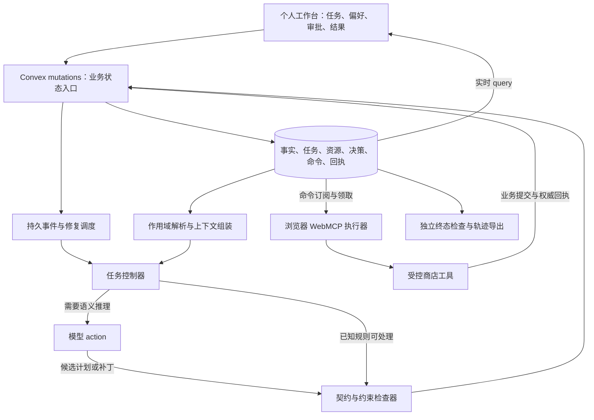

# Personal Agent 系统设计：Convex + WebMCP + 增量修复

日期：2026-10-17。状态：可实现的架构设计，尚无产品代码或实测结果。延续个人 Agent、Cal Hacks、Convex 赛道和固定 eval 的目标。使用 agent-designer 的职责、状态、工具契约和评估框架审阅。

开发节奏更新：用户计划先完成核心，再到现场精修。此设计不再以 36 小时作为总开发上限；“第一版”表示验证顺序，不表示最终能力上限。依赖修复、多个任务共享资源、持久恢复与独立评测均保留为核心目标。比赛对赛前产物的具体使用边界单列于研究协议，不据此缩减系统架构。

## 1. 最终架构决策

- 每个用户有一个逻辑上的个人 Agent；模型按事件被调用，不是永久运行一个推理进程。
- 一个 Agent 可管理多个长期任务（mission）。模型服务共享，用户数据、任务和授权隔离。
- 模型负责理解、候选生成和语义修复；确定性运行时负责状态、依赖、约束、调度、预算与提交。
- Convex 是权威状态、函数与持久工作流所在。浏览器执行真实 WebMCP；离线时保存进度并等待。
- 第一版：个人工作台 + 一个受控商店页面、两个可共享预算的任务、一个写执行器。第二商店与更多执行器后置。
- 第一种领域是采购。任务引擎通过领域契约扩展，但不在 hackathon 同时实现旅行、邮件和日历。

这些是逻辑模块，不需要拆成微服务。领域逻辑尽量写成纯 TypeScript 函数，便于对三种规划策略公平复用。

## 2. 个人状态模型

| 状态类型 | 例子 | 处理规则 |
|---|---|---|
| 用户明确事实 | 平时一个人住 | 有主体、作用域、来源、有效期；可被明确纠正 |
| 推断偏好 | 可能偏爱某品牌 | 仅作软偏好，不自动成为事实或授权 |
| 任务要求 | 周五聚餐四人、这次预算 80 | 仅用于对应任务/活动 |
| 外部观察 | 库存 3、价格 12、周五到货 | 记录 observedAt 和来源版本，必要时重新读取 |
| 承诺与完成事实 | 已锁定选择、已购买两件 | 保存为约束和真实历史；后续修复不能抹除 |
| 授权 | 可改购物车；可按批准方案购买 | 独立校验，不从偏好或聊天猜测权限 |

事实记录包含 subjectId、scope、key、value、sourceRef、assertedBy、validFrom/validUntil、status、revision。置信度不是事实真假的证明，也不是购买权限。

解析上下文时先比较主体、作用域和时间，再处理来源与纠正关系。“本人一人居住”与“周五四人聚餐”可以同时成立。两条同范围明确要求冲突且无纠正关系时，形成待澄清项，只阻塞依赖该项的动作。

第一版按用户、scope、key 和有效期查询相关记录，不先引入向量数据库。以后向量搜索也只负责召回候选；适用性、权限和最终取值仍由结构化规则检查。

上下文组装器输出 resolvedValues、sourceRefs、hardConstraints、softPreferences、commitments、resourceReservations、availableTools。模型只收到与当前任务相关的个人信息。

## 3. 模型接口与工具契约

同一模型承担三个按需调用的角色，不创建互相聊天的独立角色系统：

- interpret：把用户输入转成事实/任务变更候选，明确主体和作用域。
- plan：根据解析后的上下文与已发现工具，生成有限的决策图候选。
- repair：接收变化、失效范围、仍有效边界和错误反馈，生成图补丁。

计划是受限的 JSON 结构，不执行模型生成的任意 JavaScript。节点引用已注册的动作类型，参数可使用前序结果的类型化引用。

运行时独立检查：工具在授权目录中、参数类型正确、引用存在、图无环、条件可以求值、金额/单位合法、作用域合法、约束满足。领域插件定义约束与动作语义；模型不能发明自己的 effects 或决定只记录有利依赖。

Decision 的主要字段：missionId、nodeId、nodeRevision、operator、args、dependsOn、readRefs、queryRefs、constraintRefs、outputRef、validity。

依赖来自领域表达式及真实工具读取。无法精确追踪的模型选择，保守依赖其全部输入快照。查询集合也必须追踪：新增更便宜候选可以改变最优选择，即使原商品没变。

ToolContract 至少绑定 origin、name、schemaDigest、contractVersion、inputSchema、reads、writes、preconditions、observableEffects、retrySemantics。网站可用工具来自浏览器实际发现，读写语义由已知适配器补充。

WebMCP 当前文档提供 document.modelContext 的发现与执行接口；普通页面默认限同源 frame tree，跨源需要显式许可。MVP 使用受控同源页面，不声称支持任意标签页或任意网站。[官方 API](https://developer.chrome.com/docs/ai/webmcp/imperative-api)

## 4. 事件驱动任务控制器

事件：UserRequest、FactChanged、ResourceChanged、ToolsetChanged、CommandSettled、ExecutorAvailable、AuthorizationChanged、CancellationRequested。

每次业务 mutation 写状态和事件，并显式安排控制器。实时 query 用于通知最新状态，不能充当可靠事件日志。事件持久化，消费者保存游标；断线后可补读。

控制器每次只推进有限工作：

1. 读取未处理事件和当前权威状态；按事件 ID 去重。
2. 对事实/资源变化解析有效值，查找相关决策。
3. 重验条件，只有输出或相关要求变化才向下游传播；已知条件可以直接处理。
4. 需要语义决策时调用模型；否则保留节点或运行同一确定性求解器。
5. 从局部开始修复，硬约束冲突时扩大范围，最终可退回全局求解。
6. 发布通过验证的补丁；确定可执行节点，创建持久命令。
7. 若还有未处理变化，继续调度；否则等待事件。

合并短时间内的重复状态变化，降低修复风暴，但不能丢弃用户授权/取消、执行回执等必须逐条处理的事实。自己的 UI/进度写入不应被当成新的业务变化递归启动规划。

MVP 每个 mission 同时一个规划尝试；多个任务可并行读取和规划，共享资源的预留/提交必须通过事务。修复次数和模型预算有界，用尽时保留合法状态并显示具体阻塞原因。

## 5. 三种版本用途分开

1. **事实/资源 revision**：按实体、字段或集合判断某个决定是否需要重验。没有一个用户全局 revision 导致所有任务重新规划。
2. **planningAttemptId**：防止同一任务更早的模型结果覆盖更新的规划尝试。发布时同时校验实际依赖，不能只比较 attemptId。
3. **nodeRevision、stopEpoch 与执行 fence**：前者使被替换节点的旧命令不能新提交；stopEpoch 用于整个任务取消等全面失效；fence 区分先后领取的执行器。

任务事件序号用于游标，不等于每个决定的有效性条件。新发布一个无关节点，不应自动使所有已确认的其他节点失效。

## 6. 执行状态与计划有效性是两个维度

执行状态：queued → claimed → executing → succeeded / failed / unknown。离线等待是执行器/任务状态，不能把它当作业务执行失败。

计划有效性：active / superseded / cancelled。

旧节点可能出现 succeeded + superseded：需求改变时，其对应下单已被商店接受。迟到成功回执仍须记入实际购买和预算，然后修复当前任务；不能丢弃旧回执，也不能用它继续调度已被替换的旧计划。

Command 至少记录 operationId、missionId、nodeId、nodeRevision、stopEpoch、toolRef、args、status、leaseOwner、leaseUntil、fenceToken、workflowEventId。operationId 在同一逻辑操作的重试中稳定；真正的新操作使用新 ID。

claimCommand mutation 只负责领取并发控制。lease 过期并不证明操作未发生。executing 写操作失联后先进入 unknown，查权威回执；有安全重试语义才允许重新执行。

自有商店 commitOperation 在同一 mutation 中检查有效命令/授权/资源，修改业务状态并写回执。若 operationId 已有已完成回执，返回原结果；不同参数不能借用相同 operationId。未提交的旧 fence 或已替换节点禁止新写入。

对外部网站只能依其幂等、版本与回执接口提供保证；不支持这些能力的写操作不进入本次自动重试范围。取消信号不能撤销已经成功的购买。

Workflow 等待命令事件，onReceipt 在同一个顶层 mutation 中记录结果并调用组件事件 mutation；组件事务可与外层共同提交。[组件事务](https://docs.convex.dev/components/using#transactions)

工作流历史步骤的结果可被回放，因此新业务事件必须进入新的检查步骤并读取当前状态，不能误用缓存的旧查询结果。[Workflow](https://github.com/convex/workflow)

## 7. 多任务共享资源

预算不是每个模型各自维护的数字。设用户预算池 limit = 100，两个任务分别想花 70 和 60；必须通过同一个服务端预留入口，不能两个都成功。

available = limit - spent - activeReservations。

准备执行时建立授权范围内的 reservation；金额调整只增减差额；成功后 reserved 转 spent；确认未执行才释放。unknown 操作保留占用并等待核实，不能一边放款一边重试。MVP 在自有商店同一 Convex 事务内完成相关状态更新。

有剩余额度不等于有购买权限。授权和预算分别检查。个人账户、任务、命令、订阅均在服务端由认证身份校验归属；不能仅相信客户端传来的 ownerId。[Convex 函数认证](https://docs.convex.dev/auth/functions-auth)

## 8. 数据表与服务端接口

| 数据组 | 建议内容 |
|---|---|
| facts | 主体、范围、事实/偏好/观察、来源、版本、有效期 |
| missions | 目标、约束、软偏好、锁定项、状态、规划尝试、事件游标 |
| decisions + dependencies | 节点与反向依赖索引；小规模可从明确字段派生索引记录 |
| commands + receipts | 执行状态、operationId、领取信息、权威结果 |
| events | 类型、来源、对象版本、关联任务、操作 ID、序号 |
| budgetPools + reservations | 用户共享额度和执行占用 |
| grants | 允许的动作、资源范围、金额上限、有效期、撤销状态 |
| catalog + inventory | 受控商店的领域数据；不与用户的推断事实混用 |

重要索引：facts by owner/scope/key；dependencies by dependencyKey；commands by executorScope/status；receipts by operationId；events by mission/sequence；reservations by pool/status。索引不是自动唯一约束，业务唯一性通过相应事务查询与写入维护。

建议接口：

- submitUserInput：保存输入并安排 interpret。
- applyContextPatch：验证/应用事实或任务修改，写事件并安排修复。
- preparePlanningContext：输出当前任务的相关上下文和输入版本。
- publishPlanPatch：校验候选补丁、依赖、当前规划尝试和约束。
- reserveResources：原子检查授权及共享额度。
- claimCommand：原子领取可执行命令。
- commitOperation：自有工具的最终业务检查、写入与回执。
- reconcileOperation：确认 unknown 操作真实结果。
- settleCommand：记录已确认结果、推进当前任务、唤醒工作流。

模型通过 action 调用，业务数据验证与写入由 mutations 承担；不把整个多步骤模型请求当作一个数据库事务。[Convex agent workflows](https://docs.convex.dev/agents/workflows)

## 9. 用户界面

主视图以任务卡呈现：目标、当前方案、已完成结果、正在等待的条件、允许修改的部分。用户可直接锁定商品、修改人数/预算、暂停后续执行。

个人偏好页显示来源、作用域和有效期，区分明确事实与推断。任务页能看到某个选择实际使用了哪些偏好。执行追踪作为可展开面板，不要求普通用户理解 node、epoch、fence 等内部概念。

批准对应具体方案或清晰的动作范围；范围内可以继续处理，不要求每次只读调用都批准。超出范围的写入停在该节点，不阻塞无关的只读准备工作。

## 10. Eval 与实现边界

同一套环境、工具契约、预算预留和原子提交，接入 ReAct、全局重规划、增量修复三种策略。运行时指标包括所有模型/工具调用和维护成本。终态检查器独立于 planner 与依赖图；测试中的正确答案和预定故障对三组都不可见。

补充个人 Agent 必测项：

1. 为朋友安排四人素食聚餐后，本人晚餐任务仍按本人资料处理。
2. 过期的“这周不安排午餐”不污染下一周；修改无关偏好不重算采购。
3. 两任务争用预算时不超额；报价变化只修复相关任务。
4. 旧计划下单成功但回执迟到，真实购买和预算仍被记录。
5. 浏览器断开后恢复，未知操作先核实，不产生重复下单。

实现顺序：先数据类型/领域契约与独立检查器，再单任务闭环，再注入变化和增量修复，再预算共享与断线恢复，最后界面与保留评测。第一版仍需满足 [固定评测协议](./TECHNICAL_RUNTIME_EVAL_ZH.md)。

不在第一版加入自动训练、通用个人知识图谱、多人家庭权限继承、多个浏览器并发写入或任意网站支持。只有在现有评测暴露了它们能解决的具体问题后再扩大范围。
