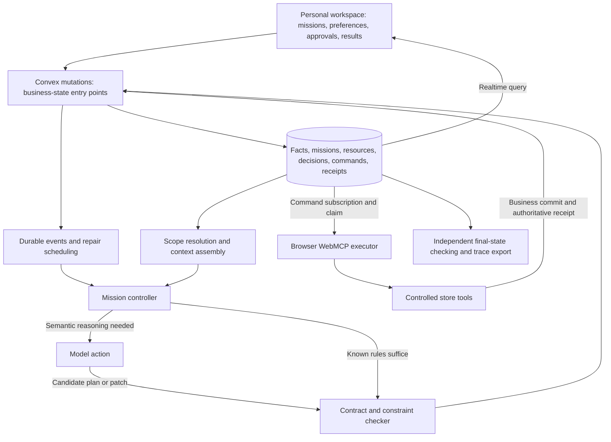

# Personal Agent System Design: Convex + WebMCP + Incremental Repair

Date: 2026-10-17. Status: implementable architecture design, with no product code or measured results yet. This continues the goals of a personal agent, Cal Hacks, the Convex track, and a fixed evaluation protocol. The design was reviewed using agent-designer's framework for responsibilities, state, tool contracts, and evaluation.

Development schedule update: the user plans to complete the core before refining it onsite. This design no longer treats 36 hours as the total development limit; “first version” describes the validation sequence, not the ultimate capability ceiling. Dependency repair, resources shared across missions, durable recovery, and independent evaluation remain core goals. The competition's specific rules for pre-event work are recorded separately in the research protocol and are not used to reduce the system architecture.

## 1. Final Architecture Decisions

- Each user has one logical personal agent. The model is invoked in response to events rather than running a permanent inference process.
- One agent can manage multiple long-lived missions. Model services are shared; user data, missions, and grants are isolated.
- The model handles interpretation, candidate generation, and semantic repair. The deterministic runtime handles state, dependencies, constraints, scheduling, budgets, and commits.
- Convex hosts authoritative state, functions, and durable workflows. The browser executes real WebMCP tools; when offline, the system preserves progress and waits.
- First version: a personal workspace, one controlled store page, two missions that can share a budget, and one write executor. Defer the second store and additional executors.
- Purchasing is the first domain. Domain contracts make the mission engine extensible, but the hackathon implementation does not simultaneously cover travel, email, and calendars.

These are logical modules, not services that must be deployed separately. Implement domain logic as pure TypeScript functions where possible so all three planning strategies can reuse it fairly.

## 2. Personal State Model

| State type | Example | Handling rule |
|---|---|---|
| Explicit user fact | Usually lives alone | Has a subject, scope, source, and validity period; can be explicitly corrected |
| Inferred preference | May prefer a particular brand | A soft preference only; does not automatically become a fact or grant |
| Mission requirement | Dinner for four on Friday, with a budget of 80 for this event | Applies only to the corresponding mission/event |
| External observation | Stock of 3, price of 12, arrival on Friday | Record observedAt and source version; read again when necessary |
| Commitments and completed facts | A locked choice; two items already purchased | Preserve as constraints and actual history; later repair cannot erase them |
| Authorization | May modify the cart; may purchase according to the approved proposal | Validate independently; do not infer authority from preferences or conversation |

Fact records contain subjectId, scope, key, value, sourceRef, assertedBy, validFrom/validUntil, status, and revision. Confidence is neither proof that a fact is true nor permission to purchase.

When resolving context, compare subject, scope, and time first, then handle source and correction relationships. “I live alone” and “dinner for four on Friday” can both be true. If two explicit requirements in the same scope conflict without a correction relationship, create an item requiring clarification and block only actions that depend on it.

Initially, query relevant records by user, scope, key, and validity period rather than introducing a vector database. If vector search is added later, it only retrieves candidates; structured rules still check applicability, permission, and the final resolved value.

The context assembler outputs resolvedValues, sourceRefs, hardConstraints, softPreferences, commitments, resourceReservations, and availableTools. The model receives only personal information relevant to the current mission.

## 3. Model Interfaces and Tool Contracts

The same model serves three roles invoked as needed, rather than a system of separate roles talking to one another:

- interpret: convert user input into candidate fact/mission changes with explicit subjects and scopes.
- plan: generate a bounded candidate decision graph from resolved context and discovered tools.
- repair: receive changes, invalidated scope, still-valid boundaries, and error feedback, then generate a graph patch.

A plan is a restricted JSON structure; the system does not execute arbitrary model-generated JavaScript. Nodes reference registered action types, and arguments may use typed references to earlier results.

The runtime independently checks that tools belong to the authorized catalog, argument types are correct, references exist, the graph is acyclic, conditions can be evaluated, amounts/units are valid, scopes are permitted, and constraints are satisfied. Domain plugins define constraints and action semantics; the model cannot invent its own effects or record only convenient dependencies.

The main Decision fields are missionId, nodeId, nodeRevision, operator, args, dependsOn, readRefs, queryRefs, constraintRefs, outputRef, and validity.

Dependencies come from domain expressions and actual tool reads. When a model choice cannot be traced precisely, conservatively depend on its entire input snapshot. Track query collections as well: a new cheaper candidate can change the optimal choice even if the original item has not changed.

ToolContract binds at least origin, name, schemaDigest, contractVersion, inputSchema, reads, writes, preconditions, observableEffects, and retrySemantics. Available website tools come from actual browser discovery; known adapters supply their read/write semantics.

Current WebMCP documentation provides discovery and execution interfaces through document.modelContext. Ordinary pages default to the same-origin frame tree; cross-origin use requires explicit permission. The MVP uses controlled same-origin pages and does not claim arbitrary-tab or arbitrary-site support. [Official API](https://developer.chrome.com/docs/ai/webmcp/imperative-api)

## 4. Event-Driven Mission Controller

Events: UserRequest, FactChanged, ResourceChanged, ToolsetChanged, CommandSettled, ExecutorAvailable, AuthorizationChanged, CancellationRequested.

Each business mutation writes state and events, then explicitly schedules the controller. Realtime queries notify clients of current state; they are not a reliable event log. Persist events and consumer cursors so disconnected consumers can catch up.

The controller advances only bounded work per invocation:

1. Read unprocessed events and current authoritative state; deduplicate by event ID.
2. Resolve effective values for fact/resource changes and find relevant decisions.
3. Revalidate conditions, propagating downstream only when outputs or relevant requirements change; handle known conditions directly.
4. Call the model when a semantic decision is needed; otherwise retain nodes or run the same deterministic solver.
5. Repair locally first, expanding the scope when hard constraints conflict and eventually falling back to global solving if necessary.
6. Publish a validated patch, identify executable nodes, and create durable commands.
7. Schedule further work if unprocessed changes remain; otherwise wait for events.

Coalesce repeated state changes over short intervals to reduce repair storms, but do not discard facts that require individual processing, such as user grants/cancellations and execution receipts. The system's own UI/progress writes should not recursively trigger planning as new business changes.

The MVP permits one planning attempt at a time per mission. Multiple missions may read and plan concurrently, but shared-resource reservation/commit must go through transactions. Bound repair attempts and model budgets; when exhausted, preserve valid state and show the specific blocking reason.

## 5. Keep Three Uses of Versions Separate

1. **Fact/resource revision:** determine whether a decision needs revalidation by entity, field, or collection. Do not use a user-global revision that forces every mission to replan.
2. **planningAttemptId:** prevent an earlier model result for a mission from overwriting a newer planning attempt. Publication also checks actual dependencies; comparing attemptId alone is insufficient.
3. **nodeRevision, stopEpoch, and execution fence:** nodeRevision prevents new commits from old commands belonging to replaced nodes; stopEpoch handles broad invalidation such as cancelling an entire mission; the fence distinguishes successive executor claims.

Mission event sequence numbers are cursors, not validity conditions for every decision. Publishing an unrelated node should not automatically invalidate all other previously accepted nodes.

## 6. Execution State and Plan Validity Are Separate Dimensions

Execution state: queued → claimed → executing → succeeded / failed / unknown. Waiting for an offline executor is an executor/mission state, not a failed business operation.

Plan validity: active / superseded / cancelled.

An old node may be succeeded + superseded: its order was accepted by the store while requirements were changing. A late success receipt must still be recorded in actual purchases and the budget, followed by repair of the current mission. Do not discard the old receipt or use it to continue scheduling the replaced plan.

Command records at least operationId, missionId, nodeId, nodeRevision, stopEpoch, toolRef, args, status, leaseOwner, leaseUntil, fenceToken, and workflowEventId. operationId stays stable across retries of the same logical operation; a genuinely new operation gets a new ID.

The claimCommand mutation handles only concurrency control for claiming work. An expired lease does not prove that the operation did not occur. If an executing write loses contact, first mark its outcome unknown and query the authoritative receipt; re-execute only when safe retry semantics allow it.

The controlled store's commitOperation checks the valid command, authorization, and resources, changes business state, and writes a receipt in one mutation. If operationId already has a completed receipt, return the original result; different arguments cannot reuse the same operationId. An old fence or a replaced node cannot authorize a new write that has not yet committed.

For external sites, guarantees depend on their idempotency, versioning, and receipt interfaces. Writes without those capabilities are outside this design's automatic-retry scope. A cancellation signal cannot reverse an already successful purchase.

Workflow waits for command events. onReceipt records the result and invokes the component's event mutation within the same top-level mutation; component transactions can commit together with the outer transaction. [Component transactions](https://docs.convex.dev/components/using#transactions)

Historical workflow-step results can be replayed. A new business event must therefore enter a new checking step and read current state instead of incorrectly reusing an old cached query result. [Workflow](https://github.com/convex/workflow)

## 7. Resources Shared Across Missions

The budget is not a number maintained independently by each model. Suppose the user's budget pool has limit = 100 and two missions want to spend 70 and 60. Both must use the same server-side reservation entry point; both cannot succeed.

available = limit - spent - activeReservations.

Create a reservation within the grant when preparing execution. Adjust amounts by their delta only; after success, convert reserved funds to spent; release them only after confirmed non-execution. Unknown operations retain their allocation pending verification; do not release funds while retrying. In the MVP, the controlled store updates these related states within one Convex transaction.

Available funds do not imply permission to purchase. Check authorization and budget separately. The server validates ownership of personal accounts, missions, commands, and subscriptions using authenticated identity; it cannot simply trust an ownerId supplied by the client. [Convex function authentication](https://docs.convex.dev/auth/functions-auth)

## 8. Tables and Server Interfaces

| Data group | Suggested contents |
|---|---|
| facts | Subject, scope, fact/preference/observation, source, version, validity period |
| missions | Objective, constraints, soft preferences, locks, state, planning attempt, event cursor |
| decisions + dependencies | Nodes and a reverse dependency index; at small scale, derive index records from explicit fields |
| commands + receipts | Execution state, operationId, claim information, authoritative result |
| events | Type, source, object version, associated mission, operation ID, sequence number |
| budgetPools + reservations | User-level shared allowance and execution allocations |
| grants | Permitted actions, resource scope, amount cap, validity period, revocation state |
| catalog + inventory | Domain data for the controlled store; kept separate from inferred user facts |

Important indexes: facts by owner/scope/key; dependencies by dependencyKey; commands by executorScope/status; receipts by operationId; events by mission/sequence; reservations by pool/status. An index is not an automatic uniqueness constraint; maintain business uniqueness through the corresponding transactional reads and writes.

Suggested interfaces:

- submitUserInput: save input and schedule interpret.
- applyContextPatch: validate/apply fact or mission changes, write events, and schedule repair.
- preparePlanningContext: return relevant context and input versions for the current mission.
- publishPlanPatch: validate the candidate patch, dependencies, current planning attempt, and constraints.
- reserveResources: atomically check authorization and the shared allowance.
- claimCommand: atomically claim an executable command.
- commitOperation: perform final business checks, writes, and receipt creation for controlled tools.
- reconcileOperation: establish the actual outcome of an unknown operation.
- settleCommand: record a confirmed outcome, advance the current mission, and wake the workflow.

Call models through actions; mutations validate and write business data. Do not treat an entire multistep model request as one database transaction. [Convex agent workflows](https://docs.convex.dev/agents/workflows)

## 9. User Interface

The main view presents mission cards with the objective, current proposal, completed results, conditions being awaited, and editable parts. Users can directly lock products, change attendance/budgets, and pause subsequent execution.

The personal-preferences page shows sources, scopes, and validity periods, distinguishing explicit facts from inferences. The mission page shows which preferences a choice actually used. Execution tracing is an expandable panel; ordinary users do not need to understand internal concepts such as node, epoch, or fence.

Approval applies to a specific proposal or a clear action scope. Work can continue within that scope without approval for every read-only call. A write outside the scope pauses at that node without blocking unrelated read-only preparation.

## 10. Evaluation and Implementation Boundaries

Connect ReAct, global replanning, and incremental repair to the same environment, tool contracts, budget reservations, and atomic commits. Runtime metrics include every model/tool call and maintenance cost. The final-state checker is independent of the planner and dependency graph; correct answers and scheduled faults are hidden from all three groups.

Additional required personal-agent tests:

1. After arranging a vegetarian dinner for four friends, the user's own dinner mission still uses the user's own profile.
2. An expired “do not schedule lunch this week” instruction does not affect the following week; changing an unrelated preference does not recompute purchasing plans.
3. Two missions contending for a budget do not exceed it; a quote change repairs only relevant missions.
4. When an old plan's order succeeds but its receipt arrives late, the actual purchase and budget are still recorded.
5. After browser disconnection and reconnection, verify unknown operations first and avoid duplicate orders.

Implementation order: data types/domain contracts and an independent checker; a single-mission feedback loop; injected changes and incremental repair; shared budgets and disconnection recovery; then the interface and held-out evaluation. The first version must still satisfy the [fixed evaluation protocol](./TECHNICAL_RUNTIME_EVAL_ZH.md).

Do not add automatic training, a general personal knowledge graph, multi-user household permission inheritance, concurrent writes from multiple browsers, or arbitrary-site support to the first version. Expand only after the existing evaluation exposes a specific problem those capabilities can solve.
